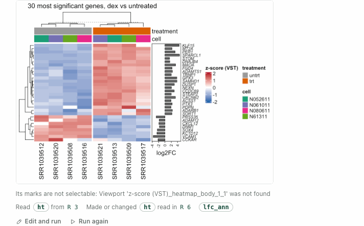
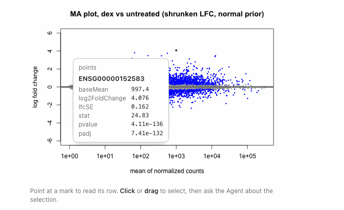
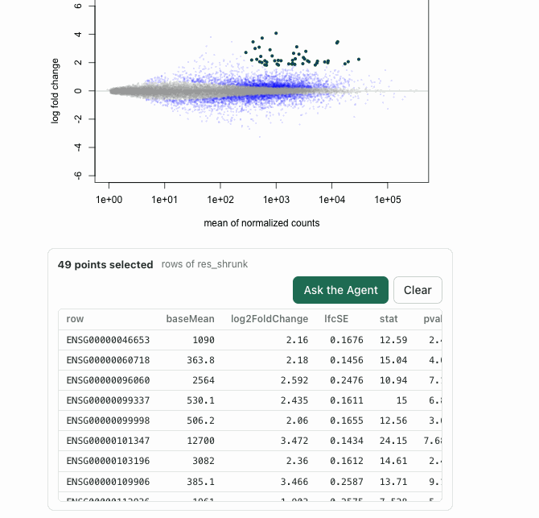
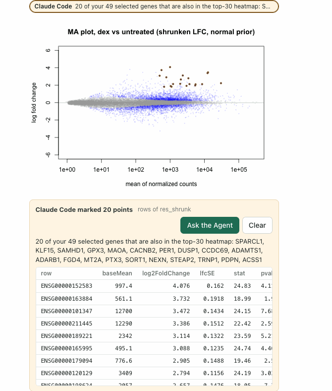
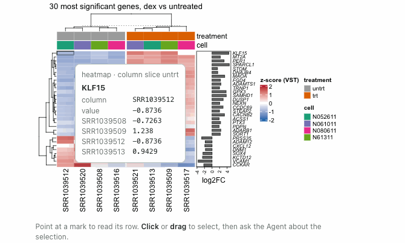
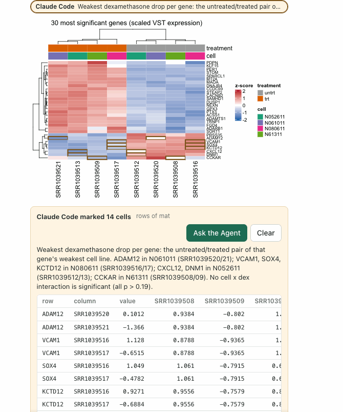
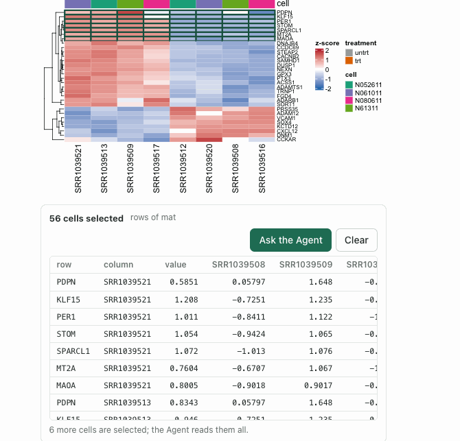
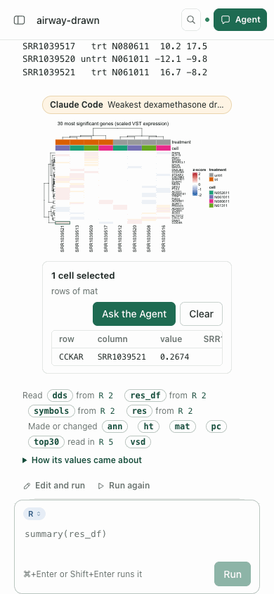
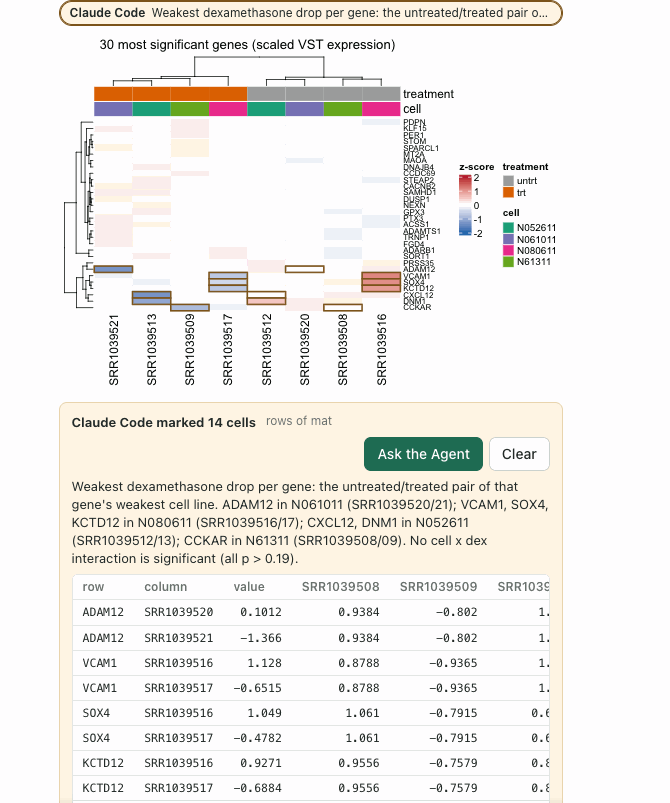

# Drawn figures: base graphics and ComplexHeatmap pages are figures

Date: 2026-11-08. Stage 3 of the built-in [Figures](FIGURES-EPISODE.md) capability, after
[Saved figures](SAVED-FIGURES-EPISODE.md), observed in one real Agent episode run twice. This
is functional evidence, not a usability claim: no independent researcher has used it.

## Why it changed

Both earlier stages left a plot drawn with base graphics, or a grid drawing that is not a
ggplot, as a picture. The person could not point into DESeq2's `plotMA` or a ComplexHeatmap,
two of the plots a bulk RNA-seq analysis draws most often. A page is a picture to the browser,
but R knows what it drew: where each point went, at what values, and from which table.

## What runs now

- **Base graphics.** gridGraphics makes the recorded page into grobs named after what drew
  them (`graphics-plot-1-points-1` is the first `points()` of the first plot). Each drawn part
  in a plot's window is a layer: points, text, rect, lines, polygon, segments, circles or a
  reference line. Each element is a mark that keeps the values it was drawn at in the data's
  units; a log axis is read back. A bar is named by the axis label at its middle. Axes, boxes
  and titles are drawn and not bound.
- **Binding to a table.** Points, labels and lines whose x and y are two columns of a table in
  the session (a data frame, a Bioconductor `DataFrame` such as DESeq2's results, a numeric
  matrix or a named vector) are bound to its rows, value for value and in the table's order;
  rows that were not drawn are skipped. The layer's `mapping` names the two columns, and its
  `notes` count marks drawn at another value, such as genes clipped to the axis limit. A part
  drawn from computed values keeps its drawn values only. At most 64 tables of at most
  5,000,000 cells are compared.
- **ComplexHeatmap.** `draw()` starts the page before it lays the heatmaps out, so the
  describer keeps the frame of its method when the page starts and reads the laid-out heatmap
  list when the cell ends: rows and columns in the order and slices drawn, and the matrix. The
  page is drawn again from its recording, and each body cell is a mark naming its row, column,
  value and slices, with the matrix row as its source (named after the session's matrix when
  one is identical). Annotations, dendrograms and names are drawn and not bound.
- **Notebook 0.5.9.** A page no extension named an object for is offered to the describer as
  it was recorded. **Figures 0.3.0** reads these records with no change to `figure.read` or
  `figure.select`; its guidance names what is described.

## The episode

An owned service with a disposable project, `airway-drawn`, ran in Chrome at 1440 × 1000 and
390 × 844. Real Claude Code ran from the Agent panel in its default mode, with Rho's tools,
file tools and a shell. The person asked: *Fit DESeq2 to the airway data
(dexamethasone-treated vs untreated airway cells). In the Notebook, show the MA plot with
plotMA, and a ComplexHeatmap of the 30 most significant genes (scaled variance-stabilised
expression, rows labelled with gene symbols, samples annotated by treatment). Then tell me
what stands out.*

**Run 1.** Claude Code answered in 214 s ($0.99). Its MA plot cell was a figure: 22,369 points
bound to the 22,369 rows of `res_shrunk`, mapped as `baseMean` and `log2FoldChange`, plus the
line at 0. Its heatmap cell was refused: *Viewport 'z-score (VST)_heatmap_body_1_1' was not
found*. The heatmap was named `z-score (VST)`, and grid matches a grabbed viewport path as a
regular expression, so the parentheses broke it.

Claude Code read the refusal and changed the person's script with `sed`: it renamed the
heatmap `zscore` and kept the legend title, so the next cell's heatmap was a figure of 240
cells. Pointing at the highest point of the MA plot showed SPARCL1's row (ENSG00000152583,
baseMean 997.4, log2 fold change 4.076, padj 7.4e-132).

The person dragged over the well-expressed genes that go up most (49 points, *rows of
res_shrunk*) and asked: *These are the well-expressed genes that go up most. Which are they,
and are any of them in the heatmap too? Mark the ones in the heatmap.* Claude Code answered
in about a minute ($0.58). It named the 49 genes by symbol, said 20 are in the heatmap and why
the other 29 are not (the heatmap ranks by adjusted p, which rewards precise estimates), and
marked the 20 on the MA plot. They appear in amber with its note.

Pointing at a heatmap cell named its gene, sample, value and slice, and the gene's row of
`mat_z`.

**Run 2**, after the changes below, made the same request in a new project. Claude Code
answered in 169 s ($0.87). Both cells were figures on the first try: the MA plot with 16,139
points bound to `res`, a `DESeqResults`, noting *6 of 16139 marks are drawn at a y other than
their log2FoldChange* (Claude Code's answer also said 6 genes fall outside the ±5 range shown),
and the heatmap with 240 cells bound to `mat`.

The person dragged over the heatmap's bottom rows (56 cells, the 7 genes that go down) and
asked: *These genes go down with dexamethasone. Is the drop the same in every cell line? Point
at the samples where it is weakest.* Claude Code answered in 3 min ($0.92) with one
`figure.read` of the selection and one `figure.select`. It wrote a script that fits a cell
line × treatment model and tabulated each gene's drop per cell line: no interaction was
significant (smallest p 0.19), and it said the test has little power with one sample per
condition and line. It marked the untreated/treated pair of each gene's weakest cell line, 14
cells, and named them in its note.

A drag over the heatmap's top rows reads as one table, gene first.

At 390 px the page did not scroll sideways, and a tap selected one cell (CCKAR, SRR1039521).
The heatmap is drawn at the column's width, and its row names are too small to read.

## Iterations and causes

- **A heatmap named with parentheses was refused.** grid matches a grabbed viewport path as a
  regular expression. The describer now makes the grabbed paths literal before the page is
  drawn again; the check names its heatmap `z-score (VST)`.
- **Claude Code changed the person's figure to get past it.** In run 1 it renamed the heatmap.
  With the fix nothing asks it to.
- **The heatmap faded when cells were marked.** A selection fades every other mark to 13 %,
  which suits points. In a heatmap the colour is the value, and the cells around the marked
  ones went almost white. Cells of heatmap, tile, raster and image layers now keep their
  colour, and a selection outlines them; points, bars and lines still fade.

  

- **The gene came third.** A cell's own values (column, value) were listed before its row's
  key. The key comes first now.
- **"6 more heatmap rows are selected".** The rest of a selection is counted by its word: *6
  more cells are selected*.
- **All-missing styles.** A drawn part whose fill was missing for every element listed
  `fill: null` as a constant; it is left out.

## Not established

- Python plots are still pictures.
- Files written with `png()` and `plotMA()` or `draw()` stay pictures. Both runs saved
  `figures/ma_plot*.png` and the heatmap that way. After run 1's first answer the page asked
  `figure.read` for two of them by their bytes and was answered 404 each time, which the
  browser logs.
- A base graphics part is bound only when its x and y are both columns of one table in the
  global environment. `plot(res$log2FoldChange, -log10(res$padj))` draws a computed y and is
  not bound; the marks keep their drawn values. A table inside a list or a function's frame is
  not seen.
- Heatmap annotations, dendrograms and row names are not bound. Cells drawn as one image are
  not bound; ComplexHeatmap does this by itself (`use_raster`) for large matrices.
- Other grid drawings (lattice, a hand-made grid page) stay pictures.
- At phone width a heatmap's labels are too small to read; the figure has no zoom.
- In run 2, one `rho_read` named a result field that was not there (`/rows`) and was refused;
  Claude Code read the result another way.

## Verification

- Plugins `npm run test:figures`: 8 of 8. New checks draw an MA-style base plot on a log axis
  with clipped points, a reference line and labels, and a barplot, and check the binding,
  the clipped-point note, the log axis read back and `where` on the source row; and a
  ComplexHeatmap named `z-score (VST)` with row slices, checking every cell's value against its
  row and the top-left cell against `row_order` and `column_order`. A grid page no describer
  knows stays a picture without a problem.
- Plugins `npm test`: 206 of 209 (2 skipped). The one failure is the same unrelated
  `all ten headless descriptors ship the Paper U1-06d copy` from `a7f9751`.
- Rho `test/figures.test.mjs`: 1 of 1.
- Rho `npm test`: 332 of 335 (3 skipped) with no failure. A first run failed 11 execution tests
  because `RHO_RSCRIPT=Rscript` was given as a bare name, which resolves to a file in the
  checkout; with R found on `PATH` they pass.
- CI: run 42484462800 on `9d6f5e42`, which selects Plugins `2133ae2`, passed all 15 jobs,
  including packing the candidate.
- Records: the 22,370-mark MA plot took 2.25 s and 5.7 MiB; a 240-cell heatmap 0.1–0.15 s and
  0.1 MiB.
- Browser: the steps above in Chrome at 1440 and 390 px, read from their screenshots.
