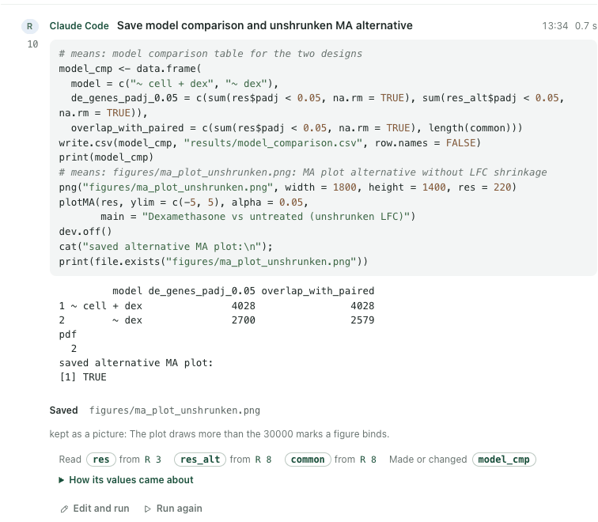
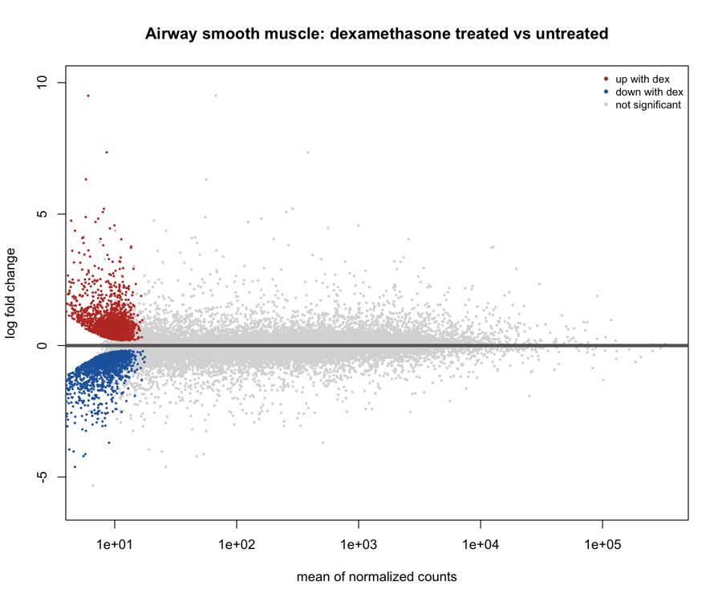
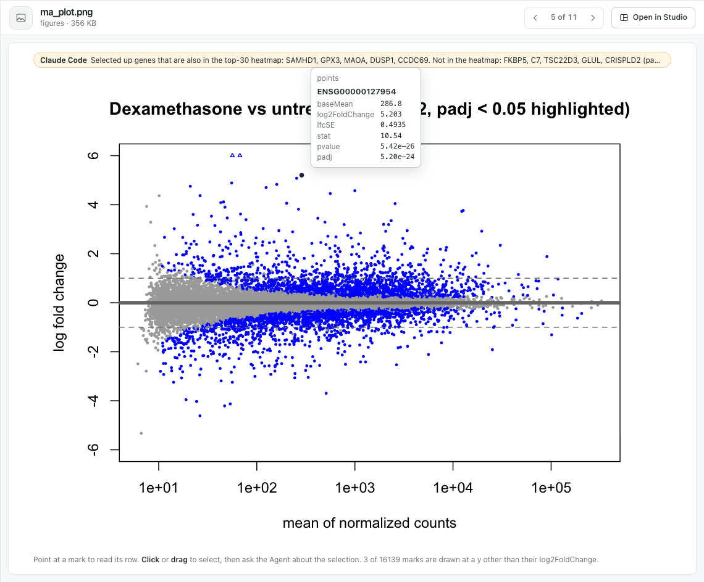
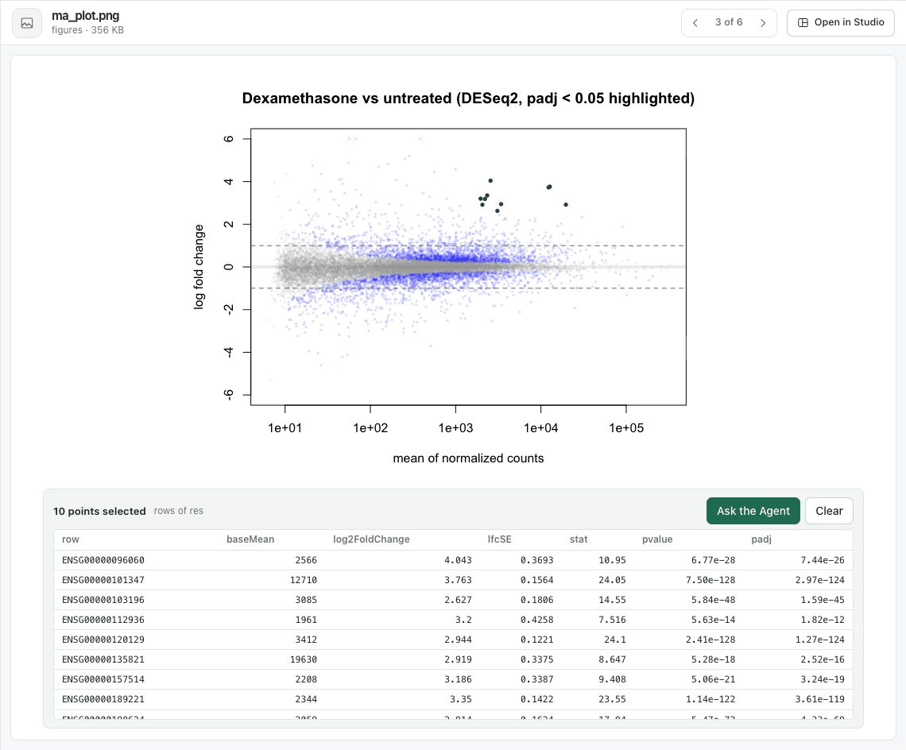
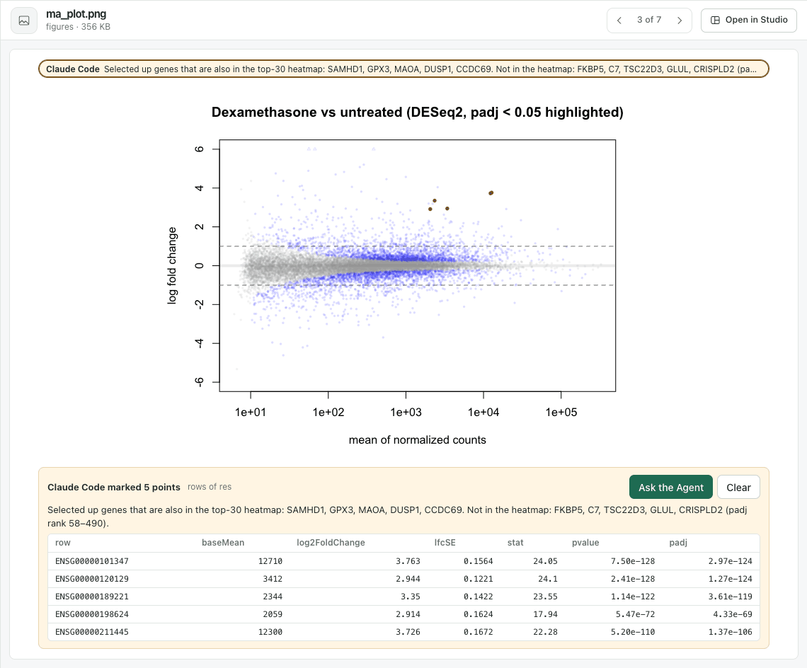
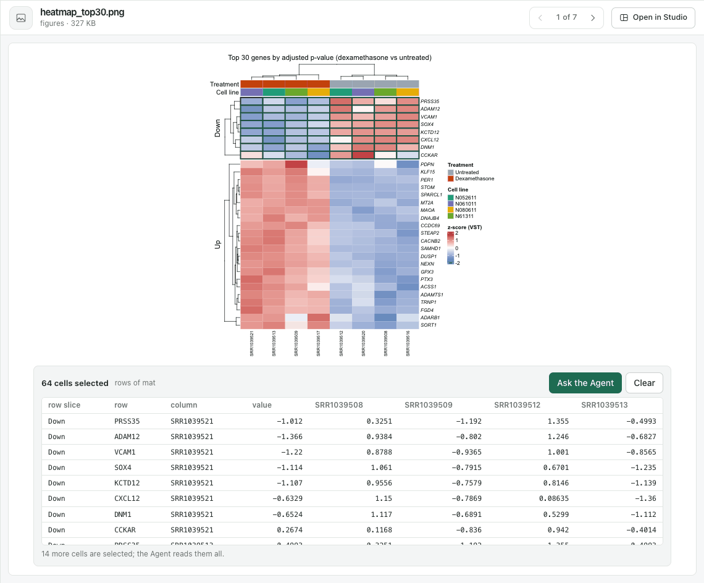
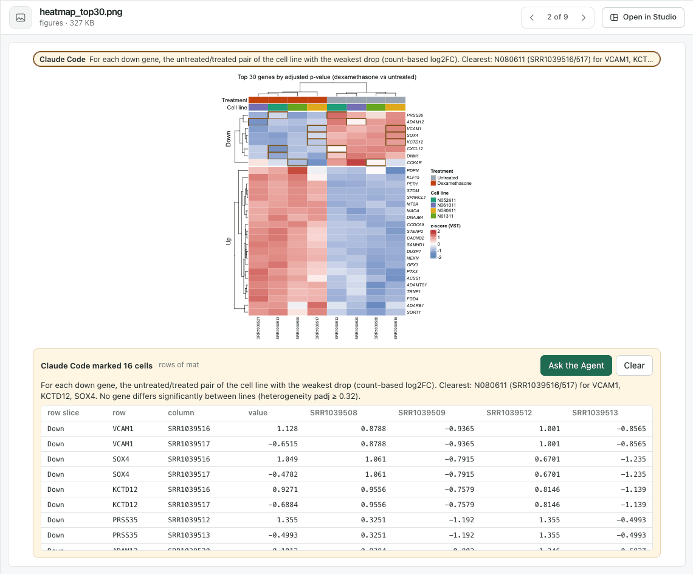
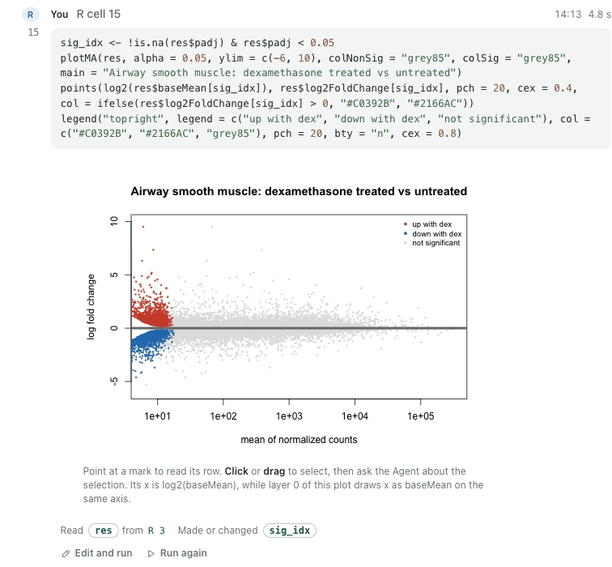
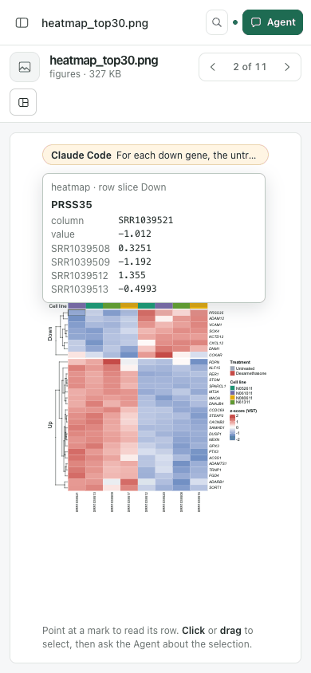

# Figure files: plots written with png() and dev.off() are figures

Date: 2026-11-08. Stage 5 of the built-in [Figures](FIGURES-EPISODE.md) capability, after
[Python figures](PYTHON-FIGURES-EPISODE.md), observed in one real Agent episode run three times.
This is functional evidence, not a usability claim: no independent researcher has used it.

## Why it changed

In both runs of [Drawn figures](DRAWN-FIGURES-EPISODE.md), Claude Code saved the MA plot and the
heatmap for the report the way R scripts do: `png("figures/ma_plot.png")`, `plotMA(res)`,
`dev.off()`. Those files stayed pictures, and the page's `figure.read` for them was answered 404.
Only `ggsave()` named its file to the describer: its frame is on the call stack when its page
starts. A device the code opens itself leaves no such trace, and a file device keeps no record of
what it drew.

## What runs now

- **Files the code opens.** The R runner (Notebook 0.5.12) traces `png()`, `jpeg()`, `tiff()`,
  `bmp()`, `svg()`, `pdf()`, `cairo_pdf()` and `dev.off()` in grDevices, so it knows each device
  the code opens on a file and the file's name. It turns on the device's display list when a page
  starts and records the page before the next page starts, after each top-level expression and
  before `dev.off()` closes it. When the cell ends, the last page of each closed file is described
  at the device's size, like a ggsave page: from its recording (base graphics), from the frame of
  `draw()` (a ComplexHeatmap) or from the ggplot `print()` drew. A name numbered with `%d` is a
  figure for each page; a PDF of several pages says why it is not described. A device left open
  stays the session's current device in the next cell, as in the R console. A page no describer
  knows (lattice) stays a picture. `png` now prints as a traced function.
- **Marks.** A figure binds up to 50,000 marks in R and Python, up from 30,000.
- **Computed positions in base graphics.** Points, lines and labels drawn through `-log10`,
  `log10`, `log2`, `log2(x + 1)` or `log1p` of a column are bound through it, as in Python. When an
  earlier layer of the same plot draws the same column on the same axis through another transform,
  the later layer's note says so. A value that is not finite matches only itself.
- **File figures on open pages.** The answer board and the file view pass the page's event cursor
  to the figure (Figures 0.5.0). A file whose bytes no cell has named yet is asked again when the
  page's events move on. In a figure narrower than its tooltip, the tooltip spans the figure.

## The episode

An owned service with a disposable project, `airway-files`, ran in Chrome at 1440 × 1000 and
390 × 844. The project started empty; R 4.5.2 had DESeq2 1.48.2, ComplexHeatmap 2.26.0 and the
`airway` package. Real Claude Code 2.1.319 ran from the Agent panel in its default mode. The
person asked: *Fit DESeq2 to the airway data (dexamethasone-treated vs untreated airway cells). In
the Notebook, draw the MA plot with plotMA and a ComplexHeatmap of the 30 most significant genes
(scaled variance-stabilised expression, rows labelled with gene symbols, samples annotated by
treatment), and save both as PNG files in figures/ for my report. Then tell me what stands out.*

Westlake HPC's route for DeepSeek V4.1 Flash still refused the third request of a three-step
`claude -p` (*400 WestlakeHPC: Duplicate item found with id .*), as in
[Python figures](PYTHON-FIGURES-EPISODE.md#the-episode). All three runs used the same model through
`workbuddy-ai/deepseek-v4.1-flash-sg`, which completed that check.

**Run 1.** Claude Code answered in 3 min. Its cells wrote `figures/ma_plot.png`,
`figures/ma_plot_unshrunken.png` and `figures/top30_heatmap.png` with `png()` and `dev.off()`. The
runner found all three files. The heatmap file was a figure, and both MA plots were refused: *The
plot draws more than the 30000 marks a figure binds.* `plotMA` drew every gene with a count, 33,469
of them; the Drawn figures runs had filtered first. With the limit lifted, describing the shrunken
MA plot took 2.5 s and 8.5 MB, and all 33,469 points were bound to `res_shrunk`. The limit is now
50,000 marks; a record over 16 MiB is still refused with its size.

**Run 2**, with the higher limit, answered in 5 min. Its cells saved `figures/ma_plot.png` twice
(20,227 marks) and `figures/heatmap_top30.png` twice (240 cells), each a figure of the bytes it
wrote. The MA plot was wrong. To colour the significant genes, Claude Code drew them again over
`plotMA` at `log2(res$baseMean)`, on an axis that `plotMA` draws as `baseMean` on a log scale. All
4,081 landed at x = 3 to 18 on that axis, at the low-count end, while the answer called the plot an
MA plot with the significant points overlaid. The figure showed exactly what the file did, but the
4,081 overlay points were not bound: the R describer matched only columns drawn as they are.

Replayed with R matching through transforms, the overlay was bound to `res` as
`x: log2(baseMean)`, with the note *Its x is log2(baseMean), while layer 0 of this plot draws x as
baseMean on the same axis.* `plot(res$log2FoldChange, -log10(res$padj))` was bound as
`y: -log10(padj)`. The replay's overlaid MA plot (about 26,400 marks, filtered differently) took
3.4 s to describe; run 2's own record of 20,227 marks, matched without transforms, took 1.7 s.

During run 2 the page asked `figure.read` for `ma_plot.png` with bytes a cell had saved and was
answered 404. Run 3 showed why.

**Run 3**, after these changes, answered in 3.5 min. Its cells saved `figures/ma_plot.png` and
`figures/ma_plot_shrunken.png` (16,142 marks each) and `figures/heatmap_top30.png` (240 cells).
Claude Code then ran its script `scripts/deseq_airway.R` with `Rscript` from a shell, which wrote
the same bytes, so the files stayed figures of the cells. The open page again logged 404s for both
MA plots, with the bytes the cell had saved.

The board learns of a file when `dev.off()` writes it, and the cell names its bytes only when it
ends, after describing the page. A figure view that asked in between kept the picture. A cell that
wrote `figures/race.png` and then slept 8 s reproduced it with the file view open. With the
previous view the file stayed a picture for the 25 s watched; with the new view it was a picture
from 3 s and a figure at 12 s, once the cell ended.

In the file view, pointing at the highest point of `ma_plot.png` read its row of `res`. Its hint
carried the layer's note: *3 of 16139 marks are drawn at a y other than their log2FoldChange*,
the points clipped at the plot's limit.

The person dragged over the well-expressed genes that go up most (10 points, *rows of res*) and
asked: *These are the well-expressed genes that go up most. Which are they, and are any of them in
the heatmap too? Mark the ones in the heatmap.* The message carried *10 points · ma_plot.png*.
Claude Code answered in 97 s. It named the ten genes and said five are in the heatmap (SAMHD1,
GPX3, MAOA, DUSP1, CCDC69), because the heatmap ranks by adjusted p, not fold change. It marked
the five on the file.

On `heatmap_top30.png` the person dragged over the down-regulated slice (64 cells, *rows of mat*)
and asked: *These genes go down with dexamethasone. Is the drop the same in every cell line?
Point at the samples where it is weakest.* Claude Code answered in 3 min. It said the drop is
about the same in every line (no gene's difference between lines below an adjusted p of 0.32),
with N080611 the weakest for VCAM1, KCTD12 and SOX4. It marked 16 cells: the untreated and
treated sample of each gene's weakest line.

The person then drew run 2's overlay code in a cell of this session. The note showed under the
figure. They dragged over the cluster at the left edge (995 marks) and asked: *Why are almost all
the significant genes at the low-count end of this MA plot? Is that right?* Claude Code answered in
109 s: *No, that isn't right. The pile-up comes from a plotting bug in cell 15, not from the data.*
It said 882 of the 995 marks are the misplaced points. It showed that the share of significant
genes rises with expression, from 9 % below a mean of 50 to 44 % above 5,000. It drew the
corrected plot in a cell. Its `figure.read` result carried the overlay's mapping and the note, as
well as the cell's code.

At 390 px, pointing at a heatmap cell near the figure's left edge put the tooltip outside the
figure, its values wrapped one character per line over the cells. The tooltip now spans the
figure when neither side of the pointer holds it.

## Iterations and causes

- **Saved MA plots refused.** `plotMA` draws every gene with a count. 33,469 points took 2.5 s
  and 8.5 MB; the limit is 50,000 marks.
- **A misplaced overlay was unbound.** R matched only columns drawn as they are. It now matches
  through the transforms the Python describer uses, and notes a layer that draws a column on
  another scale than an earlier layer of the same plot.
- **Infinity matched every value.** `abs(Inf - x) <= 1e-9 * Inf` is true in R too; it mattered
  once transforms of 0 were compared. A value that is not finite matches only itself.
- **A file shown before its cell ended stayed a picture.** The figure view read a file's record
  once. It now asks again when the page's events move on; the board and the file view pass them.
- **The tooltip broke at phone width.** It was anchored beside the pointer with no room on either
  side.

## Also observed

- Each run ran shell commands in the panel's default mode, which the run's own settings did not
  allow, as in the earlier stages. In run 3 Claude Code ran its script with `Rscript`, and the
  corrected MA plot it wrote that way, `figures/ma_plot_colored.png`, is a picture.
- In run 3 Claude Code overwrote a session variable the heatmap's cells had made (`top30`), said
  so in its answer and put it back.
- The race check rewrote run 2's `ma_plot.png` with a plain `plotMA` and added `figures/race.png`
  to run 3's project; both are the person's files in disposable projects.
- With `R_LIBS_USER` passed to the service, the board previewed CSV results (unlike
  [Python figures](PYTHON-FIGURES-EPISODE.md#also-observed)).

## Not established

- The Westlake route was not used; it still refused the third request.
- A device opened through a copy a package imported before the session started (`importFrom`),
  or through ragg, svglite or Cairo directly, is not seen; its file stays a picture.
- A PDF of several pages is not described. A device on a remote session is not watched.
- The scale note exists in R only. Whether it, rather than the cell's code, led Claude Code to the
  cause is not separated.
- File figures were checked on macOS; CI runs Rho's checks, not the Plugins describer's file
  checks, on Linux and Windows.
- At phone width a heatmap's labels are still too small to read.

## Verification

- Plugins `npm run test:figures`: 12 of 12. The new check writes base graphics, a ggplot and a
  ComplexHeatmap to files with `png()`, `pdf()` and `svg()`, also inside a function, across cells
  and with numbered pages, refuses a two-page PDF, keeps a lattice page a picture, skips a file
  outside the project and adds no variables. The base graphics check binds a volcano drawn at
  `-log10(padj)` with a p-value of 0 and an MA overlay at `log2(baseMean)` with its note.
- Plugins `npm test`: 211 of 214, 2 skipped; the one failure is the U1-06d check that failed before
  this change.
- Rho `npm test`: 338 of 341, 3 skipped.
- Browser: the steps above in Chrome at 1440 and 390 px, read from their screenshots, and the race
  check with the previous and the new figure view.
