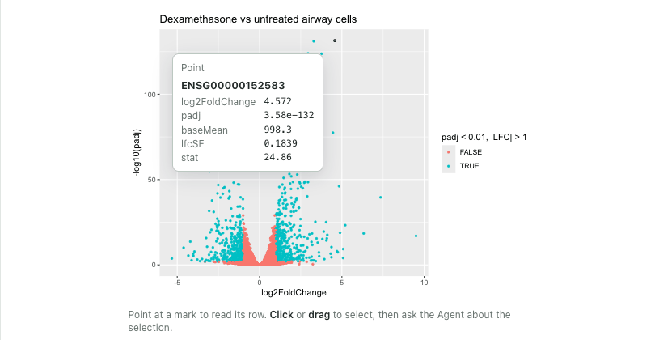
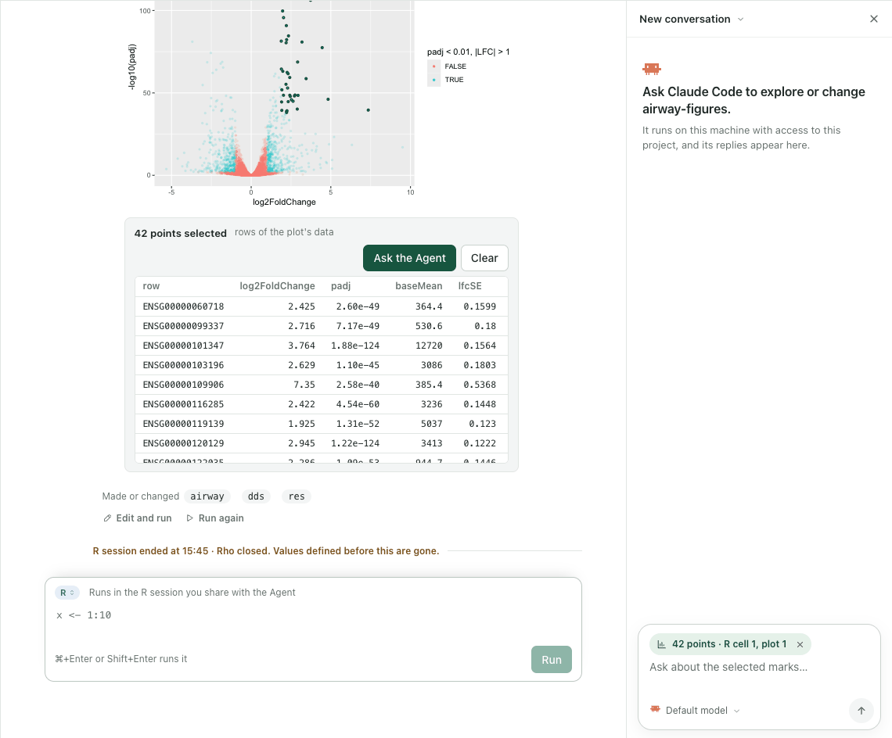
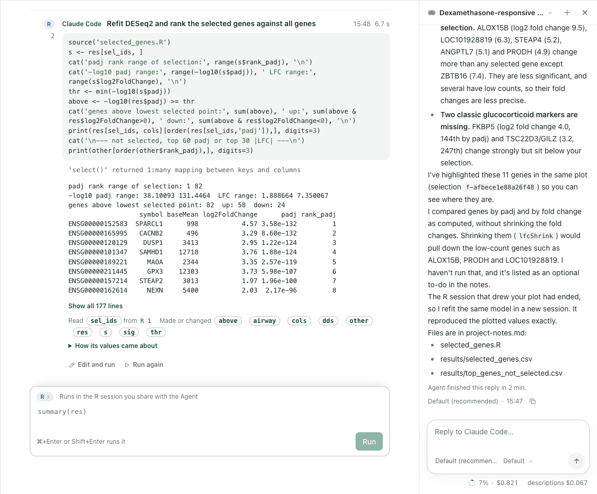
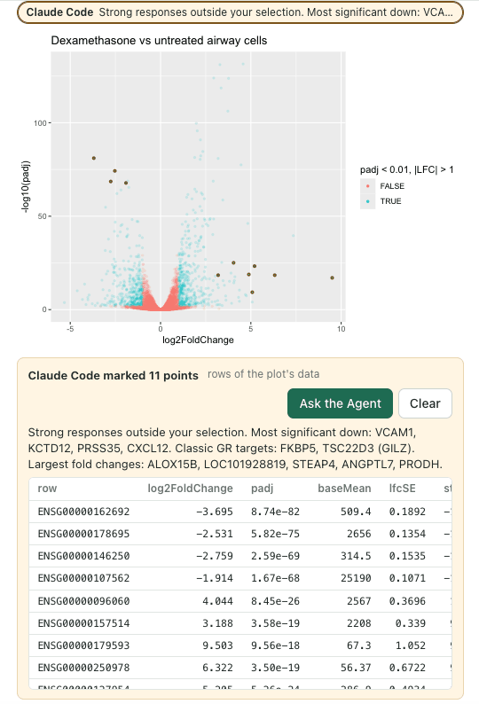
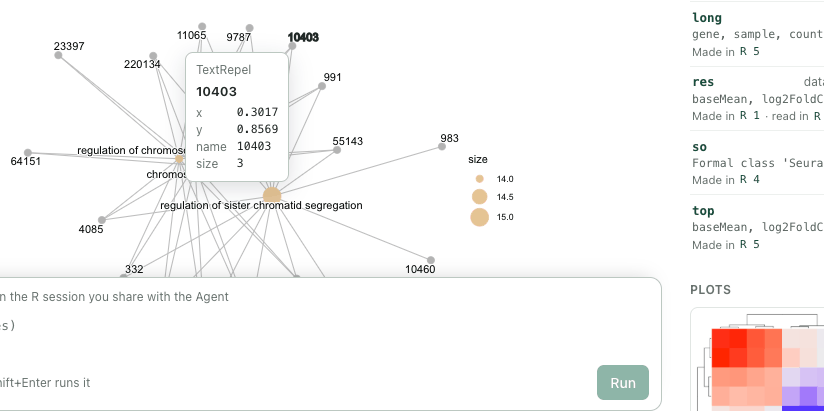
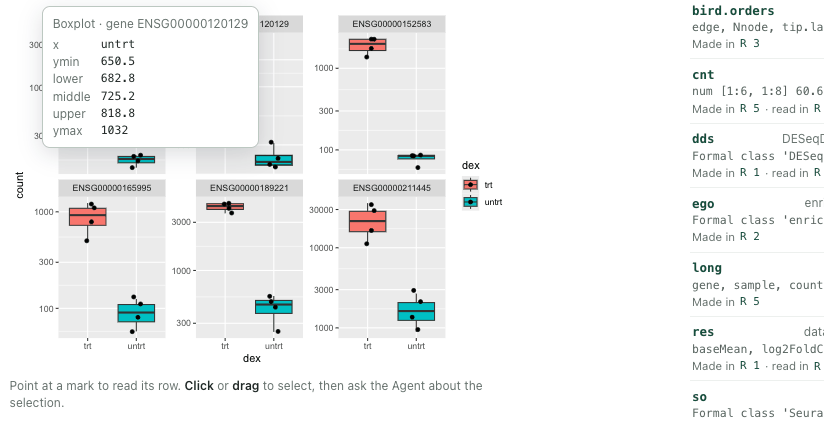
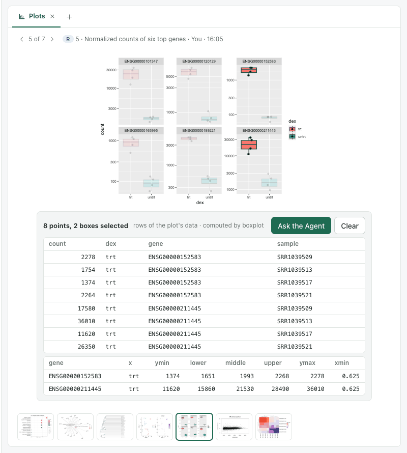
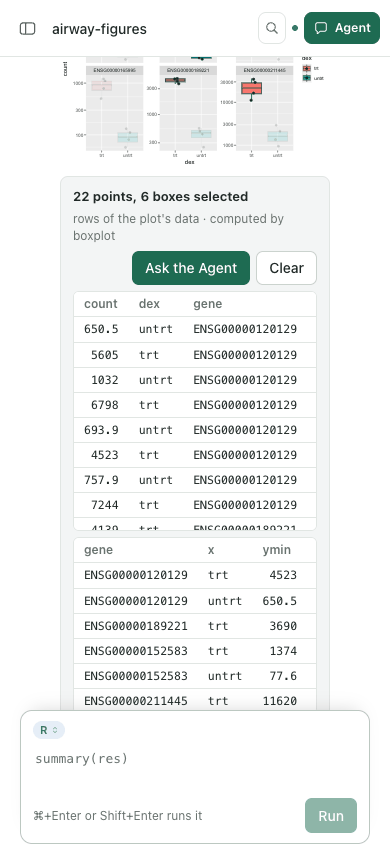

# Figures: every ggplot a cell draws, selectable and readable

Date: 2026-11-07. Stage 1 of a built-in capability, observed in one real Notebook and Agent
episode and six plot families. This is functional evidence, not a usability claim: no
independent researcher has used it.

## Why it changed

The [Semantic figures](SEMANTIC-FIGURES-EPISODE.md) plugin bound marks for two packages
(ggtree clades, enrichplot terms). It was installed separately, opened in its own view and
reached only plots saved for it. The person meant those packages as examples. A figure drawn
anywhere in the work, by the person in the Notebook or by the Agent, should know what it
drew, and the person and the Agent should both be able to use that.

## What runs now

The [Figures plugin](https://github.com/YuLab-SMU/Rho-plugins/tree/main/plugins/figures)
0.1.0 is built in and requires the Notebook (`kernel` 0.5.7). The Notebook's host passes its
`r/figures.R` to each local R session. After a cell, each ggplot page is drawn again off
screen and kept as a figure record beside the plot's PNG. Nothing in the describer names a
package: it clones each layer's geom, numbers the rows ggplot2 built, tags each panel's grob
and binds the SVG elements svglite writes to those rows. An extra aesthetic carries each data
row through the statistic, so a point links to its row of the plot's data and a box keeps
its computed values.

- **Notebook.** A described plot is drawn from its record in the cell and in the Plots view.
  Pointing at a mark shows its row. Click, Shift-click or drag selects marks; the rows behind
  them are listed. **Ask the Agent** keeps the selection and attaches it to the next message
  as a chip (`42 points · R cell 1, plot 1`).
- **Message.** The message carries the selection's count, layers and first 12 rows within the
  16 KB interface context budget. Its guidance tells the Agent that "these" means the
  selection and how to read the rest.
- **Agent.** Each plot output in `kernel.run` and `kernel.read` names its layers and marks.
  `figure.read` gives the summary, rows by mark, by condition (`where`) or by selection;
  `figure.select` points back. The Agent's marks appear on the same plot, highlighted in
  amber with its note and its rows.

## The episode

An owned service with a disposable project, `airway-figures`, ran in Chrome at 1440 × 1000 and
390 × 844. The person's cell fitted DESeq2 to the Bioconductor `airway` data (dexamethasone
vs untreated) and drew a ggplot volcano of all 16,596 genes. Real Claude Code ran from the
Agent panel with its own settings (`dontAsk`, Rho tools and file reading allowed).

Every point was bound. Pointing at the top right showed SPARCL1's row (ENSG00000152583,
log2 fold change 4.57, padj 3.6e-132). A drag selected 42 genes.

The question was *What do these genes have in common? Name them, and say whether they are
the strongest responses in the plot.* Claude Code answered in 2 minutes ($0.82). It read the
selection with `figure.read`. It named the glucocorticoid-induced genes among them (DUSP1,
PER1, KLF15, ZBTB16, CRISPLD2 and others), placed them as the top 12 by padj and all within
the top 82, and said that strong responses with large fold changes lay outside the
selection. The R session that drew the plot had ended when the service restarted between
the selection and the question. The figure and the selection were still read from the kept
record. The Agent refitted the same model in a new session and reproduced the plotted values.

It then pointed at 11 genes with `figure.select` and a note (VCAM1 and other strong
down-regulated genes, FKBP5 and TSC22D3, and the largest fold changes). They appeared on the
original volcano in amber, with its note and their rows.

## Generality

The person then ran five more cells. None of the plotting code was written for Rho.

| Plot | Built by | Bound | What a mark gives |
| --- | --- | --- | --- |
| GO dotplot | enrichplot on ggplot2 | 8 of 8 terms | ID, description, GeneRatio, p.adjust, Count |
| Gene–term network | enrichplot `cnetplot` (ggtangle, ggrepel) | 83 of 83 | each label by its text: term or gene ID |
| Bird orders tree | ggtree | 135 of 135 | node, parent, branch length, label |
| Clusters and PPBP | Seurat `DimPlot + FeaturePlot` (nested patchwork) | 163 of 163 | cell barcode, t-SNE position, identity |
| Normalized counts of six genes | `geom_boxplot` + `geom_jitter`, facets, `scale_y_log10` | 60 of 60 | each sample's row; each box's quartiles in counts |
| MA plot and heatmap | base graphics, ComplexHeatmap | none | stays a picture, without a problem note |

In the Studio Plots view the same figure fits the view; a drag across two facets selected
8 points and 2 boxes, each box with its gene. At 390 px the page did not scroll sideways and
the row tables scrolled inside their frame.

## Iterations and causes

- **Text instead of a picture.** The browser showed the SVG source as text. `xml_ns_strip`
  had removed the SVG namespace. R now writes it back, and the view adds it if missing and
  checks the parsed root's namespace.
- **The page froze when 16,596 marks dimmed.** Each unselected mark had its own opacity with
  a transition, which put every point on its own layer. Dimming now changes fill and stroke
  opacity only. A selection paints in 89 ms.
- **Every mark in the last layer.** Lazy evaluation gave each cloned geom the last layer's
  number. The plot and layer numbers are now forced when each clone is made.
- **Barcodes lost.** `layer_data()` drops row names, so Seurat cells had none. Row names are
  restored from the layer's data when the row counts match.
- **Nested patchworks refused.** `DimPlot + FeaturePlot` nests compositions. Plots are now
  collected recursively. A spacer's blank built layer had no layer object, so layers are
  counted over both lists.
- **Labels bound to everything.** ggrepel draws each label in several parts and a halo (17
  parts per label), and all were bound to all 20 labels. Parts are now bound by their text.
  Segments stay unbound and are reported as such.
- **Boxes in log units.** Built positions are on the transformed axis. They are now read back
  through the scale's inverse. A test then expected a median of 1150 between 1100 and 1200 on
  a log scale. The plot draws their geometric mean (1148.9), because the statistic runs on
  the transformed values, and the record keeps what was drawn.
- **Bars without heights.** A value equal for every mark of a layer was told once for the
  layer, so two bars of count 8 lost their counts. Only style values (one colour, one size)
  are now told once; positions and computed values stay with each mark.
- **Tooltip noise.** Internal columns (`.ggtangle_id`) and a missing label (`NA`) were shown.
  Dot-columns and missing values are now left out. A row without a key or label has no
  title, and a numeric key reads `node 34`.
- **No picture in WorkBuddy (2026-11-09).** In WorkBuddy's browser (Electron 37, Chromium
  138) a person's 17,180-mark volcano read "The figure's picture could not be read", and the
  same figure saved with `ggsave` showed an empty grey box. xml2 writes an XML declaration
  before the svg tag, so the view looked for the namespace in the declaration, missed it and
  added a second `xmlns`. libxml2, which parses XML in Safari and in Chromium before its Rust
  parser, refuses a repeated attribute; the Chromium 156 of the browser checks accepts it. The
  view now looks in the svg tag, and a saved figure shows its file's picture while its record
  is read and when it cannot be drawn. In Chromium 156 with the Rust parser turned off
  (`--disable-features=XMLParsingRust,XMLRustForNonXslt,XMLParsingRustNonXslt`), the old view
  failed with the same message and the new one drew all 17,180 marks in the Notebook; a hover
  read SPARCL1's row. Safari itself was not opened.
- **Agent client.** The first Agent run ended with an internal error. The test HOME's wrapper
  was CommonJS under Rho's `"type": "module"`, and the throwaway HOME hid the R user
  library. Both belong to the harness, not to the product.

## Not established

- Base graphics, grid drawings that are not ggplots and Python plots stay pictures. [Drawn
  figures](DRAWN-FIGURES-EPISODE.md) describes base graphics and ComplexHeatmap pages on
  2026-11-08.
- A figure saved with `ggsave` is not linked to its record. Figures in Results and on the
  answer board are still pictures. [Saved figures](SAVED-FIGURES-EPISODE.md) links them on
  2026-11-08.
- A figure is drawn again at 7 × 5 in. Labels placed at random (ggrepel) can sit slightly
  differently from the PNG.
- A mark is named only within its figure. Linking the same gene across figures needs the
  source key, which the Agent uses but the view does not yet show.
- `agent.activity.capture` answered 400 for the CSV files the Agent wrote ("Column names,
  types and null encodings must be explicit and unique"). This predates the figures work and
  remains open.

## Verification

- Plugins `npm run test:figures`: 5 of 5. Real R sessions describe a volcano with labels;
  boxes on a log scale with facets; counted bars; grouped lines; a patchwork; and a base
  plot that stays a picture. The checks read, match, select, conflict and brief, and show
  that describing restores the random state, keeps the session's variables and adds no
  warnings of its own.
- Plugins `npm test`: 203 of 206 (2 skipped). The one failure,
  `all ten headless descriptors ship the Paper U1-06d copy`, comes from
  `agent.sessions.list` added in `a7f9751` without its name in the test's table. It is
  unrelated and remains open.
- Rho `test/figures.test.mjs`: 1 of 1. The full flow through the service: a real ggplot cell,
  a person's selection, a message carrying 12 of its rows and the guidance, an unavailable
  selection, and the Agent's grant reading and pointing within the method limit.
- Rho `npm run check:contracts` passed (150 operations). Rho `npm test`: 329 of 335 (3 skipped)
  at first. The plugin count was updated to 13. Two tokens the plugin markets stylesheet read
  without declaring them now use the theme's. The MCP wait test, a load miss, passed alone.
  The suite then ran 332 of 335 (3 skipped) with no failure, with Plugins pinned at `a58be96`.
- CI: run 42416445709 on `52eed850` passed all 15 jobs: the documentation site, the four
  Cores, the suite on macOS, Linux and Windows, the packed candidate and its offline installs
  on each platform, including Linux on Node 24 and 26. The run before it, 42408969295 on
  `6f73e0b2`, failed one test on all three test platforms, `every token a web stylesheet
  reads is declared by one of them`, which the two theme tokens above fixed. Plugins has no
  CI; its checks are the local runs above.
- Browser: the steps above in Chrome at 1440 and 390 px, read from their screenshots.
- Documentation: `npm run docs:check` covers 68 pages. On the built site, every image in a
  docs folder had been linked to its GitHub page, which a browser cannot show as an image.
  Images now link to the file itself; the Semantic figures images rendered at 1280 and 390 px.
  The published site is still the one built from `515ec7b` for 0.5.6 and does not carry this
  page yet; it shows these images when the site is next published to `gh-pages`.
