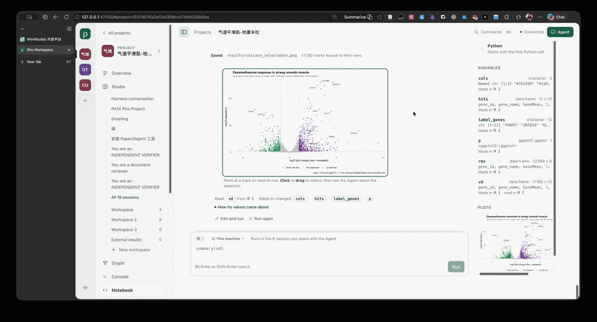
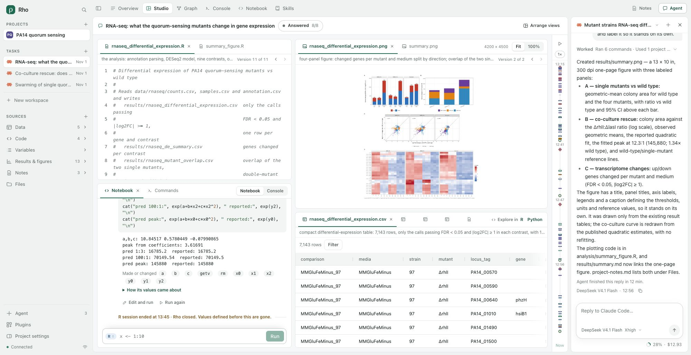

# Browser application

Updated 2026-11-11. The frontend was reset at the user's request. Previous frontend
plans, visual specifications, Paper references and appearance rulers have been
removed from the working repository. Git retains their history; they do not govern
this implementation. This document describes the current application, not another
prescriptive design system. How it changes next is decided by reviewing real runs
([Development](DEVELOPMENT.md#stages)); the current
[base-R review](BASE-R-EPISODE.md#review-of-the-2026-10-25-run) records what the
screens do not yet show. Avoid unnecessary secondary labels and descriptions: let the
layout do the explaining.

The clip runs for about 30 seconds: the projects list, the answer board with its figure and
table, a script and a table opened, and panes moved and resized while the work stays in place.
It was recorded before the frame below; the places and the work are the same.

## The frame

Every page of a project has the same three regions. The sidebar says where the person is and what
is going on there: the projects, then the open project's tasks, then its files. The project's
places are tabs above the work, which is one panel. One panel beside the work holds the Agent's
conversation or the project's notes. Each can be switched with one click from any page, and
switching never changes what is running ([record](SIMULATED-PROJECT-EPISODE.md#one-frame)).

- **Projects** lists the eight most recently opened projects by name, in the service's order, the
  one on screen marked and a dot on each one whose Agent is answering (from one bounded
  `conversation.list` per project every five seconds while the page is visible; the open project's
  own record also says when it needs a choice). Choosing one returns to where it was left in this
  tab; `+` and Rho open the projects list, where a project chosen opens on its Overview.
- **Tasks** lists the open project's recorded Agent sessions, newest first (eight, then All
  sessions), each one line: its Agent's mark, its title (from its section of the project notes, else
  the Agent's title, else its first message) and how long ago it last moved, or that it is working
  or needs a choice. Choosing one opens its Studio with its conversation in the panel. `+` starts a
  new conversation. The person's own workspaces follow, with New workspace.
- **Sources** lists the project's files by kind, as described below.
- At the foot: Agent (every session and the Agents themselves), Plugins, Project settings, and the
  connection's state with Connection & access.
- **The tabs** are the project's places: Overview, Studio, Graph, Console, Notebook, Skills, and
  Review while the project has review records. A file, the settings or another page reached from
  the sidebar is named after them while it shows. A bar without room keeps the icons and the name of
  the place on screen. At the bar's end: what the Agent is doing while it works, then Notes and Agent,
  which open the panel beside the work.
- Below 768 CSS px the sidebar is a drawer that also lists the places, the bar names only where the
  tab is, and the panel is a sheet over the page.

## The Agent's view of the sending tab

Each message sent from the Agent panel carries that tab's page and, in Studio,
its workspace ID, observed layout version and replay position. The service freezes
a bounded view summary with the message; a retry keeps that original context.
Under a Studio message, the workspace name records where it was sent from.
An empty workspace has no views, even when the project contains files. An Agent can
delete that empty layout through `composition.delete` and restore it through
`composition.undo`. Deletion removes the sidebar entry and moves an observing tab
to another workspace, or Overview if none remains. Project files and sessions are
separate. The [Studio context episode](STUDIO-CONTEXT-EPISODE.md) records the original
misunderstanding, the real OpenCode run and the limits of this summary.

## Starting from the work

A person needs to find a project, work on its contents, ask an Agent for help and
inspect what happened. The application gives those actions direct places:

- **Projects** lists and searches available projects, names the folder each one works
  in, opens folders and creates a named project from selected source folders. It
  opens as one list with one primary action, and with no projects it shows what can
  be started instead of an empty page. A new service state also holds the study Rho
  ships with: the application copies it into the projects folder once, under the name
  it is listed with, and from then on it is an ordinary project the person reads,
  edits, continues or removes ([example project](EXAMPLE-PROJECT-EPISODE.md)).
- **Overview** opens with the answer board: the newest message that produced results,
  derived from the Graph. It shows the question and the answer, then the results by
  role. The figure or table the answer names leads, with the other results beside and
  below it. Then come the method (an outline of the script), the run that produced
  them with its command and output, the message's other commands (which open in the
  Console), the data it read and any report. A result or script the project notes
  describe carries that description, and the session's choices follow the results:
  what each is about and what was taken, with any other option the notes name, under
  the choice or in the same sentence, in a well below with what it gives. Each result has Ask, and selecting a
  passage of the answer offers Ask about this. Either one sends a question to the
  same conversation with what it is about (the exact kept version for a file).
  Questions that make no new results are listed under Asked since with their
  answers, and the board stays on the answer they ask about; a header link names a
  question being answered now. Use this answer or Needs changes (with a note, also
  sent to the Agent) records the person's word for the file versions that message
  kept, and the board names results it does not cover and files changed since.
  Earlier answers are chosen from a menu. Below the board come a count for each kind
  of step (asked, read, edited, ran, changed on disk, answered), which is also the
  legend and filter of the Graph's timeline below it: one lane per conversation, the
  person's own lane above them and one for callers outside Rho below
  ([timeline events](TIMELINE-EVENTS-EPISODE.md)). A project where only the person has
  worked shows the same strip as What you did.
  Without conversations, the results show as pictures, newest first: the newest at
  twice the size, then two or five more, with the rest in Files. A side column draws
  each workspace as its panes, opens the shared notes, and lists the files the
  Agent's tools named, most used first, each with a bar for its tool calls. Its Work
  progress shows Agent sessions started outside Rho and any choice waiting in a
  session; conversations started in Rho answer on the board. Work in the Notebook is
  work: a Notebook section names each session with cells (where it runs, its cells
  and values) and the three newest cells by their purpose, each opening the Notebook
  at that cell; a project with only Notebook cells is not shown as empty.
  A project with nothing recorded yet shows its two next steps — work with the Agent
  or browse its files — rather than empty sections, leading with whichever one the
  project's listing says has something behind it.
- **Sources** counts the project's Data, Code, Results & figures and Notes from one
  bounded walk of its folders, by file name. A project that holds them also lists
  Workflows (`Makefile`, `Snakefile`, `.smk`, `.nf`, `.wdl`, `_targets.R`…), Reports (`.Rmd`,
  `.qmd`, `.Rnw` and the page rendered beside one, whose `_files` folder is left out, as are
  the versioned libraries a saved page keeps in a `lib`, `libs` or `site_libs` folder beside it),
  References (`.bib`, `.ris`, PDFs in a `refs` or `literature` folder) and Environment
  (`renv.lock`, `requirements.txt`, `environment.yml`, `pyproject.toml`, `Dockerfile`…); each file
  is in one row, while the Graph and the board keep calling a file by what it is. Variables,
  between Code and Results, lists what the live R and Python sessions hold, by session, each
  name with its type, read again (at most once a second) as cells run; a name opens the value
  in Studio beside the Notebook, and with no live session the row says so and offers the
  Notebook ([episode](SIMULATED-PROJECT-EPISODE.md#sources-that-follow-the-project)). Each kind unfolds in the sidebar into
  its files across the project and its source folders: the top level first, then by
  folder, at most 40 there with the rest on the kind's page. Choosing one shows it
  in place in its own view, without writing a layout: a CSV or image as a snapshot
  of its current bytes in the table or media view, a Markdown file in the Markdown
  reader (its to-dos tick in place; Edit shows the editor with a formatting toolbar,
  Source when the tab cannot edit), an HTML file as its page (below), other text in the editor, highlighted when Rho
  has its language, a registered result as its exact version. ← and → or the buttons beside "3 of 6" move through
  the kind, ↑ and ↓ move in the sidebar, and Open in Studio places the file in the
  workspace ([pass](AGENT-CANVAS-EPISODE.md#browsing-sources-from-the-sidebar)).
  `+` adds a source folder.
- **Console** runs the person's own shell commands in the project folder. Newest
  first, it lists each message's commands under that message in the order they ran,
  with the person's commands between them and Rho's managed runs at the end. Each
  command leads with the Agent's own words on what it was for, over the command with
  the project folder read as "."; without those words, it is named by what each part
  runs ("grep → python3 analysis.py"). Commands in a row that changed no file fold into
  one line. A row shows its time, its duration, any ending other than a clean exit,
  and the files that changed on disk while it ran; opening it shows the whole command
  and its output, which streams while it runs. A running command
  has Stop. Run again runs the person's command again, and puts an Agent's command
  into the prompt to check before Run. The board's command count opens the Console
  at that message. Only the person at this machine can run or stop commands; an
  Agent may read them ([episode](SIMULATED-PROJECT-EPISODE.md#second-pass)).
- **Notebook** shows the project's live R and Python sessions, which the person shares
  with the Agent (listed while the Notebook plugin is selected). Cells read in the order
  they ran: language and number in the gutter, who ran it (the Agent's name opens its
  conversation) and its purpose, how long it took or how it ended, the code highlighted,
  then what it printed, streamed while it runs, with messages, warnings and errors in
  their place and its plots. Long code and output show their first lines. Where a session
  started or ended the list says so, and that values from before an end are gone. Each
  cell has Edit and run and Run again. Beside the cells: each session's state with
  Interrupt and Stop (Stop asks first), its variables with type, size and summary, and
  the latest plots. The person's cell stays at the foot, with R or Python, a hint from
  what the session holds and ⌘/Ctrl+Enter. Below 820 px the sessions move above the cells.
  The same Notebook is a view of any Studio page. A view at least 840 px wide has the
  sessions beside the cells; a narrower one folds them into one line above, and below
  420 px the code takes its own line above R or Python and Run. A conversation's Studio
  has a Notebook view of the sessions its Agent ran cells in, with the person's cells
  since the conversation began, cut at the moment shown; on the person's own pages it
  shows the sessions whole. The view scrolls itself and stays at the newest cell while
  the reader is there, also when it is shown again or resized. Only the reader's own
  wheel, touch, keys or scroll bar take it off the end
  ([episode](SIMULATED-PROJECT-EPISODE.md#the-notebook)).
- **Figures.** An R plot built with ggplot2 (directly or by a package on it) is drawn in the
  cell and in the Plots view from its figure record. Pointing at a mark shows its row;
  click, Shift/⌘-click or drag selects, Esc clears, and the rows behind the selection are
  listed by layer. **Ask the Agent** keeps the selection and opens the Agent panel with it
  attached to the next message; the chip's × detaches it. Marks the Agent pointed at appear
  as an amber chip above the plot with its note, shown on the plot when the person has
  nothing selected. A plot nothing described stays a picture; one that failed says why
  under it ([episode](FIGURES-EPISODE.md)). A ggplot a cell saved with `ggsave` is drawn the
  same way wherever its file is shown with the bytes the cell saved: on the answer board, in
  the Results & figures file view and Studio's media view, and under the cell, which names
  the file ([episode](SAVED-FIGURES-EPISODE.md)). Layers that draw the same rows count the
  selection once. Pages drawn with base graphics and ComplexHeatmaps are drawn and selected
  the same way; heatmap cells keep their colour while others are selected, and a selection
  outlines them ([episode](DRAWN-FIGURES-EPISODE.md)).
- **Two forms.** Notebook | Console switches how the same sessions read: as a notebook (above)
  or as a console, one transcript as R or Python print it at a terminal. Each cell is its code
  after the prompt (`>`/`+` in R, `>>>`/`...` in Python, a new statement at the prompt) and what
  it printed under it, messages muted, warnings amber, errors red; a cell someone else ran has
  a comment line with who and why (`# Claude Code · Fit the model`). Plots show under their
  prompt, or as a line that opens them in place when the page has Plots. Session starts and
  ends are marked. A bar above names each session's state with Interrupt and Stop, and Clear
  (Ctrl+L) hides earlier output from this view only. The prompt sits under the last output:
  Enter runs finished code and goes on to another line, indented, in unfinished code (an
  open bracket or string, a trailing operator, a Python block before its empty line);
  Shift+Enter adds a line, ⌘/Ctrl+Enter runs whatever is there, ↑/↓ bring back what the person
  ran, a closing bracket on an empty line steps back, Esc interrupts, and the R/Python chip
  switches language: the small chip each cell carries, also in the notebook form's input. A click in the transcript puts the keyboard in the prompt. A Studio view
  saves its form with the page (`props.form`); the Notebook page keeps it in the browser. A
  Notebook placed under a script by running one of its lines starts as a console
  ([episode](SIMULATED-PROJECT-EPISODE.md#two-forms-of-the-notebook)).
- **Explore in R or Python** sits in the header of a table view (`.csv`, `.tsv`, also
  gzipped) and of an R or Python script, on the answer board's tables and on the file
  page. A table opens on the person's workspace with the page's Notebook beside it, or
  a Notebook placed in a pane right of the table, and loads into the session of that
  language as a new value named from the file (`model_fit`, then `model_fit_2`; a value
  the session has is never replaced). The cell is the person's, named for what it loads.
  A script opens the same way with a line that runs it (`source()` in R, `exec` with
  `__file__` in Python) waiting in the Notebook to check and run, since running it again
  writes its outputs again. On the person's own page this happens in place; from a
  conversation's Studio, the Overview or the file page it opens the person's workspace.
  The file is read as it is on disk now, by its project path, also when the view shows an
  older kept version. Files of added source folders are outside the sessions' folder and
  have no Explore ([episode](SIMULATED-PROJECT-EPISODE.md#exploring-a-finished-answer)).
- **A script's lines** run in the live session of their language from the editor of an R
  or Python script on the person's own page: ⌘/Ctrl+Enter, or Run in the script's header,
  sends the selection, or the whole statement the cursor is in (a call over several lines,
  a pipe, a function, a Python block with its decorators and `else`/`except` parts), as the
  person's cell named for the script and its lines (`analysis.R · lines 12–13`). The cursor
  goes on to the next statement; a blank or comment line runs nothing. The text runs as it
  is in the editor, saved or not. A page without the Notebook gets one under the script; one
  in another pane comes forward there, and the script keeps the keyboard. Lines run in the
  order they were sent ([episode](SIMULATED-PROJECT-EPISODE.md#script-console-variables-and-plots)).
- **Variables** and **Plots** are views of the live sessions of their own (`rho.variables`,
  `rho.plots`), added from Add view or an empty page. Either takes a column along the page's
  right side, the other above or below it there, so a script with its Notebook under it and
  these two make the four panes of a script, a console, an environment and plots. Variables
  shows the session the newest cell ran in (or the one chosen), its state and each value's
  type, size and summary; a name opens the value. Plots shows the newest plot of the live
  sessions at the size of the view with the cell that drew it, steps back through the 24
  newest (arrows, or the strip below), and brings a new one forward as it is drawn. Plots of
  an ended session stay with their cells in the Notebook. With these views on the page, the
  Notebook leaves its own variables and plots out.
- **Data flow** (`rho.flow`) shows how the values of a live session were made, as a tab beside
  Variables (else in the right column). It is a graph of values: the project files and folders
  the session read at the top, the results at the bottom (the files it wrote and the plots it
  drew, else the values nothing reads), and the values between in rows. Each node is titled with
  the meaning its `# means:` comment gives (the Agent writes these above the statement that first
  makes the value; `# means NAME:` names one of several), with the name beneath, and shows the
  name alone without one. A bar names the results: choosing one draws what leads to it, and the
  first is chosen when every result at once would put more than six values in a row. Values that
  lead to no result are named below the graph, and choosing one draws what leads to it. A chosen
  value colors what it comes from and what comes of it; its panel gives its meaning, how and where
  it was made, what it uses and leads to, and which results it reaches. A value can be looked at,
  a file opened, and the cell that made it shown in the Notebook. A narrow view (under 640 px)
  puts the chosen value above the graph. Its values come from the kernel's records (below), each
  meaning from the code of the cell that made the value, and at most 80 values are drawn at once
  ([episode](VARIABLE-FLOW-EPISODE.md#meaning-in-the-code)).
- **How variables relate** ([episode](VARIABLE-FLOW-EPISODE.md)). Under each Notebook cell, what it
  read and from which cell ("Read co from R 3"), and the later cells that read what it made ("ratio
  read in R 6"); a cell named there goes to that cell and marks it. A cell that makes at least three
  values offers "How its values came about", the same graph, under it. Variables names the cell that
  made each value as it is now and the cells that read it. An R or Python script's editor has a Data
  flow switch in its header, kept with the page: the script's flow, read from the text in the editor
  as it is typed (nothing runs), shows beside the code, or below it in a view under 640 px. Its
  nodes are titled by the same comments as the session's, and the flow line says how many values
  have a meaning written in the code. The code marks the lines that make the chosen value, those it
  comes from and those it leads to, in the colors of the key above the flow; choosing a value puts
  the cursor on the line that makes it, and a click on a line that makes a value chooses it.
- **Servers** (`rho.servers`) shows where the live sessions run: this machine and each place, a
  folder on one of the person's servers, reached through serverctl when serverctl manages it and
  with ssh otherwise. A place shows its server and folder, how it is reached, what its last check saw
  (system, R and Python there, the machine's name, who checked and how long it took), its live
  sessions with the machine and process, and a session that lost its connection, with its process
  there not seen to end. "New sessions R / Python" marks where each language's next session
  starts. Add a server lists the servers serverctl manages (system, number of skills) and takes
  one of them or an ssh name, the folder, a name and setup lines, then checks it. A place on a
  server serverctl manages shows the skills bound to it ("How it is used"); pressing one reads it
  in place, without its header, with its file's path, in the form as on the card. A check that
  finds no R where the server has skills says they may say how to set it up.
  Files lists a folder there; opening a file copies it into `remote/<place>/` and opens the copy,
  and a copy whose file has changed on the server says so. The Notebook's line has a chip beside
  the language naming where its next cell runs; session marks, rows, the console bar, Variables
  and Data flow name the place, and a file named in a server session's Data flow opens in Servers
  at its folder there. Explore in R or Python from a copy loads its original on the server; a
  file only on this machine is not sent there.
- **HTML pages** (a knitted report, a saved widget, a page an Agent wrote) open as the page they
  make, with Page and Edit (Source) in the header over the same buffer as the editor. The page
  runs in a sandboxed frame of its own: its scripts run, it cannot reach Rho, and nothing loads
  from the web. The styles, scripts, images and fonts it names in the project are read and put
  into it; a note says how many web files it named and which project files could not be read.
  A link to a project file opens it in Rho; a link outside is named, not followed.
- **Values** of the live sessions open as views of their own (`rho.object`). A variable's
  name in the Notebook, and each name a cell made or changed (listed under the cell while
  its session is live; removed names are struck through), opens it. On the person's page
  it opens there: in a pane right of the Notebook when both keep 360 px, otherwise as a
  tab of the pane next to the Notebook's, and later values join its tabs. From the
  Notebook page or a conversation's Studio it opens on the person's workspace. The view
  says where in the value it is (a trail of parts back to the name), its kind, class and
  size, the session and the cell it was read after, and the code that reaches it, which
  Use in Notebook puts in the Notebook's line. A table shows its facts and a page of 50
  rows with each column's type and summary; a column name sorts by it, again the other
  way, a third time back. A model shows its formula, fit statistics and coefficients,
  then its printed summary and its parts, folded; a vector its facts, counts when categorical,
  and values; a list its parts, each opening in place; a function its code; anything
  else as printed. The view reads the value again when the sessions change while it is
  shown, and when it is shown again; hidden behind another tab it reads nothing. While a cell
  runs, or after the value or its session is gone, the last reading stays, dimmed, with
  what it is and when it was read
  ([episode](SIMULATED-PROJECT-EPISODE.md#looking-at-values)).
- **Skills** (listed while the Skills plugin is selected) holds how work is done in the
  project: the methods the person chose, the conventions they keep and the traps its work
  ran into, as `SKILL.md` files in `.claude/skills/` that Claude Code loads by itself and
  other Agents read through Rho. The subtitle counts them and names the newest change. The
  list gives each skill's name, what it is for and who changed it last, or that it was
  written or changed outside Rho, or why Agents could not load it; removed skills fold under
  Removed. A skill opens on its newest change: its reason as the headline, who made it (an
  Agent's name opens its conversation) and when, its evidence (a Notebook cell opens the
  Notebook at that cell, a file opens the file, a note is quoted) and the lines it added and
  removed, with Undo this change (Bring it back after a removal, Put the change back after an
  undo). A change that writes or removes the whole file folds its text. An edit made outside
  Rho comes first, amber, with what changed since the last recorded version: Agents read it
  as it is, the next recorded change starts from it, and it is undone where it was made. Then
  the text as Agents read it (a first heading that repeats the name is left out), Edit the
  file, and the earlier changes, each opening to its evidence and lines. The skills serverctl
  binds to the project's servers are listed read only under From your servers. With no skills
  the page says what will appear and how, with two things to tell the Agent. Below 760 px of
  page one region shows at a time: the list, then a skill with All skills to go back. The
  Overview's side column shows the three newest changes, each opening its skill
  ([episode](SKILLS-EPISODE.md)).
- **Files** opens documents, browses the project's folder and the source folders it
  works in, and filters the current folder. A source folder is named as the person
  named it and opens one level at a time, the same way any other folder does.
- **Agent** (at the sidebar's foot) has two tabs. Conversations lists every session in
  the project folder by day, searchable and by Agent: Rho's conversations, Claude
  Code and Codex sessions read from the Agents' own records, and observed Harness
  conversations. Each row names where the session started (Terminal, VS Code, Codex
  app, Script…) and whether another window has it open now, and offers Continue,
  the terminal resume command, Markdown export and the trash
  ([session continuity](SESSION-CONTINUITY-EPISODE.md)). Agents is one list of
  the project's Agents in one row design, whatever way each works here: the Agents
  this service can start (a radio for new conversations, the model and folded
  settings; one not found on this computer is greyed out), and the Agents connected
  from their own windows. A window sits under the Agent it belongs to, named by its
  MCP client's own name (`clientInfo`) or else by the session name the Agent chose;
  each window shows its name, a waiting, verified, refused or ended state, what its
  grant allows and its last call. Marks and Agent names come from the Agent icons
  plugin, by the words of the name an Agent gave; a name it does not know shows
  its initial. Below the list, one setup prompt is for the person's own local
  MCP client. The prompt names the project and gives one `rho connect` command,
  whose reply tells the Agent how to configure its own client. Reading or copying grants no
  access. Copy failure leaves selectable text; request failure
  offers retry. ACP observations and Host activity remain under a disclosure
  ([connection episode](AGENT-CONNECT-EPISODE.md)). Conversation rows retain title,
  model, effort, messages, state, usage, cost and their files, commands and answers;
  the trash restores or deletes. Runs follow when present
  ([Agents and conversations](AGENT-PAGE-EPISODE.md)).
- **Project settings** manages source folders and explicitly checks available tools.
- **Work from other windows** feeds the same Graph, Console, answer board
  and session Studio through `agent.sessions.read`. File links in a native answer are
  reported results; current bytes are not labelled historical. A continued native session
  is listed once. Notebook cells join its timeline by exact cell IDs in their receipts,
  not by assuming every call on one connection belongs to that conversation. The
  [external work episode](EXTERNAL-WORK-EPISODE.md) records the actual Harness check.
- **Studio** shows how a conversation's work was done. The sidebar's Tasks list each
  recorded Agent session and then the person's own workspaces; the Studio bar names the
  one shown.
  The **project notes** (`project-notes.md` at the project root) are one Markdown file
  shared by the person and every session, shown in the panel beside the work from Notes
  at the end of the tabs' bar, on any page of the project. The panel holds the notes or the
  Agent's conversation, one at a time, so the work keeps the rest of the window. Rho appends to each session's Agent instructions that it keep one
  section there: a level-2 heading naming its task with a `<!-- rho:session <id> -->`
  marker below it, then Question, Data & method, Key results with a figure, and To do as
  a task list. The panel reads the file formatted, opens at the shown session's section,
  ticks to-dos in place, and edits it as Markdown with a formatting toolbar; the person's
  own edits are saved after a 1.5 s pause (`notesTiming`) with the buffer's write
  conditions, and the Agent's edits arrive through the file. The notes are read only
  when the project has sessions or the panel shows them; below 768 px they are a sheet
  over the page. The notes take no place in a conversation's Studio layout. A conversation's Studio
  lays its files out by what each is to the work, as the answer board names them: the
  data it read above the script it wrote and a Commands view of what ran, with a Session
  view beside it once the Agent ran cells in a live session, figures above
  the tables and reports beside them, each role in one place up to its limit
  (`studioLimits`). A stage under 1100 px wide (`studioWidths`) has no room for two columns of
  readable views, so the work is laid out in two rows of its whole width: what it made, figures
  first, above the script, the Notebook, Commands and the data. One line above a file says what it
  holds and, when the work kept more than one version, which one shows, with earlier and later
  ([fewer things at once](SIMULATED-PROJECT-EPISODE.md#fewer-things-at-once)).
  The parts of the work sit in a chip in the Studio bar, named by the Agent's own words
  between steps or by what the steps did, with rounds of editing and running; time runs
  down the stage's right edge beside the Agent panel, long pauses folded, with the cells and
  commands its Agent and the person ran since it began, and a moment at one of them brings
  the Notebook or Commands view forward. Choosing a
  moment there, a part, or another version replays it: the views, the commands, the
  part and the conversation in the Agent panel all show the record as it stood then, to
  the second, and a text file shows its version kept then, read only, or says that none was kept. Arranging the
  views saves the layout as `conversation-<id>`; later files join their role's place and
  files the person closed stay closed. A moment replayed still shows every view the work
  had then, also those closed. With every view closed, Lay out the work again lays them out
  by role once more, and each group's + lists the work's closed views to open one there
  ([closed views](AGENT-CANVAS-EPISODE.md#closing-every-view-of-a-conversations-studio)).
  Studio opens on the work going on now, else the
  Studio last open, else the newest conversation's. The person's workspace is shared with
  the Agent: nothing opens there by itself. Sending a message from another page follows
  the turn on the Overview's board; sent from Studio, it leaves the person where they
  are (a new conversation started from a conversation's Studio opens its own), and
  Follow opens the running conversation's Studio. The tab of an open file the Agent last
  named says Reading, Edited, Ran…, and the topbar names the Agent's newest action on
  every project page. Files open from the board, the Graph and Sources
  ([canvas episode](AGENT-CANVAS-EPISODE.md),
  [second pass](SIMULATED-PROJECT-EPISODE.md#second-pass),
  [process Studio](SIMULATED-PROJECT-EPISODE.md#process-studio)).
  Eight views render at once: those on screen, then the most recently shown, then the
  rest in layout order. A hidden view past that unmounts and mounts again from its
  owner when shown, keeping its buffer and undo but not its scroll or selection.
- **Review** is listed while a project has review records, since asking and deciding
  now happen on the answer board. It brings a frozen question, explicit Agent replies, exact result versions, keyed
  table differences, captured code changes and append-only human decisions together. Table
  row and document selection controls open the same record; whole-resource questions cover
  figures. The page offers the person's questions and the kept results as choices, the
  newest version of each result first with a count of earlier ones; any other exact
  version stays selectable. Sending a frozen context is a separate action from deciding. A result can focus
  Graph; Graph links back. Reload restores Review and its selected record. Evidence export
  previews that record and its retained references before writing a static offline reader
  ([episode](REVIEW-EVIDENCE-EPISODE.md)).
- **Graph** says what was done in the project and lets a person open it down to each
  recorded step ([levels](GRAPH-LAYERS-EPISODE.md)). Closed, the project is its lines of
  work in the order they began: a section of the notes with its conversation, or a
  conversation the notes do not cover. A card carries the question, the newest figure
  and counts, and an arrow says that one line builds on files another made.
  Conversations that changed no file stand below. Past eight lines of work the closed
  cards are names and counts, so that all of them read at once.
  An open line reads left to right: the files it used, the work, the files the work
  made, and what the notes conclude from them. The work opens in place, a message into
  its activities (looking around, cells, a script written and run in rounds, the notes,
  the answer) and an activity into its steps. A line to a file says whether the Agent
  reported it, a command named it or a change was seen on disk, and it is drawn on the
  deepest open node that stands for the step it was recorded on. Nothing is left out
  for size: what is drawn is what is open, and Close all returns to the lines.
  Choosing a finding or choice lights the files it rests on and the work behind them,
  names how many recorded steps that is, and offers the step that wrote it, traced by
  the first kept version of the notes that holds it. Choosing a file shows the version
  kept, its reviews, what happened to it step by step and what is concluded from it;
  opening the current file is a separate action. A step shows its command, output,
  ending and the files as kept after it. A choice shows the option in use beside the
  others; Use this instead drafts a message the person edits and sends. Search covers
  every level and opens what it finds. Arrow keys open and close a node and move along
  its column.
  The timeline below gives each conversation a lane and each step a block coloured by
  kind (asked, read, edited, ran, changed on disk, answered), lanes with the same title
  carrying their start time. Past six lanes it keeps its height and scrolls, opening on
  the newest. What the plugins record joins it: each plugin may name a read of who did
  what and when (Notebook cells, Console commands), and each event goes to the lane of
  whoever did it: You, the conversation whose Agent did it, or Outside Rho. Every
  stretch of time is wide enough for its steps before the rest is shared by duration,
  so a minute of cells beside days of messages stays readable. The legend counts and
  filters them, refused or unknown steps are marked, pauses fold to a short gap, and
  the work replays at 1×, 2× or 4×; replay hides what came later than its cursor.
  While the Agent works the Graph stays and follows it: its line and message open and
  its flag sits on the node that stands for the step it is on. A step waiting for the
  person's choice turns amber and is answered there. The map of the whole shows while
  the person moves the view; the key to the lines opens from a button.
  While a message runs, each file it writes is read once it rests: its facts (a table's
  rows and columns, an image's size, a script's lines and functions) show at once, then
  a sentence from the model the conversation's Agent uses, marked with that model and
  the version it read. The notes' words replace both when the Agent writes them
  ([descriptions](SIMULATED-PROJECT-EPISODE.md#descriptions-while-the-work-goes-on);
  the first Graph and the timeline are recorded in the [episode](GRAPH-EPISODE.md)).
- **Workspaces** hold real owner views in tabs and splits, which the person arranges by
  hand. The shown tab has a close button; any tab closes with a middle click, Delete or
  its menu, and a close names what it closed with Undo while the layout is as it left
  it. A tab's menu (right click, the context-menu key or Shift+F10) closes it or the
  group's other tabs, splits it right or down and maximizes its group. Each group's +
  puts a view into that group from the same choices as Add view. A tab drags onto
  another group's tabs (a line marks the place), onto the middle of a group to join it,
  or within a quarter of a group's side to open a pane there; the empty strip beside a
  group's tabs drags the whole group the same ways, keeping its tabs. While something
  drags, each side of the page takes it as a column or row a third of the page.
  Double-clicking that strip shows the group alone in this browser tab until Restore.
  Tabs narrow to their icons before they scroll, the shown tab keeping its name, and a
  view's controls take a second row when the group has no room for both. A file's name shortens
  in its stem and keeps its extension; tabs short of room share it evenly, and one without room
  for a few letters is its icon alone. Each change is one
  conditional write of the saved layout, the same the commands and the Agent use, and
  Undo reverses it. Arrange views and the command palette offer split, move, close and
  undo for the focused view. Below 768 px nothing drags
  ([episode](AGENT-CANVAS-EPISODE.md#arranging-views-the-person-drags-the-agent-writes),
  [by hand](AGENT-CANVAS-EPISODE.md#the-persons-own-hands-on-the-layout)).
  A stage narrower than 640 px, as in a small window with the panel open beside it,
  shows a layout of several groups one view at a time with all its tabs, as a phone
  does; the saved layout is unchanged. New workspace, under Studio in the sidebar and in
  the command palette, makes an empty page of the person's own (Workspace 2, 3, …). An
  empty page offers the Notebook, Variables, Plots, Data flow, Servers and the project's files by kind; Add view
  in the Studio bar offers the same on any of the person's pages. A file opens in the view it has
  elsewhere in Studio, the Notebook in a pane right of what is there. Pages cannot yet be
  renamed or removed, and they count toward the 32 layouts a project keeps.
- **View headers** give each view's controls one form, whichever component puts them there,
  also on a file's page and atop the notes: words and an icon on no ground until pointed at,
  the view's main action (Run) in the accent, a choice of forms (Notebook or Console, Read or
  Edit, Fit or 100%, R or Python) as one well with the chosen one raised, and Highlight changes
  as its words beside a bar in the Agent's colour. A control is there while it can act: Save
  while the text has unsaved edits, Review selected text and Ask the Agent with a selection, the
  highlight while Agent or disk edits remain (Documents 0.4.9). A file with one language has one
  Explore in R or Python button. The tabs give way to the controls, narrowing to their icons,
  down to room for the shown tab's name and every other tab's icon (168 px for one tab, 44 px
  more for each other); below that the controls take a row of their own, and a control that
  comes with a selection can then move the view. On the person's own page the Studio bar holds the
  Agent's latest object, held updates and Activity beside Add view and Arrange views; as
  it narrows, the object's state goes first, then the controls' names
  ([episode](SIMULATED-PROJECT-EPISODE.md#toolbars)).
- **The Agent panel** opens beside any page from the Agent button at the end of the
  tabs' bar, from a task in the sidebar, or from Continue on the Agent page. Its one header is the
  conversation's title, New conversation and Close; the title opens the recent
  conversations, the last entry leading to the Agent page's full list. A new
  conversation shows only what the Agent can do here. In a tab on this machine it holds conversations with
  Claude Code or Codex started in Rho: follow a streaming reply and its actions, reply,
  stop a turn and return to it after a reload
  ([conversation episode](CONVERSATION-EPISODE.md)). Its left edge drags, or moves
  24 px per arrow key, between 280 px and 760 px (at most 60% of the window); a
  double-click returns it to 340 px, and each browser keeps its own width. One chip under the message box
  names the model (Default model until one is chosen), its provider, the effort and what is switched on: the saved choices
  for a new conversation and the open conversation's own, changed between messages. It
  opens a short menu with a row per setting the Agent offers (the Agent for a new
  conversation, the model with its search, effort, mode); a row opens its list in place,
  an On/Off setting is a switch, and Escape steps back, then closes the menu, not the
  panel. Each ending names the model that answered ([settings pass](AGENT-CANVAS-EPISODE.md#choosing-the-agent-and-its-model)). The panel renders the retained
  record rather than protocol events ([panel pass](AGENT-PANEL-EPISODE.md)): the
  Agent's last words stay open as Markdown prose, lists, code with Copy and tables
  that scroll sideways with their numbers whole; what it did before them folds into one line ("Worked · Ran 8 commands ·
  Edited 1 file · 6 choices"), open while it works. Inside, each tool step names what it
  did (`Read data.csv`, `Ran Rscript analysis.R`, `Wrote results/summary.csv`,
  `Called data.page`) with an icon for its kind and the Agent's title and reported path
  behind a disclosure; files are counted once; answered choices stay in the fold. Each
  message ends with its outcome, model, time and Copy; a failure the Agent's last words
  already state is shown once. A native permission request is
  an amber choice card. The message box is one rounded surface with the settings chip and
  a round Send or Stop; under it, the plan entry in progress and the context and cost
  the Agent reported open a card with context as a bar, the cost and the whole plan. New activity is followed only while
  the person is at the end; scrolling up keeps the position and offers "Jump to latest". The Agent's tool status and
  reported path are distinct from Work progress's independently observed files.
  Sessions started elsewhere are listed with where to continue them. In an open
  workspace it also shows the Agent's recorded work and linked questions. A tab
  opened from a narrower link keeps a request draft for an external Agent: copying a
  request is not sending it or receiving a reply. The [live activity
  episode](AGENT-UI-EPISODE.md) records the observations, checks and limits.

Connection & access, at the sidebar's foot, opens a drawer: the focused document's Changes, then
the connection (its state, when it was last read, Refresh or Reconnect, and why the service did not
answer) and this tab (this machine or a link, its folder and expiry, what it can and cannot do, and
for a link the way back to this machine's access), each as a card
([episode](AGENT-PANEL-EPISODE.md#connection--access)). With the sidebar hidden, the bar says the
connection's state. Between 768 and 1023 CSS px the sidebar folds away while a Studio layout is
open and comes back with the Overview. Narrow screens show one workspace view at a time.
Closing a panel does not cancel work.

The [home and project episode](HOME-PROJECT-EPISODE.md) records the 2026-10-27 pass
over these screens, its checks and the listing gap it left open. The
[simulated-project episode](SIMULATED-PROJECT-EPISODE.md) records the 2026-10-29 run
of two capsule projects and the changes it led to.

## State and code

`web/main.tsx` owns navigation and session observation. `web/home.tsx` handles project
entry, `web/overview.tsx` the project sections, and `web/plugins.tsx` the installed
capability catalog. `web/shell/` renders the persisted composition tree and embeds
registered owner views. `web/agents.tsx` handles the explicit external-Agent handoff and the session list;
`web/conversation.tsx` shows a conversation started in Rho. Its presentation comes
from `src/conversation-presentation.ts` (text, action lines, folded runs, plan entry),
and Agent prose is rendered by `src/agent-markdown.ts` with `web/markdown.tsx`.
`web/project-list.tsx` draws the sidebar's projects and `web/project.tsx` its tasks and
sources; the places are `placeTabs` in `web/main.tsx`. `web/sources.ts` walks the project folders
within its limits, names each file's kind and orders each kind's files for the sidebar,
its page and `web/preview.tsx`, which shows one file in place. `web/agent-now.ts` reads the running
turn's record (`conversation.read`, last turn) and maps its steps to project paths;
`web/canvas.ts` resolves a file's owner view (`viewFor`) and places it in a workspace
with one conditional `composition.apply`, through `document.open` for text and `agent.activity.capture`
for a CSV or image. Following is a tab-local choice; the workspace layout is saved.
Every owner view receives the shell's services (`ShellServices` in `src/ui-contract.ts`,
made in `web/shell-services.ts`): a linked project file opens in place, or in the
workspace on screen in Studio; an image is read as its current bytes (`readImage` in
`web/previews.ts`, at most 64 per page of 8 MiB each, past which the view shows its
description); `web/languages.ts` gives Python, R and Markdown to the editor and to code
in rendered text, one set of token classes coloured in `theme.css`.
A command the Agent ran shows how it ended (its exit code when the Agent reported one; a
command that ran and failed is "failed", not "refused"), how long the call took from its
last description to its result, and the last lines it printed, opened at their end, in
the panel row and the Graph's run card and details (`commandEnd`, `stepDuration` in
`src/conversation-presentation.ts`). A leading `rtk` output wrapper is left out of the
command's name; the row's details keep what ran.
`src/work-graph.ts` builds the Graph from `conversation.read` records (a finished
message keeps the project files that changed on disk while it ran) and the folder walk
(`project.entries` gives each file's `modifiedAt`): questions, file versions and runs with their
reported, named and observed edges (`ranFiles` tells a script a command ran from one it only
looked at). `src/work-layers.ts` builds the levels on it without a DOM: the workspace, lines of
work, messages, activities and steps (`buildWorkLayers`), the touches between work and files,
the statements of the notes with the step that wrote each, and the reads over them
(`trajectory`, `links`, `shownAs`, `lineFiles`, `flows`, `support`). `src/layers-layout.ts` places
what is open (`layoutLayers`; `sizes.roomy` is the count of lines past which closed cards are
brief). `web/work-turns.ts` reads every session for the Graph, `turnLimits.sessionsAtOnce` at a
time and each in pages of `turnLimits.pageTurns` messages. `web/graph.tsx` draws the levels, the
inspector, the timeline (`timelineLimits.lanes`) and the
Overview's `WorkStrip`. `web/timeline-events.ts` reads each plugin's `timeline` read named in
the catalog, and `src/timeline-events.ts` places its events in lanes by principal. `src/answer-board.ts` derives the Overview's answer board from
the same graph: `answerBoard` gives each file and command of a message a role,
`boardThreads` keeps a later question that made no results with the answer it asks
about, and `src/asking.ts` writes and reads back what a question was asked about.
`web/answer-board.tsx` draws the board and records decisions (`conversation.decide`);
`web/console.tsx` draws the Console from the same graph, with the person's command line and
records from the Console plugin's `./ui` (`useCommands`, `useCommandLine`, `CommandLine`,
`CommandRecord`); the Agent's commands and the managed runs stay Rho's.
The live sessions' views come from the Kernel plugin's `./ui` (Rho-plugins, Notebook 0.4.0):
the Notebook, Variables, Plots, Data flow, Servers and a value's view (`rho.notebook`,
`rho.variables`, `rho.plots`, `rho.flow`, `rho.servers`, `rho.object` at version 1), registered
in `ui-entries.json` and drawn through the registry like the other plugin views.
`web/entries/kernel.tsx` hands them the page's services from `web/shell/workspace-views.ts`:
opening a value or a server's file as a view, code waiting for the Notebook's line, saving the
Notebook's form with the page, which views the page has, and a conversation's share of the
sessions. Highlighting and Markdown come from the shell services (`highlight`, `markdown`).
The plugin's `./code` finds the statement a script line runs (`statementAt`), writes the code
that loads a table or runs a script, what each cell read from which cell (`cellRelations`), and
Data flow's graph of values from a session (`sessionGraph`) or a script's text (`scriptGraph`);
`web/entries/documents.tsx` sends a line through the page's `runCode` shell service, draws a
script's graph with the plugin's `ScriptFlowView`, keeps the chosen value (from the graph or the
cursor's line, `graphNodeAt`) and marks the lines behind and in front of it (`graphMarks`).
The HTML page view is `html.reader` from Rho-plugins (HTML 0.1.0); Rho gives it `pageFrame`, the
service's `/frame.html` (sandboxed, with its own policy and no network; the page's policy adds
only `frame-src 'self'`), and `fileBytes`, a file snapshot's bytes (`readFile` in `web/previews.ts`).
`web/skills.tsx` draws the Skills page from `skills.list` and `skills.read`; `web/skills-work.tsx` holds the list read, the authors and the Overview's Skills section, and hands a chosen skill to the page.
The Notebook's views share one `kernel.read`; inside a conversation's Studio the Notebook is
scoped to the conversation's principal, its start and the moment shown. `web/explore.ts` places the Notebook
(`addBeside` in `src/shell-layout.ts`), values (`addWithRoom`) and Variables and Plots
(`addAtEdge`), loads a table and
makes the person's pages;
the Kernel plugin's `./code` writes the code; `web/page-add.tsx` lists what a page can add.
A conversation's Studio (`web/studio-process.tsx`) reads its record, builds the graph
whole and as cut at the moment shown (`turnsAt` in `src/replay.ts`), takes each file's
role and kept versions from the whole record (`studioFiles` in `src/studio-layout.ts`)
and lays the files out (`studioTree`, `studioMerge` over a saved arrangement).
`src/project-notes.ts` reads the notes' sections and session markers (`notesSections`,
`sessionTitles`, bounded by `notesLimits`) and writes the instructions a session is
given; `web/project-notes.tsx` keeps the notes' one buffer open for the project, saves the
person's edits and draws the panel. `src/notes-meaning.ts` reads each section into
statements with the files they link (`notesMeaning`, `fileDescriptions`) and traces each
to the kept notes versions (`traceStatement`); `web/meaning.ts` reads every kept notes
version, `meaningLimits.versionsAtOnce` at a time, and `web/choices.tsx` draws a choice's options. `src/file-describer.ts`
reads a file's facts (`fileFacts`, `describeLimits`) and chooses what a file holds as shown
(`holdsOf`); `Conversations` checks the project while a message runs and asks the Agent
component's `describeFile` for the sentence. A figure goes as an image when the Agent
component's `./models` finds the model on models.dev taking images, else `figureContext`
gathers what made it. `web/holds.tsx` draws the line with its source and the cost of its
call. The session popover in `web/conversation.tsx` holds the person's switch for
describing (`describeFiles` in `web/agent-settings.tsx`) and the conversation's spend.
`src/studio-chapters.ts` names the parts of a message. The views find their file and
moment through `web/process-context.ts`; `web/shell/process-views.tsx` frames a file's
versions and `CommandPane` in `web/console.tsx` shows the conversation's commands. For the Graph, `foldVersions` merges a message's versions of one
file and folds its unrelated commands (`foldLimits`); the `WorkStrip` keeps every step. `web/previews.ts` reads the card and Overview previews from a captured
snapshot, or a registered result at its exact version: at most 16 files, two at a time, figures
up to 2 MiB and tables to 3 rows by 4 columns.
`web/work-progress.tsx` reads `project.work.read` for the local person's project
Overview: Agent-reported plans/usage, retained native source identities and current
referenced files. Under the answer board it shows a conversation started in Rho only
while it waits for a choice (without the board, also while it answers), and links to
the Agent page for the finished ones; references the observation left out are counted
under the file list.
`web/agent-manage.tsx` draws the Agent page's tabs from the conversation summaries in
the snapshot and `conversation.list` for the trash; an opened row reads its latest
four messages through `web/agent-work.tsx`, the same step model as the panel.
`web/agent-settings.tsx` keeps one copy of `conversation.settings.read` per tab for
the Agents tab and the panel's settings menu (`web/settings-menu.tsx`);
asking an Agent what it offers (`conversation.settings.check`) is always the
person's click. The Agents tab adds an ACP Agent (`conversation.agents.add`) when the
person clicks Add on one found installed, types its command, or clicks Use in Rho on an
Agent connected from its own window whose command Rho knows; an added Agent's settings
show its command and Remove from Rho. An Agent that offers no settings says so in the
message box rather than offering to ask.
Shared notes opens `project-notes.md` in the existing Documents owner. A failed work read keeps the previous
view and offers Refresh. The cursor invalidates the read model; individual sources
and resources retain their own versions. See the [observed loop](ACP-EPISODE.md#shared-workspace-loop).
External ACP sessions use the same work surface with their own source identity,
plans, usage and read-only latest reply there. Their permission choices stay in the
original client; the Agent panel continues such a session in the folder once no
other window holds it. The visible Overview rereads external projections every
1.5 seconds; it does not start a collector, Agent or Host. Turn cancellation keeps
unfinished tool outcomes unknown and does not claim all native processes exited.

The browser calls the existing `BrowserClient` contract. Document content, undo,
conditional save, execution identity, output and versions remain with their existing
owners. Views of the same document do not acquire independent document buffers.
Opening exact results uses both resource identity and version. Reconnect only reads.

A linked result initially opens as a local view. When the person arranges it, Rho
includes that exact descriptor in the same conditional composition write as the
split or move. The original view and its selection retain their own version;
reload restores the saved arrangement. No unrelated preview is saved with it.
The [base-R episode](BASE-R-EPISODE.md) exercises this path with a real Agent reply.

Opening the service URL on this machine is the access: the tab starts as the local
person, so there is no link to redeem, no session credential in tab storage and no
first screen asking for one. A deliberately narrower link (`rho --pair`, one folder
or an expiring tab) still arrives as a one-time code in the fragment; the page
redeems it, keeps that credential only in this tab's session storage, and says when
the link could not be used. A tab that falls back to this machine keeps its open
projects, unsaved edits and running work: leaving a link forgets a credential, it
does not close a view or submit anything.

A request draft is scoped to the project and to the principal using the tab in
session storage. It is local preparation, not a saved project document or Agent
message. Using this machine's access instead of a link forgets only that link's
credential. The existing Documents editor owns acknowledged document recovery; a
view change makes no new save claim.

A conversation's messages, steps and endings belong to the service's record, not to
the tab. The tab keeps only an unsent message per conversation and the identity of
a message being sent. When the reply to a send is lost, Retry sends that same message
once; when the service refuses it, the words go back into the box. A session started
elsewhere opens in the same panel with its history, its turns marked with where they
were sent, and its next message continues that session. While another window holds
it, the box is disabled with where it is open and a link to continue a copy; Rho
reloads a session whose record changed after its own last message.

The palette and responsive dialogs use native dialog focus containment and Escape.
Typography, color and layout are implemented in the three CSS files under `web/`.
These are current implementation values, not an accepted design system; they change
when a reviewed result calls for it. The shared CSS variable interface lets owner
views use the application's colors.

## From source

`npm run dev` serves the browser application as `web/` is on disk, through Vite's dev server on
this machine (port 5173 or the next free one; `--port`). A saved stylesheet shows in place. A
saved component shows once the page has reloaded itself, at the same address. The page stands in
front of a built service (`dist/`). Without folders that is the Rho already running on the folders
`rho` uses, which is left running when the command ends; when none runs, one is started for the
run and stopped with it. `--root` and `--state-dir` choose other folders, such as a throwaway
project folder, and `--example off` leaves the shipped project out of a new state. Changes under
`src/` need `npm run build:service` and a new service, and a plugin's views follow that plugin's
own build.

The service still answers only its own origin. The page server passes its own page's requests on
as the service's and passes any other origin on as it came, which the service refuses. A view's
rendered receipt names the selected browser build, so a receipt from this page is refused.
`test/dev.test.mjs` starts the command on a throwaway folder and checks the page, both service
cases and the refused origin.

## Verification

`npm run acceptance:frontend` exercises the application using disposable projects,
real R output and the installed Chrome executable. It records screenshots of the
project entry, overview, files, table, figure, activity, settings, plugins and Agent
panel. Its assertions cover navigation, editing and undo, an unsent conversation message,
the clipboard handoff in a link tab,
conditional layout changes, dragged tabs, the Agent panel's width, reload, keyboard input, responsive overflow and accessible
control names. The report and images go to `work/frontend-reset/browser/` by default.

`npm run acceptance:agent-canvas` drives a controlled ACP peer that reads, edits and
runs project files and writes an output no step names. It checks the sidebar counts,
that a message sent from Studio leaves the person's workspace as they arranged it,
the edited text on disk in the open editor, that nothing else opened there, the Agent
page's record of the turn and a file it names shown in place, that Follow opens the
conversation's Studio, marked in the sidebar's sessions, with its data, script,
commands, output, parts and timeline, that
a moment chosen on the timeline at the work's first read shows the views and the
conversation as they were then, that the answer board is led by the figure the turn made, with the next question and its
answer under it, and overflow at 1024/390. Evidence goes to
`work/agent-canvas-acceptance/` by default.

`npm run acceptance:agent-page` drives controlled peers for Claude Code and Codex
that offer models, settings and Claude Code's own names and report a title, context
and cost. It checks asking an Agent, its names, providers and models, saving the model,
effort and default; the message box's chip naming them and its menu changing the
effort in place, with Escape stepping back and closing the menu but not the panel; the
rows with their model, effort, context and cost, search and
the Agent filter; an opened row's facts and rendered table and the Markdown export;
the trash with Undo, restore and delete, never while the Agent answers; and overflow
at 1024/390. Evidence goes to `work/agent-page-acceptance/` by default.

`npm run acceptance:graph` drives a controlled peer that runs the real Rscript for two
messages. It checks the empty Graph, the Agent's flag on the activity it is in while the
Graph stays and follows, the project closed to one line of work with its counts and
figure, the open line from what it used through its messages to what they made, a
message opened into activities and an activity into steps by key and pointer, a figure
leading to the step whose run changed it with the command as it ran, Play's narration,
that following opens no files in the workspace while a file the person opens goes
there, and overflow at 1024/390. Set `RHO_RSCRIPT` if `Rscript` is not on the
path. Evidence goes to `work/graph-acceptance/` by default.

`npm run acceptance:sources` browses a project of data, scripts in two folders and
figures in two output folders from the sidebar, without a model. It checks the
unfolded lists and their order, a file shown in place with no layout written, ←/→,
the buttons and ↑/↓, the table and editor keeping their own arrow keys, an R script's
colours, Open in Studio, unfolded kinds after a reload, a Markdown note read with its
image, math, table and highlighted code, following another writer's edit, Edit and Read,
a link to a script, and the 390 px drawer. Evidence goes to
`work/sources-acceptance/` by default.

`npm run acceptance:agent-ui` drives a controlled ACP peer through the real service
and Chrome; it uses no model credentials. It checks that reply text arrives in more
than one visible piece, that read/command/write actions name their target while they
run, that the plan line follows the entry in progress, that a native permission is
shown, answered and retained in the work that folds when the message ends, that the
Agent's Markdown renders, and that reading
earlier lines is not interrupted by new activity. Evidence and screenshots go to
`work/agent-ui-acceptance/` by default.

`npm run acceptance:base-r` runs the complete selected-row question, external Agent
edit, real R execution, two-version comparison and browser-disconnection episode.
It requires the configured Claude Code client and never substitutes a simulated
model. Its [record](BASE-R-EPISODE.md) separates fresh execution from browser-only
continuation and independent aggregate checks from scientific review.

Action, object, shell, document and continuity suites exercise the existing owner
behavior through the rebuilt UI. Only executed checks in [Status](STATUS.md) are
current evidence. Historical component and installed-package results do not accept
this new frontend automatically. Native physical IME behavior and human usability
require their own evidence. The frontend reset did not implement a Project Notebook
owner, native desktop windows or a registry release.
Functional browser evidence shows that paths work, not that the screens can be read;
the [base-R review](BASE-R-EPISODE.md#review-of-the-2026-10-25-run) records where
they cannot.

`node scripts/conversation-episode.mjs` drives the conversation episode with the
configured Claude Code. It stops only when a step cannot be performed; the reviews
in its [record](CONVERSATION-EPISODE.md) judge what its screenshots show.
