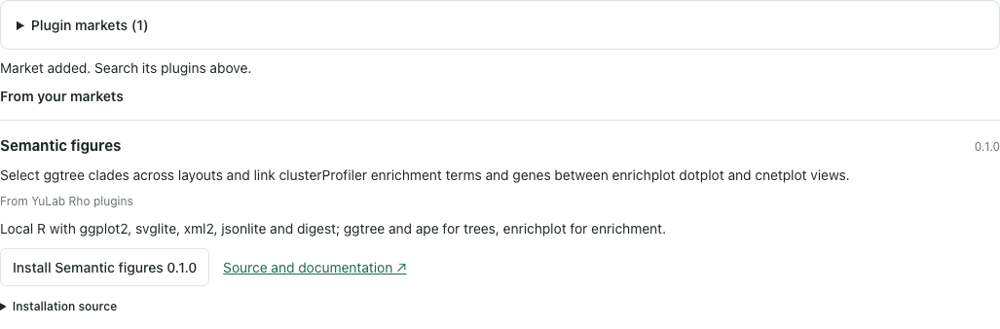
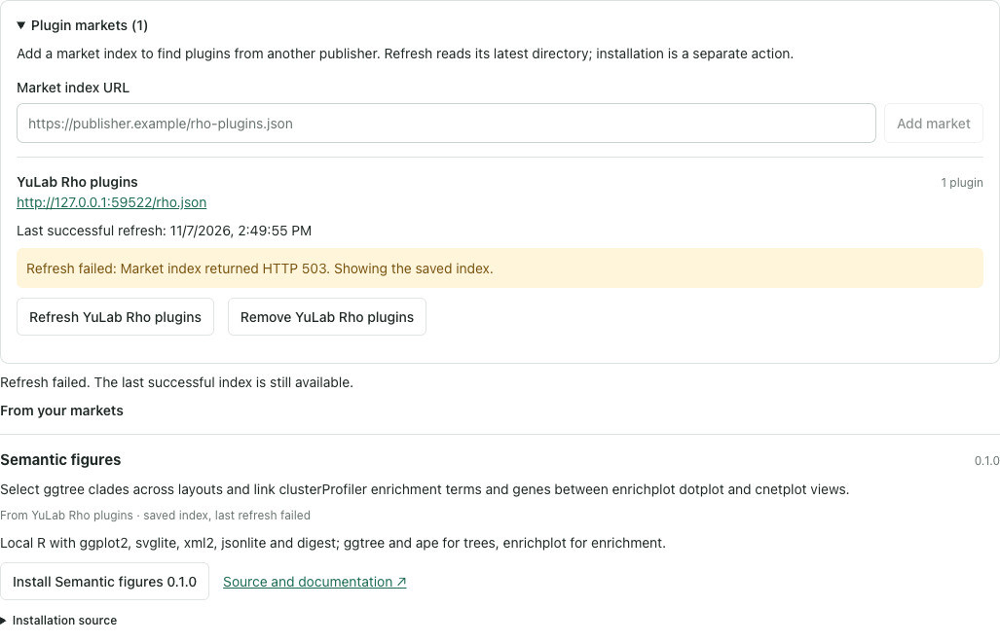

# User-configured remote plugin markets

Observed on 2026-11-07 in Rho source after 0.5.6. This extends the independent
[package channel](THIRD-PARTY-PLUGINS.md#remote-plugin-markets): a person can add a
publisher's index, search its plugins, and install a selected immutable source.
The functional plugin remains owned by Rho-plugins. No Core or scientific plugin
code changed in this episode.

## The flow that ran

A disposable project and owned Rho service ran in Chrome 156.0.8078.81 on macOS.
A controlled loopback HTTP index served the real
[YuLab Rho catalog](../site/market/rho.json), allowing malformed JSON and HTTP 503
to be exercised. Package installation fetched the actual public Git source:

```text
git+https://github.com/YuLab-SMU/Rho-plugins.git#50d2427683e9077a5141b011c9696c51a00c90c5:plugins/semantic-figures
```

The Plugins page rejected malformed JSON without retaining a source. Correcting
the index made Semantic figures searchable with `clusterProfiler`, even though
that word is absent from its native package description. Searching, listing and
reopening made no further index requests and installed nothing.



An explicit refresh received HTTP 503. Rho showed the error and kept the previous
index digest and entries. Installing its saved selection fetched the fixed Git
commit, checked id/version and opened the plugin's actual Interactive figures
view. The installed package recorded its market origin and index digest. The
later successful refresh cleared the error. The source controls remained
reachable at 1440, 1024, 768 and 390 px; none of those views overflowed horizontally.



Removing the source kept the installed package, its digest and its searchable
`clusterProfiler`/`cnetplot` keywords. No scientific runtime started: the test
configured missing Core/R executables, and the service still reported no R
sessions. This checks discovery, installation and opening the view. Native plot
selection and linked plotting retain their separate
[semantic-figure evidence](SEMANTIC-FIGURES-EPISODE.md).

## What the observations changed

The first invalid-index run displayed a generic unknown-operation error because
the new reader threw plain JavaScript errors. The owner now uses Rho's structured
faults for invalid indexes, limits and unavailable sources. The same browser path
then named invalid JSON and allowed correction in place.

The first removal implementation lost the market-only search words. Recording
those keywords with the installed package's origin made the same search work
after source removal. A repeat browser run checked both words and the retained
package digest.

The new operation also needed an explicit top-level object schema for Rho's
discovery projection. Its focused projection and HTTP/CLI checks pass. A broader
all-operation adapter probe reached an existing missing-effect-contract refusal
outside this new operation; that broad adapter path is not claimed as passing.

## Verification and limits

- `npm run build` and `npm run check:contracts` passed.
- `node --test test/extension-markets.test.mjs test/extensions.test.mjs`: 9 passed.
  These cover restart/cache behavior, invalid formats and sources, streamed size,
  entry/source/time limits, stale revisions and digests, actual staged package
  identity/version mismatches, CLI/API consistency and Agent authorization.
- The existing entry-contract, contract-coverage, protocol, validation and layered
  MCP suites passed 16 checks before the final discovery-schema adjustment. The
  focused discovery check and current generated-contract check passed afterward.
- `node scripts/plugin-markets-episode.mjs`: six browser groups passed against
  the real public Git package. The [retained report](plugin-markets/report.json)
  records the exact installed digest, index digest, browser and viewport results.
  `RHO_MARKET_EPISODE` selects a disposable output folder; the script closes its
  browser, service and fixture server after the run.

The new [public HTTPS index](https://raw.githubusercontent.com/YuLab-SMU/Rho/main/site/market/rho.json)
is included in this source change; verification of that published endpoint is
pending publication. The controlled HTTP fixture is not evidence of a published
HTTPS index. This pass does not establish independent-user usability, other OS
behavior, registry publication, market signing, automatic updates, or installation
into the person's running Rho. No npm release was made.
