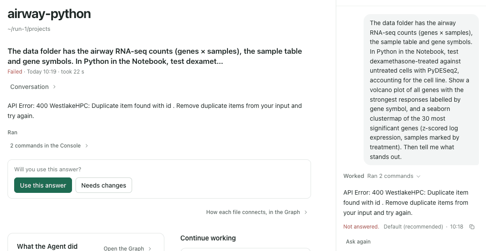
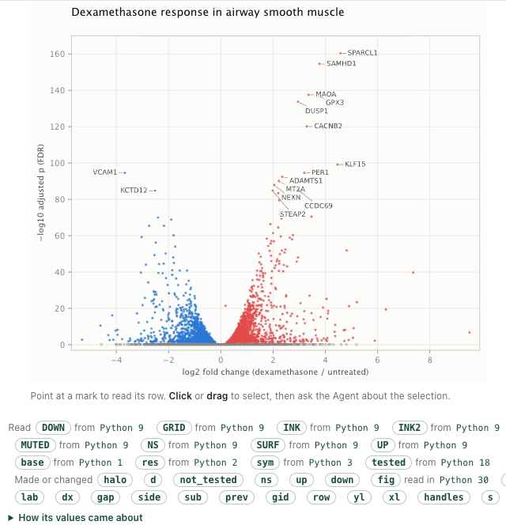
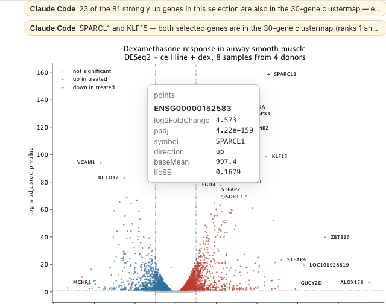
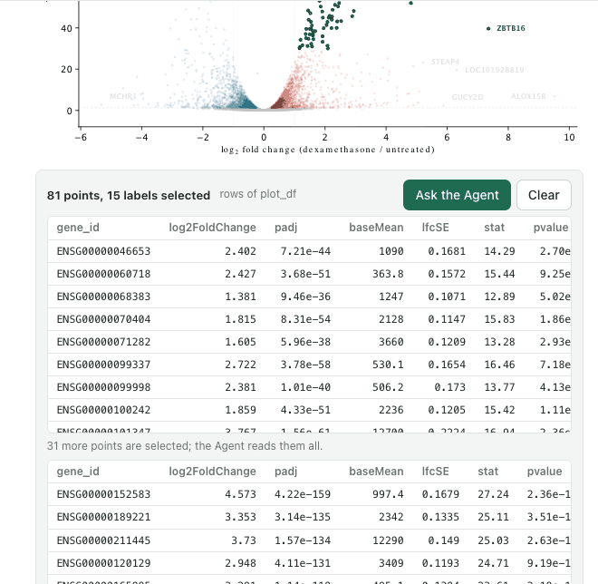
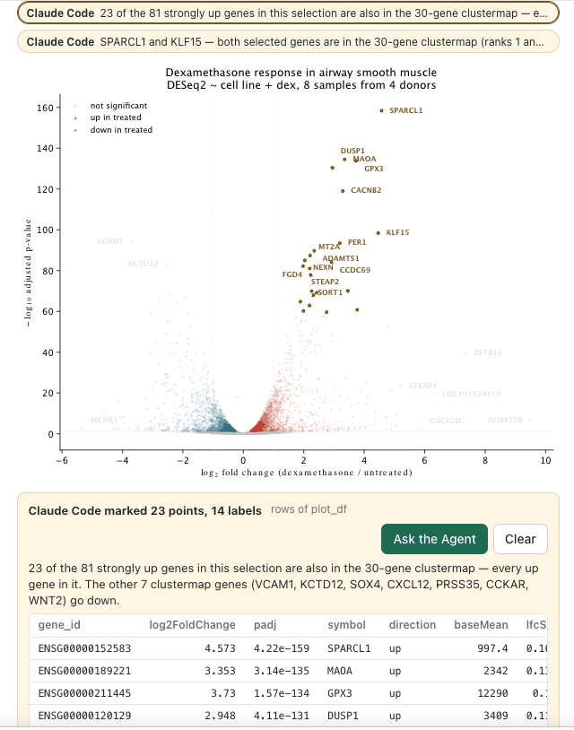
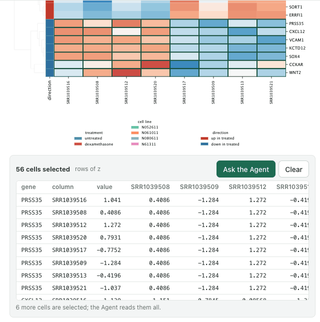
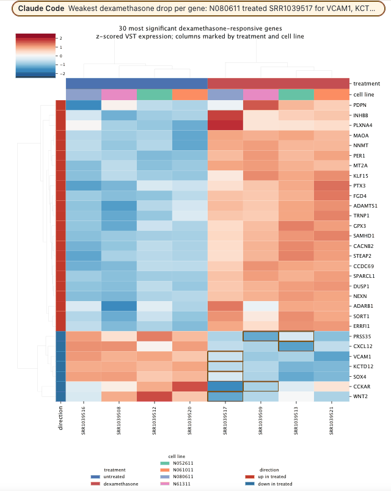
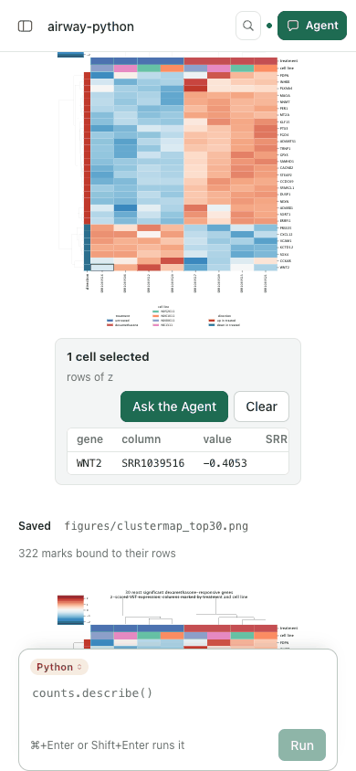
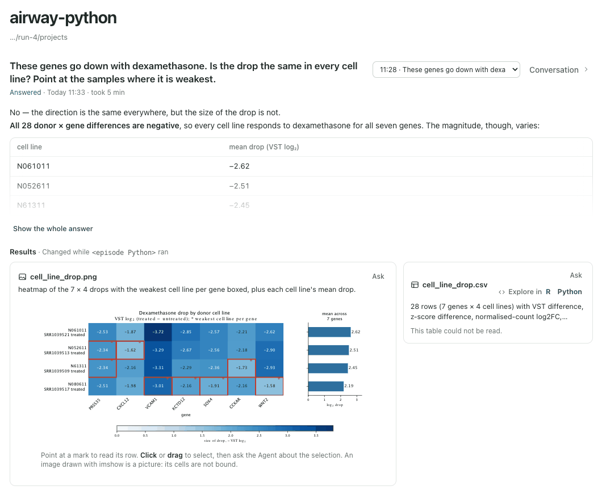
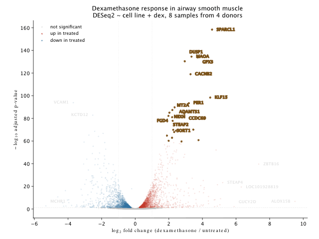

# Python figures: matplotlib and seaborn figures are figures

Date: 2026-11-08. Stage 4 of the built-in [Figures](FIGURES-EPISODE.md) capability, after
[Drawn figures](DRAWN-FIGURES-EPISODE.md), observed in one real Agent episode run four times.
This is functional evidence, not a usability claim: no independent researcher has used it.

## Why it changed

The R stages left every plot a Python cell draws as a picture. A Python analysis of the same
data draws the same volcano and clustered heatmap with matplotlib and seaborn, and the person
could not point into either. matplotlib keeps what each Axes drew as artists: a scatter's points
with their offsets, a line with its vertices, each bar a rectangle, a heatmap a mesh of cells, a
label with its text and position.

## What runs now

- **Describer.** `py/figures.py` in Figures 0.4.0 gives each artist an id, writes the figure as
  SVG at its own size and names each element matplotlib wrote after the marks it stands for.
  Points, line vertices, bars, heatmap cells, segments, polygons and labels are marks that keep
  the values they were drawn at, in the data's units. An artist drawn `rasterized=True` is drawn
  as vectors for the figure; the picture and the figure object are left as the code made them.
- **Binding.** Points, lines and labels whose x and y are two columns of a table in the session
  (a DataFrame, a numeric Series, a 2-D array) are bound to its rows, in the table's order. A
  position drawn through `-log10`, `log10`, `log2`, `log2(x + 1)` or `log1p` of a column is
  matched through it, and the mapping says so (`y: -log10(padj)`). Marks all drawn at one value
  (genes not tested, at y = 0) are bound by their other axis and noted. A label drawn at a bound
  point's position names that point's row, in whatever order the labels were drawn. Tables
  another layer of the plot is bound to come first, then those the cell assigns, then those it
  reads.
- **Heatmaps.** A seaborn `heatmap` or `clustermap` cell names its row, column and value. When a
  session table holds the same values, also reordered by clustering, the cell's source row is
  that table's row; tick labels that name other rows of it than the values beside them are noted.
  Otherwise the drawn matrix is the source, named by its tick labels; labels set on the cells'
  edges are read in their order and noted.
- **Saved files.** The Notebook's runner (Notebook 0.5.11) watches `Figure.savefig` once
  `matplotlib.figure` is imported: a figure saved to a project file is described as savefig wrote
  it, and the cell's `saved` list names the file with its bytes, also when the cell closed the
  figure. A layer's notes travel in the cell's plot output and show under the figure.

## The episode

An owned service with a disposable project, `airway-python`, ran in Chrome at 1440 × 1000 and
390 × 844. The project held the airway counts, sample table and gene symbols as CSV files, and
the Notebook's Python was the episode's own environment (Python 3.12, matplotlib 3.11.2, seaborn
0.13.2, PyDESeq2 0.5.4). Real Claude Code 2.1.319 ran from the Agent panel in its default mode.
The person asked: *The data folder has the airway RNA-seq counts (genes × samples), the sample
table and gene symbols. In Python in the Notebook, test dexamethasone-treated against untreated
cells with PyDESeq2, accounting for the cell line. Show a volcano plot of all genes with the
strongest responses labelled by gene symbol, and a seaborn clustermap of the 30 most significant
genes (z-scored log expression, samples marked by treatment). Then tell me what stands out.*

**Run 1, Westlake HPC.** Every model slot was set to `westlakehpc/deepseek-v4.1-flash`. After two
shell commands the third request was refused: *API Error: 400 WestlakeHPC: Duplicate item found
with id . Remove duplicate items from your input and try again.* A three-step `claude -p` outside
Rho was refused the same way, also with thinking turned off. The gateway offers that model from
Westlake under no other name, so runs 2 to 4 used the same model through
`workbuddy-ai/deepseek-v4.1-flash-sg`, which completed the same three-step check.

Run 1's project also sat inside this checkout, so Claude Code read the checkout's Git status and
the person's own instructions as the project's. Runs 2 to 4 used a folder under `/tmp`.

**Run 2.** Claude Code answered in 12 min. Sixteen plot and saved-file outputs were figures,
but none of the volcano's points could be selected: it drew every scatter `rasterized=True`, so
SVG held one image of them. Worse, the 4,337 genes not tested, drawn at y = 0, and the 15 labels
were bound to `counts` as `x: -log10(SRR1039508)`. A count of 0 gives `-log10(0) = inf`, and the
comparison took inf as near every value. The clustermap's 240 cells were bound to the session's
`heat_z`, by value, through the clustering's reordering. In eight of its records the tick labels
came from the unclustered order and named other genes than the rows they sat beside; Claude Code
found this itself after several checking cells.

Replaying run 2's own cells with rasterized artists drawn as vectors, describing the volcano took
35.6 s, past the 20 s limit. The session held samples × genes tables of 8 rows and about 22,000
columns, and 628,802 columns were compared. Tables with fewer rows than the plot's marks are now
skipped, each table is compared on at most 64 numeric columns and each axis is sorted once: the
volcano took 2.1 s and all 22,384 marks were bound to `d`.

**Run 3.** Claude Code answered in 7 min, drawing from functions in `analysis.py`. The volcano's
15,847 points were bound to `results`, but its 18 labels were not: 16 were annotations at their
points in another order than the table's, in one layer with two notes placed in the axes' corner.
The clustermap's matrix existed only inside its function, and its 30 row labels were set at the
cells' edges (`set_yticks(range(30))`), so its rows were named 1 to 30.

**Run 4**, after the changes, made the same request in a new project. Claude Code answered in
9 min. The volcano was a figure of 17,921 marks, all bound: 17,896 points as `log2FoldChange` and
`-log10(padj)`, two threshold layers and 22 labels, each label naming its point's row. The
clustermap's 322 marks were bound, its 240 cells to the session's `z` by gene. Pointing at the top
of the volcano showed SPARCL1's row: ENSG00000152583, log2 fold change 4.573, padj 4.22e-159.

The person's first drag caught only the SPARCL1 and KLF15 labels; Claude Code read them as those
two genes, said both are in the clustermap and marked them. The second drag over the strongest
up-regulated genes held 96 marks. The person asked: *These go up most strongly with dexamethasone.
Which genes are they, and which of them are also in the clustermap? Mark those on the volcano.*
Claude Code answered in 3 min: the 96 marks are 81 genes, *15 of the marks are text labels sitting
on already-selected points*. It said 23 are in the clustermap, all of its up-regulated genes, and
that ZBTB16 has the largest fold change but ranks 78th by padj. It marked the 23 points and the 14
of their labels drawn on the plot.

The person dragged over the clustermap's seven down-regulated rows (56 cells) and asked: *These
genes go down with dexamethasone. Is the drop the same in every cell line? Point at the samples
where it is weakest.* Claude Code answered in 5 min. It said all 28 gene × cell line differences
are negative, but N080611 is the weak responder (mean drop −2.19 against −2.45 to −2.62), with
WNT2 its clearest exception. It marked the weakest treated sample of each gene, 8 cells.

At 390 px the page did not scroll sideways, and a tap selected one cell (WNT2, SRR1039516). As in
R, the heatmap's labels are too small to read at that width.

The answer board drew Claude Code's last saved figure, a heatmap of the drops drawn with `imshow`,
as a figure: its outlines and value labels are marks, and its note says the image's cells are not
bound. Its CSV could not be previewed, for the harness reason under Also observed. The path of the
episode's Python, in the line above the results, is masked in the picture.

## Iterations and causes

- **Rasterized points were not drawn.** SVG writes a rasterized artist as one image. The describer
  draws the artists it describes as vectors and restores their setting.
- **A count of 0 matched every value.** `|inf − x| ≤ 1e-9 · inf` is true. A value that is not
  finite now matches only itself.
- **Describing took longer than 20 s.** Wide tables were compared column by column under each
  transform; see run 2.
- **Genes not tested, drawn at 0, were unbound.** Marks at one value of an axis are bound by the
  other axis when its values are at least half distinct, and noted (*All 4337 marks are drawn at
  y = 0*).
- **Labels in another order were unbound.** A label is looked up through the columns the points of
  its plot were bound by. Texts placed in the axes' coordinates are a layer of their own.
- **Heatmap labels on the cells' edges named nothing.** Read in order when that names every row
  once, and noted.
- **Mislabelled heatmap rows went unnoticed.** The record compares tick labels with the rows of the
  table it matched: *29 of 30 rows are labelled with another row of heat_z: row 1 is labelled
  SPARCL1 and draws the values of PDPN* for run 2's first clustermap, replayed. No run after the
  change drew a mislabelled heatmap.
- **One layer bound to a loop's table.** In run 4 the down-regulated points were bound to `d`, the
  loop variable holding those 1,761 rows. Tables of the plot's other layers now come first.
- **The gene symbol was not shown.** The tooltip and the selection table listed every number of a
  row before its other names. Text columns now follow the mapped columns (shared with R).
- **Marked labels were outlined.** For the Agent's marks, the amber stroke reached text too. Text
  is filled, not outlined (shared with R).

  

## Also observed

- In runs 2 to 4 Claude Code also wrote the analysis as a script and ran it from a shell, which the
  run's settings did not allow and the panel's default mode did, as in step 1. In run 2 it
  installed adjustText into the episode's environment that way. A figure written by a script
  outside the session is a picture; run 2's page asked `figure.read` for the rewritten volcano by
  its bytes and was answered 404.
- The harness gave the service a home folder without the person's R library, so Tables' R
  requirements read as missing and CSV results could not be previewed.
- Claude Code's cost line uses its own price table; it is not the provider's price and is not
  reported.

## Not established

- The Westlake route was not used past run 1.
- Cells of a heatmap drawn as one image (`imshow`) are not bound.
- Points drawn in another order than their table's (sorted before plotting) are not bound; their
  labels are only when the points are.
- A table inside an object (an AnnData's `obs`) or a function's frame is not seen, so a figure
  drawn from it keeps its drawn values. scanpy plots were not checked.
- plotly, Bokeh and Altair figures are not described; dates on an axis are kept as matplotlib's
  day numbers.
- The heatmap label note has not been read by an Agent in a run.
- At phone width a heatmap's labels are too small to read; the figure has no zoom.

## Verification

- Plugins `npm run test:figures`: 11 of 11, 3 of them Python. The Python checks bind a volcano at
  `-log10(padj)` with annotated labels and a corner note, a log-axis MA plot of markers, a
  rasterized scatter with genes at y = 0 beside a table of counts with zeros and an 8 × 5000
  table, a seaborn heatmap, a clustermap (also with labels in the table's order, which is noted),
  a heatmap with edge labels, a barplot, and figures saved with `savefig` and read by path and by
  bytes until the file is written again. They passed with matplotlib 3.10.3 and 3.11.2.
- Plugins `npm test`: 210 of 213, 2 skipped; the one failure is the U1-06d check that failed
  before this change.
- Rho `npm test` first failed 26 tests, as CI did for `2b801cd3`: Plugins `ca09d9c` raised Tables
  to 0.5.1 and Rho still selected 0.5.0, so Tables did not load. With Tables 0.5.1 selected, Rho
  passed 338 of 341, 3 skipped.
- CI for `6a58c009` (run 42502446349): the tests passed on macOS, Linux and Windows, but packing
  the candidate refused the figures package: its packer allowed only `r/figures.R` beside `dist`.
  Plugins `d5bce29` packs `py/figures.py`; a local pack of Rho's selected plugins includes it.
- All 15 CI jobs passed for `5e899fb2` with Plugins `d5bce29` (run 42503174060): tests on three
  systems, the packed candidate and six installations.
- Records in run 4: the 17,921-mark volcano took 0.58 s and 5.4 MB; the clustermap 0.07 s and
  0.13 MB.
- Browser: the steps above in Chrome at 1440 and 390 px, read from their screenshots.
