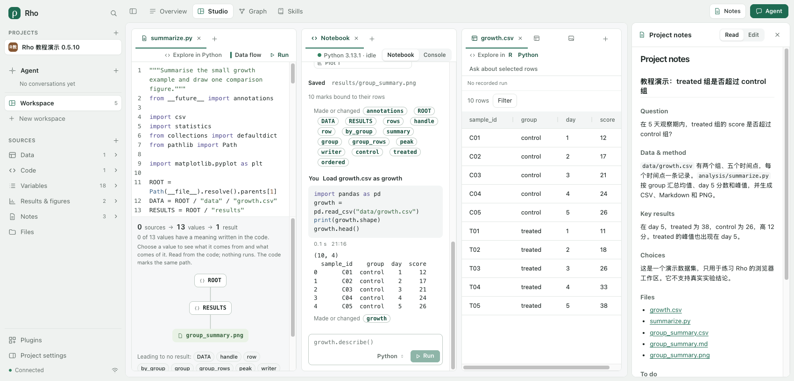

# Rho 0.5.10 人类教程：把一次分析放进同一个工作区

这篇教程写给坐在浏览器前的人。安装和启动由 Agent 完成，人从项目页面开始：先看问题和数据，再看代码和 Notebook，接着把输入、代码、结果和笔记放进 Studio，最后回到 Graph 看这次工作留下了什么。

我用 Rho 0.5.10 新建了一套专门的演示项目，把完整路径走了一遍。项目回答一个很小但完整的问题：**在 5 天观察期内，treated 组的 score 是否超过 control 组？**

## 1、先看这套完整的 Rho 教程

### 1.1 这 5 个入口各做什么

第一次打开 Rho，先不要把它当成一个只能显示文件的网页。一个项目里的入口各自负责一件事，合起来才是完整工作流。

| 入口 | 这次演示里看到什么 | 人要做什么 |
| --- | --- | --- |
| **Projects** | `Rho 教程演示 0.5.10` | 选对项目，确认自己没有进错文件夹 |
| **Sources** | Data、Code、Results & figures、Notes | 按资源类型找输入、脚本、结果和笔记 |
| **Notebook** | Python 3.13.1、4 个 cell、输出和图 | 看每次运行的代码、输出、时间和触发者 |
| **Studio** | `summarize.py`、Notebook、`growth.csv`、汇总表、PNG 图 | 把一次工作的关键视图放到同一屏里 |
| **Graph** | 1 条 Notebook 工作线、4 个步骤和时间线动作 | 回看这次工作做过什么，不替没有发生的 Agent 工作编故事 |

左侧还会看到 **Plugins**、**Project settings** 和 **Agent**。Plugins 是能力入口，Project settings 是项目配置，Agent 是可选的协作者；这篇教程的主路径先由人走通，不依赖 Agent 对话。

### 1.2 这次演示的文件

项目在：

```text
~/Rho/projects/Rho 教程演示 0.5.10
```

文件只有几类，但每一类都有用途：

| 位置 | 文件 | 作用 |
| --- | --- | --- |
| Data | `data/growth.csv` | 10 行观测，两个组、五个时间点 |
| Code | `analysis/summarize.py` | 读入数据、分组汇总、写结果、画图 |
| Results & figures | `results/group_summary.csv` | 两组的均值、day 5 分数和峰值 |
| Results & figures | `results/group_summary.png` | 两组五天变化曲线 |
| Notes | `project-notes.md` | Question、Data & method、Key results、Choices、Files、To do |

### 1.3 开始前准备什么

请让 Agent 在浏览器中打开这个项目即可：

```text
请在浏览器中打开 Rho 的“Rho 教程演示 0.5.10”项目。这篇教程写给我本人：我会在页面里点 Projects、Data、Code、Notebook、Studio、Notes 和 Graph，请不要让我使用命令行。
```

浏览器打开后，在左侧 **Projects** 选择 `Rho 教程演示 0.5.10`。这篇教程不把安装命令当正文，因为安装和连接属于 Agent 的准备工作；人要学的是项目页面里的判断、操作和复核。

## 2、7 步走一遍完整 Rho 工作流

### 2.1 第 1 步：先把问题立住

进入项目后，先读 Overview 和项目标题，确认这次要回答的是：

> 在 5 天观察期内，treated 组的 score 是否超过 control 组？

这一步的产出不是结论，而是一个可以由数据和结果回答的问题。问题如果不清楚，后面打开再多文件也只是浏览。

### 2.2 第 2 步：在 Data 里读原始表

展开左侧 **Data**，点击 `growth.csv`。Rho 会打开表格视图；实际页面显示 **10 rows**，4 列：`sample_id`、`group`、`day` 和 `score`。

先做三个检查：

1. `control` 和 `treated` 是否各有 5 行。
2. `day` 是否覆盖 1 到 5。
3. `score` 是否随天数变化。

这时你已经能看到 day 5 的两个数：control 是 26，treated 是 38。但先把它当作观察，不要直接当成分析结论。后面还要看均值、峰值和图。

表格上方有 **Explore in the Notebook**。先不要点它，先把输入读懂；人知道输入是什么，Notebook 才有上下文。

### 2.3 第 3 步：在 Code 里看数据怎样变成结果

展开 **Code**，点击 `analysis/summarize.py`。代码视图里可以看到：

- `DATA` 指向 `data/growth.csv`；
- `by_group` 按 `group` 收集行；
- `summary` 计算均值、day 5 分数和峰值；
- `RESULTS` 写出 CSV、Markdown 和 PNG。

代码视图里的 **Data flow** 也可以打开。这次实际看到 `ROOT`、`RESULTS` 和 `group_summary.png` 等值的路径关系。Data flow 只读取代码来画关系，不会运行脚本。

这里的 **Run** 运行当前光标所在的语句或选中的代码。光标在第一行时，Run 只会跑这一行；要运行完整脚本，下一步使用 **Explore in Python**。

### 2.4 第 4 步：把输入带进 Notebook

回到 `growth.csv`，点击表格上方的 **Python**。Rho 会自动：

1. 打开 Notebook 视图；
2. 启动这个 Notebook 自己的 Python 会话；
3. 加入一格加载 `growth.csv` 的代码。

实际页面显示 Python 3.13.1，并给出 `(10, 4)` 和前几行。这个 cell 的记录带着 **You**、时间和输出，说明这一步是人从表格触发的。

Notebook 不是一个只显示最后结果的黑箱。每个 cell 都能看到代码、输出、运行时间、变量和图；后面的 cell 可以继续使用同一个 Notebook 会话里的值。

### 2.5 第 5 步：从 Code 运行完整脚本

回到 `summarize.py`，点击 **Explore in Python**。Rho 会把下面这段待确认代码放进 Notebook：

```python
__file__ = "analysis/summarize.py"
exec(compile(open(__file__).read(), __file__, "exec"))
```

先读一遍，再按 **Run**。这次实际运行后，Notebook 记录了：

- `results/group_summary.csv` 被写出；
- `results/group_summary.md` 被写出；
- `results/group_summary.png` 被写出；
- 一张图被绘制；
- 图里 10 个点与原始数据行保持绑定；
- Python 会话里保留了脚本产生的变量。

如果脚本缺少 Python 包，先读当前 cell 的错误，再决定是否让 Agent 帮忙准备环境。不要因为一格报错就删项目或重启整个服务。

### 2.6 第 6 步：在 Results & figures 里复核结果

展开 **Results & figures**，先打开 `group_summary.csv`。这次实际看到的是：

| group | n | mean_score | day_5_score | peak_day | peak_score |
| --- | ---: | ---: | ---: | ---: | ---: |
| control | 5 | 20.0 | 26 | 5 | 26 |
| treated | 5 | 25.2 | 38 | 5 | 38 |

再打开 `group_summary.png`。蓝线是 control，橙线是 treated；第 3 天以后两条线明显分开，treated 在第 5 天到达 38。

现在才写这次演示的结论：treated 在 day 5 比 control 高 12 分。这个结论只属于演示数据，项目笔记里也明确写了它不能支持真实实验结论。

如果你想追问一个具体点，可以在图上点或拖选 marks；Rho 会提示这个点对应哪一行，并提供向 Agent 提问的入口。人可以先自己判断，再决定要不要让 Agent 补充解释。

### 2.7 第 7 步：用 Studio 把完整工作放到一屏

这一步是 Rho 和普通文件浏览器最不一样的地方。

点击 **Studio**，把下面 5 个视图放进同一个 **Workspace**：

1. `summarize.py`；
2. Notebook；
3. `growth.csv`；
4. `group_summary.csv`；
5. `group_summary.png`。

这次实际的 Studio 有 5 views：左边是代码和 Data flow，中间是 Notebook，右边是结果图；`growth.csv` 和汇总表以 tabs 保留在同一组视图里。你可以拖动分隔线改变宽度，也可以在同一个视图组里切换数据表和结果表。



Studio 不是把文件复制成一张新报告，而是把原有资源的视图组合起来。关闭某个 tab 不会删除文件，关闭 Workspace 也不会删除项目、Notebook 或结果。

打开左侧 **Notes**，让 `project-notes.md` 作为右侧面板显示。这样人的 Question、Key results、Choices 和 To do 与 Studio 同屏，复核结果时不需要另开一个编辑器。

完成后再点 **Graph**。这次 Graph 会把 4 次由你触发的加载和运行收进一条 **Notebook** 工作线，下面的时间线还会标出这些动作和结果文件的变化。没有 Agent 对话，就不会凭空生成一条 Agent 工作线。

## 3、完整使用时，人在每个页面做什么

### 3.1 Projects 和 Sources：确定范围

Projects 决定你在哪个项目里，Sources 决定你看输入、代码、结果还是笔记。先在这里确定范围，再进入 Studio。

### 3.2 Notebook：确认运行真的发生过

Notebook 保留每个 cell 的代码、输出、时间和触发者。它回答“哪一格跑了、跑出了什么”，而不是只给一个最终数字。

### 3.3 Studio：安排一次工作的上下文

Studio 把人当前要对照的东西放在一起。这次的 5 个 views 让你能同时看代码、数据、汇总表、图和 Notebook；换成自己的项目时，视图数量取决于当前问题。

一个项目可以放多个 Notebook。新建 Notebook 时，Rho 会给它一个不重复的默认名称（例如 `Notebook`、`Notebook 2`）；选中 Notebook 标签后，点击标签旁边的铅笔按钮即可改名。改名只改变这个视图在当前项目里的标题，不会清掉其中的 cell、输出或运行记录。

Overview 里的 Notebook 区块、时间线和右侧 Workspace 摘要会沿用这个标题。本教程项目把它命名为 `Growth analysis`，所以回到 Overview 时，三处都会显示这个名字。

### 3.4 Notes：留下人的判断

Notes 记录问题、方法、结果、选择、文件和下一步。结果表说“是多少”，Notes 说“为什么这样做、哪些限制仍然存在”。

### 3.5 Graph：回看已经发生的动作

这次 Graph 不是一张空白画布。它会显示一条 `Notebook` 工作线、4 个 recorded steps，并把 `growth.csv`、`summarize.py`、汇总表和 PNG 图挂在这条线上。下面的时间线按时间放入 4 次 cell 运行和结果文件变化。

Graph 是回看工具，不是自动补全器；没有发生的 Agent 对话和没有记录的步骤不会被它编出来。

### 3.6 Agent：在上下文准备好后再提问

这次演示没有启动 Agent 对话。你完成前面 6 步后，可以在结果表里选一行，再问：

```text
只根据当前项目的 growth.csv、summarize.py 和 group_summary.csv，说明 treated 在 day 5 比 control 高多少；指出数字来自哪一列，并说明这份演示数据不能支持什么结论。
```

这样 Agent 看到的是你已经读过的数据、代码、结果和 Notes，而不是一个没有上下文的空问题。

## 4、这篇教程里应该放哪些截图

参照新品教程的写法，截图只证明旁边那句话。准备这套 Rho 教程时，建议保留 6 张：

| 截图 | 要证明什么 |
| --- | --- |
| Projects + 项目名 | 人进入的是专门的教程项目 |
| `growth.csv` 表格 | Data 里有 10 行、4 列和两个组 |
| `summarize.py` + Data flow | Code 怎样读入、汇总和写出结果 |
| Notebook | Python 3.13.1、cell、输出和绘图 |
| 5-view Studio + Notes | 代码、Notebook、数据、汇总表、图和人的笔记同屏 |
| Graph | 1 条 Notebook 工作线、4 个步骤和时间线动作 |

截图里不要放 connection 文件或任何凭据。项目内容可以保留，因为它是专门为教程准备的演示数据。

## 5、常见问题

### 5.1 为什么这篇教程不从命令行开始？

因为命令行安装和连接是 Agent 的准备工作。人使用 Rho 的主路径从浏览器里的 Projects 开始，重点是理解数据、代码、Notebook、Studio、结果、Notes 和 Graph 怎样连在一起。

### 5.2 Studio 和打开几个文件有什么区别？

单独打开文件只是浏览。Studio 会把这些视图组成一个可继续工作的上下文：这次 5 个 views 保持代码、Notebook、数据、汇总表和图的关系，Notes 还能在旁边持续显示。

### 5.3 为什么我的 Studio 里没有 5 个 views？

打开项目后，先从 Sources 依次点开 `growth.csv`、`group_summary.csv` 和 `group_summary.png`，再从 Code 打开 `summarize.py`，从已有 Workspace 打开 Notebook。它们会加入当前 Workspace；不要每次都新建一个浏览器窗口。

### 5.4 为什么不同 Notebook 的名字都一样？怎么改名？

旧版本里，新建 Notebook 可能都显示为 `Notebook`，所以看起来像是同一个视图。0.5.10 会为后续 Notebook 使用 `Notebook 2`、`Notebook 3` 这样的不重复名称；已经存在的 Notebook 不会被自动改名。选中要改的 Notebook，在标签右侧点击铅笔按钮，输入新名称并确认即可；右键标签也能从菜单里选择 **Rename notebook**。

### 5.5 为什么 Graph 里没有 Agent 对话？

因为这次演示没有启动 Agent 对话。Graph 仍会保留人的 Notebook 工作线：你触发的 4 次加载和运行会作为 4 个步骤出现；启动 Agent 后，再用同一个项目的 Agent 面板继续，Graph 才会增加对应的 Agent 记录。

### 5.6 没有 R 能不能完成这篇教程？

能。这套演示使用 Python。Rho 的浏览器、文件、Notes、Studio、Graph 和 Python Notebook 仍然可以使用；只有需要 R 的 cell 才需要 R 和相应的 R 包。

### 5.7 这份数据能证明真实实验结论吗？

不能。它只用来练习 Rho 的完整使用。真实项目要把数据来源、实验设计、缺失值处理、模型选择和不确定性写进 Notes，再由研究者判断结论范围。

## 6、完成标准

读者走完这篇教程后，应该能在浏览器中完成一次完整的 Rho 使用：

- 在 Projects 进入正确项目；
- 从 Data 读懂原始表；
- 从 Code 和 Data flow 看懂输入到输出；
- 从表格把数据带进 Notebook；
- 从 Code 运行完整脚本；
- 在 Results & figures 核对表和图；
- 在 Studio 里组合 5 个 views；
- 在 Notes 里写下结论、选择和限制；
- 在 Graph 里回看人的操作；
- 在上下文准备好后，再让 Agent 回答具体问题。

这才是一次完整的 Rho 使用：人从问题开始，在同一个项目里完成数据、代码、Notebook、结果、Studio、Notes 和 Graph 的闭环。
