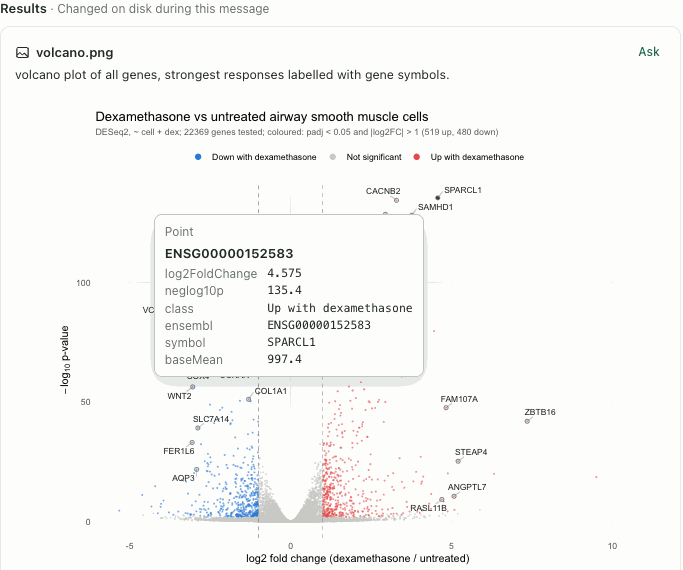
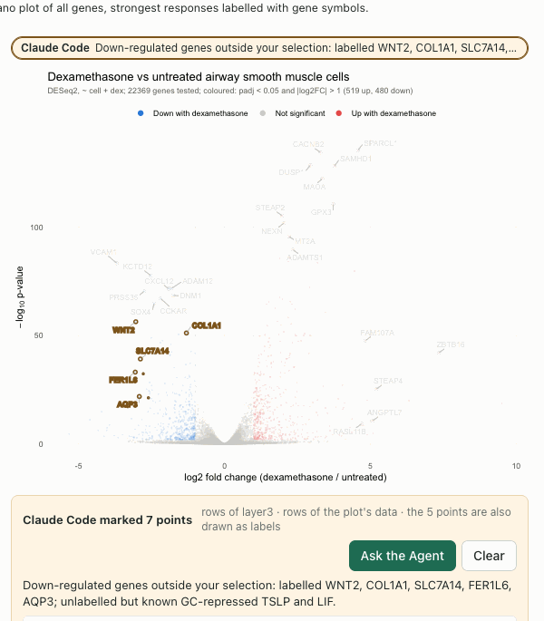
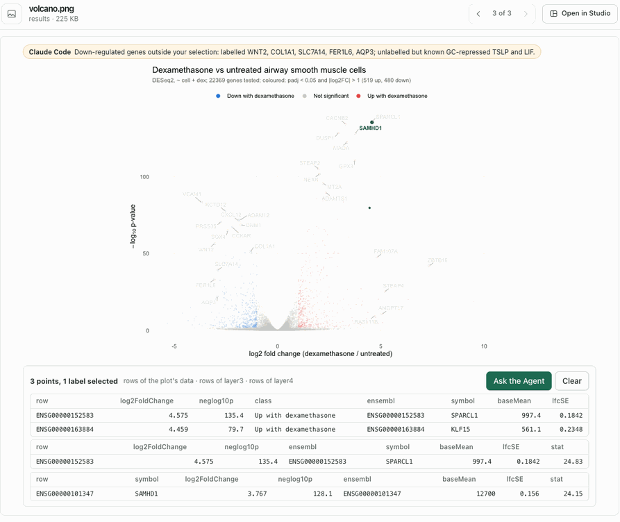
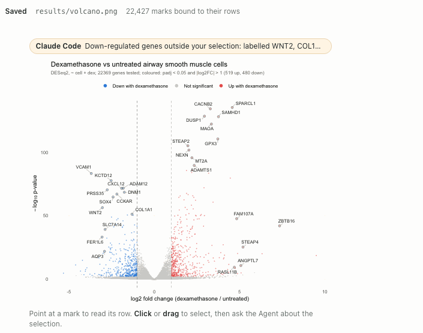
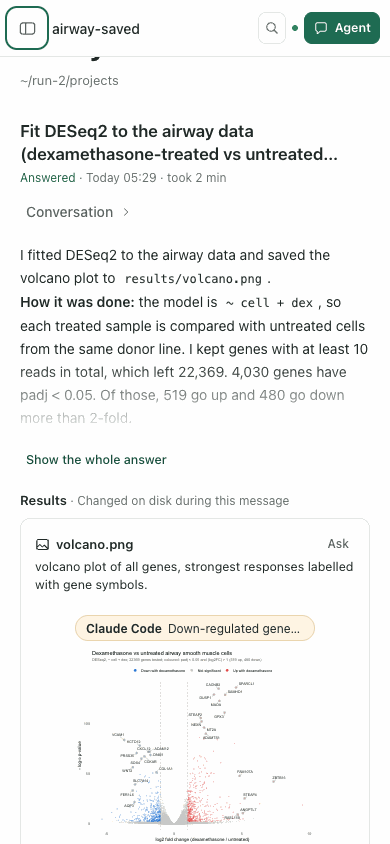
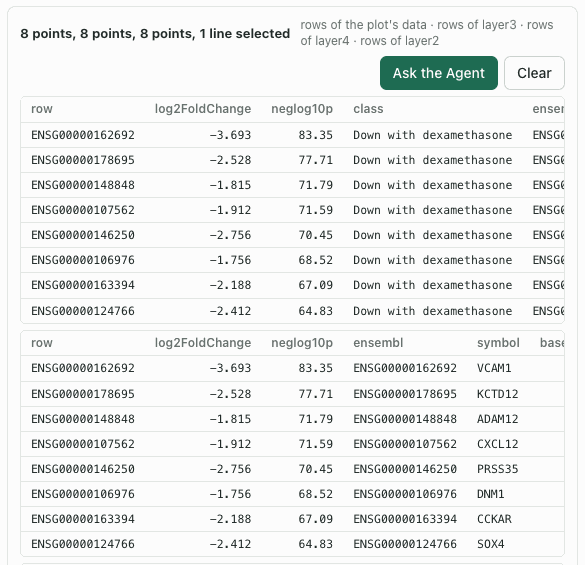
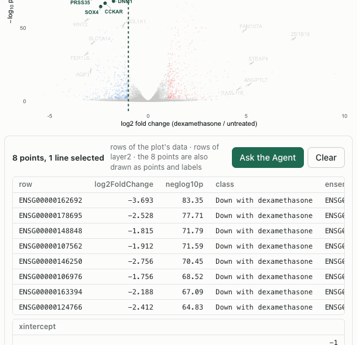

# Saved figures: a ggplot saved with ggsave is a figure of its file

Date: 2026-11-08. Stage 2 of the built-in [Figures](FIGURES-EPISODE.md) capability, observed
in one real Agent episode run twice. This is functional evidence, not a usability claim: no
independent researcher has used it.

## Why it changed

The Figures episode left a figure saved with `ggsave` unlinked to its record. The answer
board leads with the figure the Agent saved, and Results & figures lists it, so both showed
a picture the person could not point into. An Agent asked for a figure usually saves it.

## What runs now

- **R session.** When a page starts on a device other than the session's recording device,
  the Figures extension's `saved_page()` looks for `ggsave` on the call stack. It names the
  plot (found as for a printed page), ggsave's file and the device's size in inches. When
  the cell ends, each saved file inside the project is described at that size, and its record
  is kept with the cell's plots. A file outside the project, or saved by a session on a
  server, is not kept.
- **Notebook 0.5.8.** The cell's `saved` list names each file as the cell left it: path,
  bytes and SHA-256, with the figure's summary or why it has none. `savedFigure(sha256)`
  returns the newest cell's record for those bytes.
- **Figures 0.2.0.** A figure is named by `{cellId, plot}` or by a saved file: `{path}` (the
  file as it is now) or `{sha256}` (exact bytes). A file's selections follow its bytes. A
  message carries `{path, sha256, selectionId}`, and its guidance names the file and
  `figure.read {sha256, selection}`.
- **Pages.** The answer board, the Results & figures file view and the Studio media view
  name an image by its Files version, which is the SHA-256 of its bytes. They draw the figure
  when a cell saved those bytes. A picture no cell saved stays as it is, without a note; one
  a cell saved but could not describe says why. A Notebook cell that saved a figure says
  *Saved results/volcano.png · 22,427 marks bound to their rows* and draws the figure of the
  bytes it saved. The console form says `# Saved …`.

## The episode

An owned service with a disposable project, `airway-saved`, ran in Chrome at 1440 × 1000
and 390 × 844. Real Claude Code ran from the Agent panel with its own settings: `dontAsk`,
Rho's tools and file reading, no shell. The person asked: *Fit DESeq2 to the airway data
(dexamethasone-treated vs untreated airway cells) and save a volcano plot of all genes,
labelled with gene symbols for the strongest responses, to results/volcano.png. Then tell me
which genes stand out.*

**Run 1.** Claude Code wrote `scripts/deseq_airway.R` and ran `source()` on it in the
Notebook session three times. Each `ggsave` inside the script was found and
`results/volcano.png` was kept as saved. Each figure was refused: *The plot draws 22399
marks, more than the 20000 a figure binds.* The answer board showed the picture and said
nothing about the refusal.

**Run 2**, after the changes below, made the same request in a new project. Claude Code
answered in 142 s ($0.80). It wrote `analysis/deseq2_airway.R` and sourced it twice; both
saves were bound (22,419 and 22,427 marks). The answer board drew `results/volcano.png` from
its record. Pointing at the top right showed SPARCL1's row (ENSG00000152583, log2 fold
change 4.575, −log10 p 135.4).

On the board, the person dragged over the strongest down-regulated genes and asked: *Are
these down-regulated genes known glucocorticoid targets? Name them and point out any in the
plot that I missed.* The message carried the selection by the file's bytes. Claude Code
answered in 88 s ($0.66), with four `figure.read` calls and one `figure.select`. It named the
8 genes (VCAM1, KCTD12, ADAM12, CXCL12, PRSS35, DNM1, CCKAR, SOX4). It called VCAM1 the
classic target and CXCL12 partly supported, and the others not known glucocorticoid receptor
targets. It said these calls came from memory and had not been checked against a database.
It then marked 7 genes it said were missed on the same file: WNT2, COL1A1, SLC7A14, FER1L6
and AQP3, which carry labels, and TSLP and LIF, which do not. They appeared in amber with its
note.

In Results & figures, opening `volcano.png` drew the same figure with Claude Code's marks
above it. A drag selected SPARCL1, KLF15 and SAMHD1.

In the Notebook, each cell that sourced the script names the file it saved and draws the
figure of those bytes. The first cell's figure is of bytes the second cell wrote over; it is
still read from that cell's record.

At 390 px the page did not scroll sideways.

## Iterations and causes

- **All-gene volcanoes refused.** Stage 1 set `maxMarks` to 20,000 from a volcano of 16,596
  genes; this one has a mark for each of the 22,369 genes with a p-value, plus labels. Described
  without the limit, the 22,415-mark plot took 2.8 s and gave a record of 7.75 MiB. `maxMarks`
  is now 30,000, and the record's `maxBytes` and the kernel's `maxFigureBytes` are 16 MiB.
- **A refusal said nothing.** A picture that no cell saved should stay a quiet picture, and
  a figure a cell saved but refused was just as quiet. The kernel now marks that refusal
  (`details.saved`), and the page shows its reason under the picture.
- **"plot undefined of cell 3".** The message note assumed a cell's plot. A saved figure is
  now named by its file: *25 selected marks · results/volcano.png, saved by cell 3*.
- **One drag told three times.** Claude Code's volcano draws the labelled genes in three
  layers: every point, a highlighted subset and the labels. The selection read *8 points, 8
  points, 8 points, 1 line*, with the same 8 rows in three tables. Layers whose selected marks
  have the same keys are now one group: *8 points, 1 line selected*, *the 8 points are also
  drawn as points and labels*, one table, and the chip *8 points, 1 line · volcano.png*.
  Labels are counted as labels, and different rows drawn the same way are added together:
  *Claude Code marked 7 points*, where it had read *5 points, 2 points*.

  

  

- **Every selection credited to the Agent.** The board and the file view did not say who
  "you" are, so the person's own selection appeared as *Agent 25 marks*. The shell now names
  the author of each selection as the Notebook does: you, or the Agent of the conversation
  that kept it.
- **The file view stayed a picture.** A Files snapshot's resource path is where Files keeps
  the snapshot (`.rho/plugins/restored/…`), with no extension. The view now tests the extension
  in the view's title and names the figure by its digest alone; the record supplies the
  project path.
- **The record's path argument.** It was named `record`, and a variable of that name inside
  `describe_page` replaced it. The check caught it before any session did.

## Not established

- Figures written outside the Notebook session stay pictures: a script run with `Rscript`
  in a shell, Python, and `png()` or `pdf()` with `print()`, which names no file.
- A saved figure's record lives with its cell. When the Notebook drops its oldest cells
  (`maxCells`, 500), their records go and the file is a picture.
- A saved figure is drawn again from the plot object at the size it was saved at; fonts and
  ggrepel's label placement can differ slightly from the file.
- The message note counts marks (*25 selected marks*), while the chip counts groups.
- The first table's key column is the row name (an Ensembl ID); the symbol column is further
  right and scrolls into view.
- In run 1's answer, Claude Code embedded `results/volcano.png` with Markdown image syntax.
  It showed as *!volcano*, with a link to a relative URL that does not open. Agent message
  Markdown is not changed here.
- `figure.read` answers 404 for each picture no cell saved, and the browser logs those as
  failed requests.
- Base graphics, ComplexHeatmap and Python plots are still pictures.

## Verification

- Plugins `npm run test:figures`: 6 of 6. The new check saves a PNG with `ggsave`, and a PDF
  of a patchwork with `path=` while it is also printed. It shows that a file outside the
  project is not kept, that the figure is read by path and by SHA-256, selected and briefed by
  file, and refused by path once `png()` writes the file again, while the bytes the cell saved
  still name it. A path outside the project is refused.
- Plugins `npm test`: 204 of 207 (2 skipped). The one failure is the same unrelated
  `all ten headless descriptors ship the Paper U1-06d copy` from `a7f9751`.
- Rho `test/figures.test.mjs`: 1 of 1, now also through the service: a `ggsave` cell, a
  selection by SHA-256, a message whose brief and guidance name the file, and the Agent's
  grant reading the selection by SHA-256.
- Rho `npm test`: 332 of 335 (3 skipped) with no failure.
- Browser: the steps above in Chrome at 1440 and 390 px, read from their screenshots.
