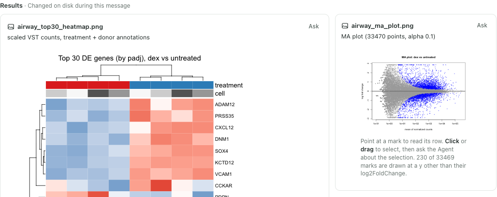

# Script runs: an Agent's script runs in the Notebook session, and its figures stay figures

Date: 2026-11-08. A follow-up to [Figure files](FIGURE-FILES-EPISODE.md) and
[Python figures](PYTHON-FIGURES-EPISODE.md), observed in three hand-driven Agent runs and then in
twelve [trial runs](#trials), three per prompt and guidance. This is functional evidence about what
the Agent did; it is not a usability claim.

## The question

A figure file is readable mark by mark only while it holds the bytes a Notebook cell saved. Two
files from the earlier episodes ended as pictures:

- Figure files run 3: Claude Code drew the corrected MA plot in the session, without a file, and
  wrote `figures/ma_plot_colored.png` only by running `Rscript scripts/ma_plot_colored.R` from a
  shell.
- Python figures run 2: a cell saved `figures/volcano_dex.png` at 15:38:37; at 15:39 Claude Code ran
  `python3 analysis.py` from a shell, which wrote the file again with other bytes. It then said
  *Both figures are now consistent between the live Notebook and the script.*

## Why the Agent ran its scripts from a shell

Every conversation in those episodes that wrote a script, and how it ran it (Claude Code 2.1.319,
DeepSeek V4.1 Flash through workbuddy-ai):

| Episode | In the session | From a shell | Not run |
| --- | --- | --- | --- |
| Figure files (R), 6 conversations | 3: `source()` in a cell | 2: `Rscript scripts/…R` | 1 |
| Python figures runs 2–4, 5 conversations | 0 | 5: `python3 analysis.py` and the like, up to 4 times each | 0 |
| Figure files follow-up (Python), 2 conversations | 2: `exec(open(…).read())` | 0 | 0 |

The other files those shell runs wrote stayed figures only because the run wrote the same bytes a
cell had saved. A cell that runs a script writes figures: `source("deseq2_airway.R")`,
`source(…, local = dc)` and `exec(open("ma_plot.py").read())` each saved its files as figures.

Rho asked for the scripts. The instructions it appends to the Agent's system prompt said *Keep the
code your results rest on in script files as well, so they can be run again without the session*,
the Notebook's guidance said *Results meant to last still go to files from a script, so they can be
run again without the session*, and the Skill `rho.analysis-run` said *One script written in full
and then run costs less*. None said where to run the script.

A baseline run showed how the Agent read this. On the current guidance, with Claude Code on
Westlake HPC's `glm-5.3-flash` and the Python figures prompt, it wrote `de_analysis.py`, ran it in
cells and then, after the last cell, thought *verify the script runs standalone* and ran
`python3 de_analysis.py` from a shell. Its answer said *the script also runs standalone*. Here the
shell run wrote the same bytes as the last cell, so both files stayed figures; with any difference
they would have been pictures.

## The change

The three texts now ask for the script to run in the session: the system-prompt instruction, the
Notebook's guidance (Notebook 0.5.13) and the Skill (`rho.analysis-run` 1.2). The scripts are still
kept *so the results can be rebuilt without the session*; they are run with `kernel.run`
(`source("analysis.R")` in R, `exec(open("analysis.py").read())` in Python), *not with Rscript or
python3 from a shell: a saved figure is readable mark by mark only while its file holds the bytes a
Notebook cell saved, so a shell run that writes it again leaves a picture.*

## The runs

Each run had its own service and disposable project, with Claude Code 2.1.319 in the Agent panel's
default mode on Westlake HPC's `glm-5.3-flash` (four requests passed in 4.4 s; the user chose it
after `deepseek-v4.1-flash` kept refusing the third request).

| Run | Script runs | Other shell commands | Saved files |
| --- | --- | --- | --- |
| Python, before (364 s) | in cells, then `python3 de_analysis.py` from a shell | 30 `python3` probes, mostly of the PyDESeq2 and anndata API; `ls`, `head` | 2 figures (same bytes) |
| Python, after (200 s) | `exec(open("analysis_dex.py").read())` in 5 cells | `ls`, `head`, one `python3 -c` version check, `grep` | 2 figures |
| R, after (115 s) | `source("scripts/airway_deseq2.R")` in 3 cells | two package checks with `Rscript -e`; `ls`, `mkdir` | 2 figures |

Python runs used the Python figures prompt, the R run the figure files prompt; the times are until
each answer.

After the change neither run ran a script from a shell or checked one there. In R, the MA plot
saved with `png()` bound all 33,469 points and the heatmap its 240 cells; the answer board showed
both as figures, and the answer began *Everything ran in the shared R session*.

## Trials

`scripts/agent-trials.mjs` then gave each prompt to Claude Code 2.1.319 on `glm-5.3-flash` three
times in parallel, on the guidance before the change (restored in a working tree) and after it.
Each run had its own service and disposable project and started through the Agent panel's own
operation. The runner read every transcript for script runs and shell commands, compared each saved
image's bytes with the cells' saved records and asked the answer board for each CSV.

| Prompt | Guidance | Runs that ran a script from a shell | Saved images that are figures | CSVs previewed | Seconds |
| --- | --- | --- | --- | --- | --- |
| Python figures | before | 2 of 3: `python3 -I airway_deseq.py` 7 times; `python3 -I scripts/airway_deseq2.py` once | 3 of 6 | 3 of 3 | 150, 516, 190 |
| Python figures | after | 0 of 3; `exec(open(…).read())` in 9, 2 and 2 cells | 6 of 6 | 4 of 4 | 381, 221, 140 |
| R figure files | before | 1 of 3: `Rscript analysis.R` once | 6 of 6 | 2 of 2 | 165, 170, 1,076 |
| R figure files | after | 0 of 3; `source()` in 3 and 5 cells, run 3 wrote its script and ran the code in cells | 6 of 6 | 2 of 2 | 291, 211, 201 |

Every shell run came after the cells had saved the files, to check the script "standalone". In
the Python run that ran its script 7 times, the standalone run failed at the volcano and then
showed a clipping bug and overlapping labels, which Claude Code fixed in the script and checked
only there; the volcano the person got is a picture. Both Python answers said everything ran in the
shared session. The R run's shell run wrote the same bytes as its cells, so its files stayed
figures. The R run of 1,076 s waited twice about five minutes on tool input the model sent that
could not be parsed.

## Also observed

- In the Python baseline the answer board refused to preview `results/de_results_dex_vs_untrt.csv`:
  *Column names, types and null encodings must be explicit and unique.* pandas' `to_csv()` writes
  the unnamed index as a column with an empty name, as R's `write.csv()` does for row names.
  Tables 0.5.2 (Plugins `ce1185f`) names such a column `row` (another unnamed one `column N`). The
  same project reopened showed the file on the answer board (*First 5 of 33,469 rows*) and in
  Results & figures, all 33,469 rows read, with no refused request.
- The instruction to explore in the session rather than with `python3 -c` or `Rscript -e` was not
  followed in the baseline's 30 probes, nor for the R run's two package checks.

## Not established

- Six runs per guidance on one model and one day. 3 of 6 runs before against 0 of 6 after is not
  significant at this size (one-sided Fisher exact p ≈ 0.09), and 0 of 6 still allows a rate of
  about 40% (one-sided 95% bound). The earlier shell runs came from another model (DeepSeek V4.1
  Flash).
- The baseline's 30 shell probes chased PyDESeq2 API errors that the run after the change did not
  hit, so the drop to one probe is not attributed to the change.
- A script that only works with what the session already holds is no longer caught by a standalone
  run; nothing checks it now.
- A file a person or a script outside Rho writes is still a picture. Rho does not tell the person
  why a saved figure became one.

## Verification

- Plugins `node --test test/kernel.test.mjs`: 19 of 20, 1 skipped. Plugins `npm test`: 211 of 214,
  2 skipped, the U1-06d failure that predates this.
- Rho `npm test`: 338 of 341, 3 skipped. All 18 CI jobs passed for `c46f83b0` with Plugins `24f2537`
  (run 42529798306), and for `ba4e9b62` with Plugins `ce1185f` (Tables 0.5.2, run 42532709998).
- The three runs above in Chrome at 1440 px, their transcripts read for every script run and shell
  command, and each saved file's bytes compared with the cells' saved records.
- The twelve trial runs counted by `scripts/agent-trials.mjs` (its shell-script pattern was fixed to
  count runs with interpreter flags such as `python3 -I`, and all runs counted again), and the
  transcripts of the three runs that ran a script from a shell read in order.
