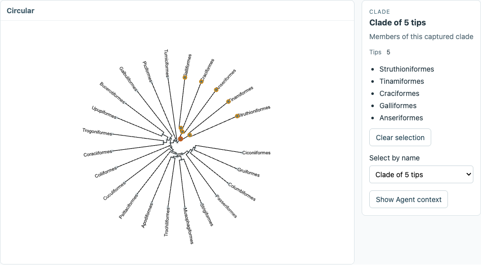
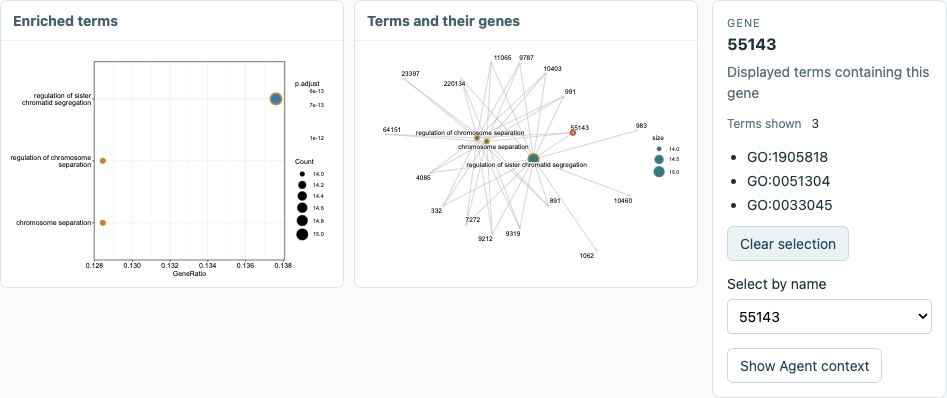

# Semantic figures: clades and linked enrichment

Date: 2026-11-07. Stage 1: two native workflows run inside Rho. This is a functional
episode, not independent researcher usability evidence or a general SVG converter.

## What ran

The optional [Semantic figures plugin](https://github.com/YuLab-SMU/Rho-plugins/tree/main/plugins/semantic-figures)
0.1.0 supplies its own operations, Skill and HTML view through Rho's existing
[independent plugin channel](THIRD-PARTY-PLUGINS.md). Its `adapters/ggtree.R` and
`adapters/enrichplot.R` retain domain identities; `capture.R`, `host.mjs` and the
view share rendering, snapshot reading and conditional selection. Plot families
add no application routing branches, base dependencies or Core behavior.

The package was packed with `npm pack --ignore-scripts` and installed into an
owned, disposable Rho service. Capture used the project's shared local R session.
No existing user service, R session or project was changed.

| Input | Native output | Observed selection |
| --- | --- | --- |
| `ape::bird.orders`, 23 bird orders | ggtree rectangular and circular layouts; 45 point bindings each | One five-tip clade retains exactly the same members across layouts and reopening |
| `DOSE::geneList`, positive values greater than 2; declared background of all named genes | clusterProfiler GO BP enrichment with 156 visible terms; enrichplot shows the first three, with 17 genes and 20 network nodes | A term selects its 14 contributing genes; shared gene 55143 links back to all three displayed terms |

The enrichment is a demonstration, not a new biological finding. The recipe uses
ENTREZID, GO BP, gene sets of size 10–100, BH adjustment, p-value cutoff 0.05 and
q-value cutoff 0.2. The source `enrichResult`, source bytes, analysis conditions,
package versions and ordinary result table are retained. The
[preparation script](https://github.com/YuLab-SMU/Rho-plugins/blob/main/examples/semantic-figures/prepare.R)
keeps these dataset choices outside the reusable plugin.





These are captures of the plugin's actual view inside Rho, excluding the package
management controls. They are not a separate mockup.

## Iterations and causes

The first native probe produced both families. The first composed capture failed
because the adapter inferred its source directory from an R stack frame that was
different inside Notebook. The plugin now passes its installed adapter directory
explicitly. The original failed cell was retained; a deliberate new capture ran.

The first browser run selected a clade and retained its membership across layout
changes, but its SVG cleaner had removed svglite's default stylesheet. Tree lines
disappeared, and a decoration rectangle intercepted dotplot clicks. The view now
retains bounded native styles without external loads and gives pointer events only
to explicitly bound marks. Neither role nor identity is guessed from pixels. Tree
label space was increased after the first view clipped tip names.

The next run passed both selection directions. The episode initially expected a
stale native selection call to have a `failed` extension receipt. API 1 reports
worker errors as `unknown`, even for this explicit pre-write refusal. The check
now preserves that receipt state, checks the conflict message and independently
reads the unchanged selection. Harness retries also toggled an already-open
capture form closed. Child visibility proved unreliable during a viewport
transition; the check now reads the details element's open state after settling.

Final review found that a selection reply arriving after a figure switch could
change the new view's local selection. Replies now stay with their requesting
figure; a browser check holds the real reply while switching figures. Native
capture also restores the shared R random state, including an originally absent
seed, so the network layout's seed does not affect subsequent analysis.

Concurrent unrelated plugin-interface edits appeared in the Rho working checkout.
The final composition was therefore rebuilt from clean Rho source
`e2345c599d6f7a6aca543efe64dae112aae1edd2` in a detached verification checkout,
with base Plugins source `b451e8df8361bc0ff95e9b037c22b10cb754587d` and the explicitly
installed new plugin. Exploratory shell-layout edits were not delivered as part
of this episode; the concurrent work was preserved. No application runtime change
is required to install or use this plugin.

## Verification

The [retained machine record](semantic-figures/acceptance.json) identifies the
installed package digest, source and figure digests, native versions, checks and
viewport observations. Local private service state and full-page screenshots stay
under ignored `work/semantic-figures/`; public captures contain package example data.

- Clean verification-checkout `npm run build`: passed. Existing bundle-size,
  browser externalization and mixed-import warnings remained.
- Owner `node --test test/semantic-figures.test.mjs`: 5/5 passed, covering captured
  source identity, conditional writes, concurrent selection, containment and
  source limits, and preservation of the original submitted cell.
- `node scripts/semantic-figures-episode.mjs`: passed using real R and Chrome.
  It checks tree selection/layout change, reopening, term-to-gene and keyboard
  gene-to-term linkage, the Agent-readable selection response, a stale write,
  a delayed reply after switching figures, R random-state restoration, invalid
  R-object input followed by corrected capture, and changed-source notice.
- The view was exercised at 1440, 1024, 768 and 390 CSS px. Its body did not
  overflow horizontally. Screenshots were read, including settled captures after
  viewport transitions; a separate retained-figure read started no R cell.

Native versions included R 4.5.2, ggtree 4.0.1, ape 5.8.1, ggplot2 4.0.3.9000,
enrichplot 1.30.4 and clusterProfiler 4.18.4. The last was installed in a private
episode library and reports that its binary was built under R 4.5.3. ggtree also
emitted four `subgroup` column warnings per capture; these remain in the record.

To repeat from a built Rho checkout, with the component checkout beside it:

```sh
RHO_FIGURE_R_LIBRARY=/absolute/existing/R-library \
  node scripts/semantic-figures-episode.mjs
```

The variable is optional if prerequisites are already installed. An existing
prepared episode project can be reused with `RHO_FIGURE_INPUT` to avoid refitting.
`RHO_FIGURE_EPISODE` selects a fresh output directory. `--keep` keeps the owned
trial service open until interrupted. The default closes only its own service and
browser and retains output files. No npm or application release is performed.

## What the screens show, and what remains

The circular tree and its five-member list can be read together; the selection
survives layout changes without recomputing the tree. The enrichment inspector
names the selected term, adjusted p-value, ratio and contributing genes. The
reverse selection identifies exactly which displayed terms contain a gene.

The host currently places independent views under Plugins, below management
information, inside a scrolling frame. The 1440 px view gives each enrichment
plot about 342 px, so native labels are small; at narrower widths the inspector
and plots stack and require scrolling. These are concrete composition/readability
limitations, despite passing interaction assertions. Studio placement and a
better use of plot space remain follow-up work; no usability claim is made.

Bindings currently cover point handles only: tree clade nodes, enrichment term
points and network nodes. Network edges and text are not independently selectable.
The tree adapter accepts `phylo`; the enrichment adapter accepts ORA
`enrichResult`. Existing decorated ggtree objects, GSEA, compareCluster, remote
capture and ComplexHeatmap are not supported by this first package.

Selection context is available through the plugin's ordinary operations. No model
was asked to interpret it, and it is not automatically inserted into Agent-panel
messages. A layout change retains one snapshot; topology or result changes create
a new capture. Automatic semantic migration, layered claims and persistent
explanations are not yet implemented. Resource limits and exceeded-limit behavior
are documented by the component owner.
