# Simulated analysis projects

On 2026-10-29, Rho was started from source and two disposable projects built from
rho-bio-eval capsules, bix-18 and bix-41, were run through it, giving the screens real
content to review. Each project held only its capsule's data and a questions file.
Notebooks and gold answers were left out. Question text stayed outside every
repository, so this record names capsules and question ids only. The bix-41 q3 basis
stated its ratio rule, and the strain identifier was to be read as text.

## The run

The service ran from `dist/cli.js` with a disposable root and state under `/tmp`, the
debug Core binary and the system Rscript. A headless Chrome on the same loopback page
took the screenshots. Projects were registered with `project.open`. Clicking Open
folder from the headless browser once opened the native folder dialog on the
person's screen, and the folder the person chose there was left alone. Conversations
were started from the Agent panel with Claude Code. The person answered every native
permission request; the scripts only watched.

- **bix-18:** the first conversation failed because the default model was not
  available from the configured provider. The person chose another model, and a new
  conversation finished in 53 s.
- **bix-41:** the conversation finished in 12 min with 110 steps and no permission
  requests.

Both answered every question in agreement with the capsule's gold answers (compared
outside the repository). The screenshots also stay outside the repository, because
they show question text.

## What the screens showed

1. Studio opened every file the Agent named. At nine views, the newest one, the
   answers file, showed "This layout has reached its view limit".
2. The answer, and the method it used, appeared only in the Agent panel. Overview
   showed counts, the timeline and figures.
3. With 110 steps, the Graph became a tall column of near-identical "`analysis.py` ·
   Captured 3×" cards, and the question and results were off screen. In bix-18,
   repeated "captured observation" labels covered the cards.
4. Review refused row questions on the result CSV ("Rows have no key") even though one
   column was a unique identifier. Its page used native selects and different margins.
5. In the panel:
   - Wide tables were cut off.
   - An empty "no recorded action" block always showed.
   - A failure was shown twice, with the provider name masked in only one copy.
6. Labels and naming:
   - Legend labels were truncated.
   - Files titled kept results by their SHA-256.
   - Two projects shared the same rail initials.
   - The model chip read "Model".
   - `inventory.json` was listed under Data.
   - Each conversation was titled from its first words.
   - The address bar always read `/`.
7. After a service restart, a folder the person had chosen in the system dialog was
   gone from their project list.

## Changes

- **Studio** (`web/shell/workspace.tsx`): the views on screen always render, then the
  most recently shown, then the rest in layout order, up to the eight-view budget. A
  hidden view past the budget unmounts and mounts again from its owner, which keeps
  its buffer and undo but not its scroll or selection. The U2 browser acceptance now
  opens nine views, expects no limit page and at most eight editors.
- **Overview:**
  - It leads with the latest answer: the newest finished conversation's question and
    last answer, its time, duration and model, and Open conversation.
  - The results list names a kept version by the project file it was taken from.
- **Graph** (`foldVersions` in `src/work-graph.ts`):
  - One message draws one card per file, holding every captured version.
  - When a message runs three or more commands that touched no project file, they fold
    into one "N other commands" card listing each command with its ending, duration
    and output.
  - Lane names that repeat carry their start time.
  - The legend wraps at narrow widths and reads "Versions kept".
- **Agent panel:**
  - A failure the Agent's last words already state is shown once (masked URLs
    included).
  - The empty Agent column is hidden.
  - Tables scroll sideways with edge shadows and keep numbers whole.
- **Agent page:** conversation details stack below 820 px.
- **Review** (Annotations 0.5.2):
  - The person's questions and the kept results are choices, newest version of each
    result first with a count of earlier ones.
  - Any other exact version stays selectable.
  - The page uses the project pages' width and margins.
- **Rail:** where initials collide, a project is marked by the part of its name that
  differs ("18", "41").
- **Settings chip:** it reads "Default model" until a model is chosen.
- **Server:** the local person's chosen folders survive a restart. Each carried grant
  still names one registered, natively selected project, and a paired tab does not
  see it. The new browser test fails on the earlier code.
- **Local tab identity** (`web/main.tsx`): rerunning the U2 browser acceptance for the
  Studio change stopped before its budget check, as a run from 2026-10-28 already had.
  The person's own edit was labeled "Another tab". Since local access replaced links
  on 2026-10-25, a tab on this machine had not named its principal. It now names
  `browser:local`, so the person's own changes read "You" and keep the own-undo hint.

## Verification

The same projects were reopened after the changes:

- Studio showed the answers file.
- Overview showed the latest answer with its numbers and method, and the legend read
  whole.
- The bix-41 Graph read 1 question · 9 files · 18 runs, with one "13 other commands"
  card.
- The panel showed the failure once, and tables kept their numbers intact.
- Review showed its choices.
- Files showed original names, and the rail read 18 and 41.
- At 390 px no page scrolled horizontally.

Owner and application suites passed as recorded in the [ledger](VERIFICATION.json).
The U2 browser acceptance passed, including nine views with at most eight editors
(`work/u2-ui-closeout/browser-1793285040156/`), and so did the review-evidence
acceptance after its chooser step moved to the new choices.

## Left open

- Row questions on an ordinary CSV need an identity choice: the person declares a key
  column (a capture with an explicit key), or a row is anchored by position within
  one exact version.
- Pages have no addresses of their own.
- `inventory.json` stays under Data, which is its kind by file name.
- The provider name is masked in errors but not in the Agent's own text.
- Conversation titles are still taken from their first words.
- A grant lost before the server change has to be reopened once.
- No independent researcher has used these screens.

## Second pass

On 2026-10-30 the person looked at the changed screens and named what was still wrong.
A separate Review page was not where a researcher or an Agent would go to question an
answer. The Overview set things side by side without saying how they related. Commands
the Agent ran had no place of their own, and a person had nowhere to run a step
themselves. They suggested a Console plugin and asked whether the screens needed a
layout grammar. The design agreed on was:

- The answer is the page. A board derived from the Graph shows one message's answer
  with its results, the method, the run, its inputs and its report, each in a role.
- Questions and decisions happen on the answer. A person asks about a result or a
  passage in place, which sends a message to the same conversation. The person's
  word is bound to the versions the message kept.
- A Console records every command, the Agent's and the person's. The person can run
  a step, stop it and run it again.
- Studio is the person's own arrangement. Following the Agent happens on the board.

A grammar for arbitrary layouts was not built. The board's roles are the one
arrangement the runs so far called for.

### Changes

- **Console 0.1.0** (Rho-plugins `plugins/console`): `console.run/list/output/stop`
  keep each command's change identity, who ran it, folder, pid, ending and
  head-and-tail output under `.rho/plugins/console/`. Stop reaches the command's whole
  process group. After a restart, a live command is `continuing` and a vanished one
  `unknown`. Rho admits `console.run` and `console.stop` from the local browser only;
  Agent grants may read the record
  ([Headless](HEADLESS.md#decisions-on-an-answer-and-the-console)).
- **Console page** (`web/console.tsx`): newest first, each message's commands sit under
  it, with the person's own between them and managed runs last. A command shows its
  ending, duration, output and the files that changed while it ran. Run again puts an
  Agent's command into the prompt to check.
- **Agent 0.4.19:** a command's whole text is kept, up to 8 KiB. Before, an inline
  Python here-document was recorded as its first line and could not be read or run
  again. Older records still have only that line, and say so instead of offering Run
  again.
- **Answer board** (`src/answer-board.ts`, `web/answer-board.tsx`), which leads the
  Overview: the figure or table the answer names leads, and the other results sit
  beside or below it. The method, the run, a count of other commands (opening the
  Console), inputs and report follow. Ask on a result, or Ask about this on a selected
  passage, sends a question that names what it is about, including the exact kept
  version. Later questions that made no results stay with the answer under Asked
  since.
- **Decisions** (`conversation.decide`): Use this answer, or Needs changes with a note
  that is also sent to the Agent. Each decision is bound to the versions the message
  kept, names results it does not cover and files changed since, and supersedes
  without deleting. Review is listed only while a project has review records.
- **Capture** (`src/conversations.ts`): a file seen again with the same bytes, a key
  already tried, or a file with a capture still pending no longer spends the message's
  budget. The final collection at turn end does not count against the attempt limit.
- **Graph:** a question asked in place is titled by its question. A `captured
  observation` line is dropped where another line of the message already reaches the
  file; the redundant lines had made ← jump to the question.
- **Studio:** nothing opens there by itself. A message sent from Studio leaves the
  person there, and Follow goes to the board.

### What the runs showed

**Asking in place.** On the earlier bix-41 project, Ask on `figure.png` sent a
question about the kept version. Claude Code answered from `analysis.py`, citing its
lines. The board then showed that answer in place of the original one, since the
newest message had led it. Later questions that make no results now follow the answer
they ask about.

**Results with no kept version.** The first bix-41 message had filled its 64-record
capture budget and counted 2,024 omitted captures. Repeated reads of the same
unchanged script and data had each spent an attempt, so several results kept no
version. A decision on it therefore read "Not covered" for those results. The capture
change and its test (`test/answer-decisions.test.mjs`) address the cause.

**Commands.** The Console listed the old run's commands under their message. An inline
script showed only its first line, which led to the Agent 0.4.19 change. The person's
own commands streamed output, ended with their exit code, stopped, and ran again. At
390 px nothing scrolled sideways.

**Interface faults**, both fixed: a board card turned green on hover, because its role
class collided with the global `.primary` button style, and a hook placed after an
early return caused React error #310.

**A fresh run.** A new disposable copy of bix-41 (data and questions file only) was
given the same message from the Overview. Claude Code answered in 11 min with 39 steps
and 19 commands, and asked for no permissions. Its capture record held 23 versions
with no omissions. All six results were kept (the figure in four versions,
`answers.md` in two, the others once), as was `figure.pdf`. The board led with the
figure, then the three tables and `answers.json`. Below them came the script's
outline, `python3 -I analysis.py` with the seven files it changed, 18 other commands,
the data and questions it read, and `answers.md`.

**Faults seen in the fresh run:**

- The model's provider broke off once mid-response. The Agent's text then read as an
  API error, and the board showed it as the answer while the message ran.
- The model's next call had truncated input, and Claude Code refused it
  (`tool_use_error`). The Console and Graph had counted that refusal as a failed
  command titled "Terminal". A refusal Claude Code answers this way, with no exit
  code, is now a refused step: it is marked on the timeline and drawn as no run.
- While the message ran, the board's header read "Working · … · Working", and Work
  progress repeated the board above it. The header now names the step ("Running
  python3 analysis.py"). Work progress lists only sessions the board does not show,
  and choices waiting in it.
- The answer's four numbered items each rendered as "1.", because blank lines
  separated them. A list now continues across blank lines and keeps its first number.
- `answers.json` was an empty card; a text result now shows its first lines.
- The Graph still drew a captured-observation line beside each read line, since a
  read runs from the file to the question. A capture line now goes whenever another
  line of the message touches the file.

**Deciding and asking on the fresh answer.** Use this answer recorded "for the 10 file
versions this message kept", with nothing reported as not covered. The answer ended
by naming its own two judgment calls: what counted as "equivalent", and the distance
used for "most similar". That sentence was selected and asked about in place. The
header named the question being answered, but cut it off mid-phrase with no ellipsis,
which was corrected. Claude Code answered in 2 min without running anything: with a
prespecified margin, the count in the first answer would drop from six to none. The
reply stayed under Asked since, below the answer it asks about, with the passage it
quoted on its own line. The decision recorded before stayed as it was.

### Verification

On the fresh project after these changes:

- The board showed the results with `answers.json`'s first lines, and the follow-up
  under the answer.
- The Console listed the 18 commands that ran; the refused call was no longer among
  them.
- The Graph drew no captured-observation lines and read 2 questions · 10 files · 18
  runs.
- At 390 px neither the Overview nor the Graph scrolled sideways, and no page errors
  were logged.

Suites and acceptances are recorded in Status and the [ledger](VERIFICATION.json).

### Left open

- **Agent-declared choices** were agreed (the Agent declares its choices, and the
  person answers Agree or No on the board) but not built. In the fresh run the Agent
  stated its two judgment calls in one sentence of its answer and in `answers.md`. It
  did not declare them through Rho: a Rho-started session can reach Rho, but nothing
  asked it to. Asking about that sentence in place showed that one of the calls
  decides an answer. Building it needs a public declaration (or a kind of task-map
  item), wording that asks the Agent to use it, and a per-choice record that holds,
  like `conversation.decide`, for the versions the message kept. That choice is the
  person's.
- **A layout grammar:** the board is one arrangement derived from roles. Whether other
  answers need the Agent to compose their own arrangement is not yet observed.
- Row questions on an ordinary CSV still need an identity choice, and pages still have
  no addresses.
- An Agent's interim text (such as a provider error mid-response) shows as the answer
  while the message runs.
- No independent researcher has used these screens.

## Process Studio

After the second pass the person said Studio should not be cut back to the person's
own arrangement. Studio is where a person sees, in one space, how the Agent got the
work done; the Overview and the Console stay as focused views. The actions, outputs
and commands need their own components and a layout that holds that much. The steps
of the work belong in a small aid generated as the Agent works. Time belongs down the
side, beside the conversation, so that a replay plays the two together. They framed
it as a layout grammar and content question as much as a visual one, and chose one
Studio per conversation started in Rho.

### Changes

- **One Studio per conversation** (`web/studio-process.tsx`): a tab for each of the
  newest conversations, ahead of the person's own workspaces. The layout is derived
  from the conversation's record until the person arranges it. It is then saved as
  `conversation-<id>`: later files join their role's place and files the person closed
  stay closed (`studioMerge`, by the time the layout was last saved).
- **Layout by role** (`src/studio-layout.ts`): each file takes the role the answer
  board gives it, from the whole record. Inputs, the code and a Commands view stack on
  one side; figures sit above the tables and reports on the other. Each role has one
  place and a limit (`studioLimits`); further files stay in Files. A role first
  appears when the work first had such a file.
- **Versions in place** (`web/shell/process-views.tsx`): a file's view names the kept
  version it shows, with earlier and later. A view's properties hold only its
  declared title, so the file is found again from the view's id.
- **Commands** (`CommandPane` in `web/console.tsx`): the conversation's commands
  oldest first, as a terminal reads, with the files each changed and the person's own
  commands and prompt below.
- **Parts of the work** (`src/studio-chapters.ts`): a chip in the Studio bar names the
  part in progress, in the Agent's own words between steps or by what the steps did,
  with rounds of editing and running. Provider error notices open no part.
- **Time beside the conversation:** a timeline down the stage's right edge, long
  pauses folded. Choosing a moment there, a part or another version cuts the record
  at that second (`src/replay.ts`). The views, commands, part and the conversation in
  the Agent panel all show it; a text file shows the version kept then, read only.
  At phone width the timeline is a row with play, the moment and steps.
- **Following:** Follow and the topbar chip open the running conversation's Studio,
  which brings forward the file the Agent is on, or Commands while it runs one.
  Sending from the person's own workspace leaves them there.

### What the runs showed

**The recorded bix-41 run, replayed.** The second pass's fresh project (two messages,
10 kept versions of the script, 4 of the figure) was opened in its Studio. The first
screen had no script and no question file: text views arrive after the editor's
document opens, and the live layout took a new arrangement only when its saved
version changed. A derived layout is now taken as given each time. Stepping to the
moment the script was written showed "no version kept" beside "Wrote analysis.py":
the write and its kept version fell 76 ms apart in the same displayed second, so a
moment now holds its whole second. In that second the Agent also announced its next
command, which won the step and kept the script behind Commands; a file written in
the same second now comes forward. In the canvas acceptance's controlled run, the
steps chip named a part by what it went on to do ("Edited analysis.R") while the
conversation beside it had only read the data; it now names the part from the steps
taken by then.

**Saying only what the record holds.** During replay every command read "changed no
project file". The record keeps each file's last change, so a run whose output was
rewritten later has no change of its own. The fold now says "with no recorded file
change", in the Console too. A command with no reported exit code had shown as a red
"Finished"; only a failure or a non-zero exit is marked now.

**Arranging.** Closing a view failed: the catalog accepts only a `title` property, and
the views carried their path and role. The file is now found from the view's id;
closing a view saved `conversation-<id>`, and after a reload the closed view stayed
closed and the rest kept their places.

**A live run, watched from its Studio.** A fresh copy of the bix-41 inputs was
answered by Claude Code (DeepSeek V4.1 Flash) in 13 min, with no permission
requests. The message was started from Studio and Follow opened its Studio. The data
and question file appeared as inputs, then the script, then the results beside them,
and the Agent's marker moved between Read, Wrote, Edited and Running. The script was
kept 26 times and the figure twice. The chip named 16 parts in the Agent's own words,
and a failed run showed as a red mark on the timeline. No page errors were logged.
Between two updates the results tabs swapped places while nothing about those files
had changed: a role's files had followed the board's order of the moment. They now
keep the order the work first had them, after the result an answer led with. The
long command in the topbar chip clipped the breadcrumb on both sides; crumbs now
shorten at their end before the page name. Replayed afterwards at 04:43:42, the
conversation showed the Agent 1:50 in, running a SciPy check, and Commands showed
that command still running. The Agent named one analysis choice in its answer rather
than declaring it, as in the second pass.

### Verification

- `test/studio-process.test.mjs`: the cut at a moment, the parts, roles and order from
  the whole record, the layout, and a saved arrangement merged with later files.
- `acceptance:agent-canvas` now checks that Follow opens the conversation's Studio with
  its data, script, commands, output, parts and timeline. It also checks that a moment
  chosen on the timeline shows the views and the conversation as they were then. The
  sources, graph, agent-page, agent-ui, review and ui:u2 acceptances passed unchanged.
- At 390 px the conversation's Studio shows one view at a time, with play, the moment
  and its steps in a row; nothing scrolled sideways.

### Left open

- No independent person has watched a run or a replay in Studio.
- A command is credited only with files whose last change fell while it ran.
- Studio reads a conversation's newest 8 messages (`processLimits.turns`); earlier
  ones are not in its layout or timeline.
- A replayed text file is shown as plain read-only text, without the editor's
  highlighting. At 900 px the inputs' place leaves a table few rows.
- A saved conversation Studio counts toward the project's 32 layouts and cannot yet be
  removed.
- Agent-declared choices, row identity on an ordinary CSV and page addresses remain
  as recorded in the second pass.

## Project notes

After the process Studio the person asked for the notes to be organized: a project
has several sessions and several Studio layouts, so Studio should list the sessions
under it with fitting titles, and the whole project should share one set of notes, a
special component. Their sketch put a notes column with Question, Data & method, Key
results (with a figure) and To do beside the code, commands, figure, table, timeline and
Agent panel. They chose one section per session in a shared file, titled by the
Agent's heading there, read formatted with tickable to-dos and a toolbar that writes
the Markdown.

### Changes

- **Sessions under Studio** (`web/project.tsx`): the sidebar lists each session
  started in Rho under Studio, newest first (eight, then All sessions), then the
  person's workspaces. The Studio bar names the one shown, with its steps, Follow,
  Notes and Arrange views; the tabs across the bar are gone.
- **One set of notes** (`src/project-notes.ts`, `web/project-notes.tsx`):
  `project-notes.md` at the project root, an ordinary file every session reads and
  edits with its own tools. Rho appends to a session's Agent instructions that it keep
  one section there: a level-2 heading naming its task, `<!-- rho:session <id> -->` on
  the next line, then Question, Data & method, Key results with a figure and To do as
  a task list, changing only its own section (Agent 0.4.20 passes them as ACP
  `systemPrompt`, append, on session/new and session/load). A session's title is its
  heading there, else the Agent's title, else its first message.
- **The notes panel**: one view of the file's shared buffer beside any Studio layout,
  opened at the shown session's section and hidden or shown from the bar (remembered
  in this browser; hidden at first below 768 px, where it replaces the stage).
  Markdown 0.2.0 ticks a to-do by editing its line through the buffer, hides
  comment-only lines and gives its editor bold, italic, two heading levels, lists and
  to-dos (Documents 0.4.8 hands it the editor). The person's edits are saved after a
  1.5 s pause with the buffer's write conditions; the editor's own Save and highlight
  controls stay out of the column.

### What the runs showed

**The recorded bix-41 run with notes.** A notes file was written by hand into the
third copy, with a section for its conversation and one of the person's own with no
marker. The session's row under Studio, the Studio bar and the breadcrumb took the
section's heading in place of the conversation's first-message title, and the panel
opened with that heading marked. Three defects showed and were fixed. The to-do boxes sat centred
on lines of their own: Rho's form styles make a `label` a column. After a blank line
the list turned loose (`<li>
<label>`), so the reader's fix now matches any label in
a to-do. The steps chip overlapped the Notes button, because its slot had no width of
its own; the date left the bar and the buttons drop their names when the Studio is
narrow. In Edit the editor's Save and highlight controls covered the panel's title, and
the Read button disappeared: the reader had stopped rendering its own modes in Edit,
so a workspace pane could not return to Read either. A ticked box and a typed line
each reached the file about 1.5 s later and the panel said Saved; hiding, showing and
760 px behaved. A project with no notes showed the hint and wrote no file.

**A live session keeping its section.** A fourth copy of the bix-41 inputs (the question
file and the data only) was answered from Studio by Claude Code (DeepSeek V4.1 Flash)
in 5.6 min, with no permission requests and no page errors. Near the end the Agent
created `project-notes.md` with its own tools, in the asked shape: a level-2 heading
naming the task, its session marker on the next line, then Question, Data & method (the
data file, the tests and the script), Key results with the figure embedded, and To do
with every item ticked. About 6 s later, while the turn was still running, the sidebar
row, the Studio bar and the breadcrumb took that heading, and the panel showed the
section with its figure. The Agent's answer pointed to the notes. The same screen had
the notes twice: as an output the Agent wrote, the file took a place among the results.
The project notes now take no place in a conversation's Studio. A long title squeezed
the steps chip to two letters; the chip now keeps its width and the title shortens. A
wrapped to-do continued under its box; to-dos now hang under their text.

**Opening a project.** The U2 acceptance then failed on its 200-row table blocks. Two
3-row reads of the same table came from the Overview's result cards before the
workspace opened. With this pass's views but the notes hook disabled it passed, as it
did with the previous views. Opening `project-notes.md` as every project opened had
added a round trip that kept the Overview on screen a little longer. The notes are now
opened only when the project has sessions started in Rho or the panel is shown, and
the unchanged acceptance passes. The same run showed that notes open on a wide window
took the whole page when it narrowed, so the views disappeared without the person
doing anything. A window that narrows now closes the notes without changing the wide
window's choice; at phone width they open only when asked.

### Verification

- `test/project-notes.test.mjs`: sections and markers outside code, a duplicate, late
  or fenced marker, the title and byte limits, and instructions that name the file and
  marker and carry nothing of the person's question.
- `test/studio-process.test.mjs`: a session's project notes take no place in its Studio
  (the test fails without the change).
- Plugins: Agent instructions appended on session/new and session/load; Markdown to-do
  source lines, comment-only lines, ticking and the formatting edits.
- `acceptance:agent-canvas` checks the conversation's row under Studio and the Studio
  title; `acceptance:sources` uses Edit and returns with Read.
- Browser checks on disposable copies: ticking and typing reached the file and said
  Saved; the toolbar wrote to-dos; hide, show, 760 px and a project with no notes.

### Left open

- No independent person has used the notes or the session list.
- In a project without sessions, leaving Studio within the pause keeps the person's
  edit in the buffer, unsaved, until the notes are next shown.
- An Agent writing its section while the person has unsaved notes edits was not
  observed. Documents merges a file change into unsaved text when the lines differ;
  otherwise the save fails on its disk condition and the panel says Not saved.
- Sessions cannot be renamed from Rho; the title follows the heading in the file.
- The sketch's dark terminal, labelled figure versions, compare button and file cards
  in the Agent panel were not built.

## Meaning layer

The person then asked for the semantics of the work: artifacts had almost no natural
language description, and the Graph had only actions. They chose the project notes as
the source, with provenance; a Graph that shows the meaning by default, can be followed
into the process and can show either layer alone; descriptions written by the model while
the work goes on; and the Agent's choices folded into choice nodes. A choice must not make
the person choose: the results are prepared so the person sees what each option gives.

### Changes

- **The notes as statements** (`src/notes-meaning.ts`): each session's section is read
  by subsection into its question, data and method, findings, figures, choices with the
  options not taken, file descriptions and to-dos, each with the project files it links
  (Markdown links, or a path in inline code). A file is described by its Files entry,
  else a figure's description, else the data and method statement that names it first.
- **Provenance**: the kept versions of `project-notes.md` in the Agent's record are read
  oldest first (`meaningLimits`); a statement was written by the message whose version
  first holds its lines, and each file it names is the version kept then. A newer kept
  version, or a later write on disk, is named as such; a statement in no kept version
  is said to be outside the record.
- **Layers** (`src/meaning-graph.ts`, `web/graph.tsx`): one row per section, from the
  question to findings and choices, the files they rest on, and how those came about
  (made by, reads), taken from the process record with its basis. Meaning + process
  draws the meaning rows above the message rows with "kept as" and "written in" edges
  between them; Meaning or Process shows one. A card says who wrote it and when.
  Following a statement or file into the process selects and centres the kept version
  or the message.
- **Descriptions where files are shown**: the answer board's results and method, and
  each file view in a conversation's Studio, carry what the notes say the file holds.
- **Choices without a decision asked for** (`web/choices.tsx`): the option in use beside
  the others, each with what it gives and the files that show it, on the answer board
  and in the Graph. Use this instead drafts a message to the same conversation for the
  person to edit and send. No badge, waiting state or decision record is added.
- **The session instructions** now ask for fixed English subsection headings, links on
  every file mentioned, a finding per bullet linking its results, a Files entry when a
  file is first written, and each choice with a reasonable alternative recorded with
  what both options give, computing the alternative when cheap, without asking the
  person or waiting.

### What the runs showed

**The fourth copy's notes, read as meaning.** Its section predates the new instructions:
its findings named no files, and its figure followed them after a blank line. The layer
drew the question, four findings, the figure by its description and the script, the
last taken from the process record. The first reading attached the figure to the last
finding; a figure now shows a finding only on the line right after it. A paragraph naming
the data and the script had described both; a statement now describes only the first file
it names. In Meaning only, the inspector offered no way into the process, because it
looked for the message among the nodes on screen; it now looks in the process record.
Following the figure into the process selected the kept version and its lineage.

**A fifth copy under the new instructions.** Claude Code (DeepSeek V4.1 Flash) answered in
5.7 min, with no permission requests and no page errors. Its section linked every file it
mentioned, gave each finding its result file, listed eight files with what each holds and
recorded four choices. For one it computed the alternative and linked that table. The
person sees both options on the answer board, and Use this instead drafts a message they
can send. The notes were written twice,
at 258 s and 290 s, after every result existed: the format was followed, the timing was
not. Two readings were corrected. Options and descriptions that wrap onto a second line
had lost that line, with an option's link to its table; wrapped lines now belong to the
bullet they continue. Every finding was marked as written before its file changed. The
Agent had edited the script and run it again 22 s after writing the findings, and the
record kept no version of that run's outputs. The mark is kept and now distinguishes a
newer kept version from a later write on disk; a capture of the same bytes is the same
version.

**A sixth copy, told to write the section first.** The instructions now ask for the
heading, question and method before any analysis, and for each file's entry before the
next command. The Agent answered in 10.0 min, with no permission requests and no page
errors. Its section appeared at 79 s, before any result, with the question, the data and
the script; that much followed. Everything else arrived together at 512 s, when seven
result files already existed: nine file entries, five findings each linking its table,
a figure, and three choices, each with an alternative and the table showing it. Two of
those alternatives were computed for the purpose. During the run the person saw a
question and a plan, not what each new file holds. Instructions alone did not make this
Agent describe its files as it wrote them.

Its notes linked the results folder itself, which had become a file card named
`results`; a link ending in `/` now names no file. Choice cards cut their fourth line in
half and now stop at three lines with an ellipsis, the full text staying in the inspector.
The inspector's file rows had shrunk a path to five letters beside its version note; the
note now sits below the path. The inspector headed a statement Found or Chose; it now
names the section the statement belongs to.

### Verification

- `test/notes-meaning.test.mjs` covers the parsing of each subsection, wrapped lines,
  file descriptions, links to folders and outside the project, the trace to kept
  versions with a newer kept version, a later write and a capture of the same bytes,
  and the meaning layer and its three graphs on a small process record.
- Rho 253/253 and the agent-canvas, sources, graph, agent-page, agent-ui, review and
  ui:u2 browser acceptances passed on the final build; no Plugins source changed, so
  Plugins 120/120 stands from the project notes pass.
- The fourth, fifth and sixth copies were read in a real browser in each layer, with a
  statement and a file followed into the process, and on the answer board with the
  descriptions, the choices and a drafted Use this instead message, which was not sent.
  No page errors.

### Left open

- **Descriptions during the run.** The person asked for the model to describe the work
  while it goes on. Two rounds of instructions moved the section to the start of the run
  but not the file entries, which came with the findings near the end. Facts read from
  each file as it appears, such as rows, columns or image size, or a separate model that
  describes each new file, had not been built; the person chose both, built in the
  [next pass](#descriptions-while-the-work-goes-on).
- **Choices are what the Agent declares.** A choice the Agent took without writing it
  down does not appear, and an alternative is shown only as far as the Agent computed and
  linked it. Rho does not check that an alternative's table shows what its sentence says.
- **No independent person** has used the layers or the choices; every reading here is mine.
- **Meaning only has no timeline**: the timeline replays process events, and a statement
  has no events of its own beyond when its version of the notes was kept.
- **Meaning + process is busy**: the meaning rows and the message rows share one canvas,
  with trace edges between them; on the sixth copy the default view showed a slice of
  each. Whether a person follows a trace there has not been observed.
- **Free-form notes**: text under other headings, or between a section's heading and its
  first subsection, is not read as meaning and is not drawn.

## Descriptions while the work goes on

The meaning layer left the person following a run with a question and a plan: the Agent
described its files only at the end. The person chose both remedies: facts read from
each file as soon as it is written, then one sentence from a model.

### Changes

- **Facts from the bytes** (`src/file-describer.ts`): a table's rows and columns with
  their names, an image's size, a PDF's pages, a JSON value's shape, a Markdown file's
  lines and first heading, a script's lines and functions. They are bound to the digest
  of the bytes read, the same digest Files gives a kept version.
- **While a message runs** (`Conversations`): the project is compared with the start every
  5 s, and each changed file that has rested 2 s is read. The facts are recorded with the
  message as `descriptions` in `conversation.read`. The notes file and known private
  locations are left out.
- **The sentence** (Agent 0.4.21 `describeFile`): the person's own Claude Code with every
  tool off, no MCP servers and no kept session, in an empty folder of Rho's state, using
  the conversation's model. It is given the path, the facts, the first lines and the
  person's request. A file is asked about at most once a minute while the message runs.
  A later version with the same facts keeps its sentence. Figures and PDFs keep their
  facts; a Codex session records facts only.
- **Where it shows**: above each file in a conversation's Studio, on the answer board and
  on the Graph's meaning cards. The notes' words lead, then the model's sentence followed
  by the model's name, then the facts in a muted line. The inspector says which it is.
  Results and figures join their conversation's meaning row as they appear, in a row of
  their own when the notes have no section yet. The Graph opens on that row's question.
- **The session instructions** ask the Agent to leave a subsection empty rather than
  write a placeholder.

### What the runs showed

**A seventh copy.** Claude Code (DeepSeek V4.1 Flash) answered in 6.3 min with no
permission requests. Its section appeared at 45 s with placeholder bullets under Key
results and Choices, which the Graph drew as a finding and a choice; the instructions
now ask for empty subsections instead. The script had its facts at 110 s and a sentence
3 s later. Nine results appeared between 140 and 150 s. Each had facts within 6 s of
being written and a sentence 10 s later (median), 18 s at most; the figure kept its
size and bytes. The full section arrived at 328 s, and from then the notes' words led.
The sentences stayed with what the columns and first lines show. One called a
circularity column "circumference": a model's misreading, shown with the model's name.

The live Graph opened on empty canvas, because it was fitted before the meaning row
existed. It now fits again whenever its layout changes until the person moves, zooms or
selects, and opens on the meaning row's question. The meaning layer had also drawn
`project-notes.md` as a file card; the notes are where the layer comes from, and the card
is gone. A model mark at 12 px read as a plus sign; the model's name follows the sentence
instead. Paging one result table failed with "CSV headers do not match the declared
columns": a later version with new columns had been declared with the earlier version's
columns. A version whose header differs is now declared from its own header. The version
kept before the fix cannot be paged; kept versions are immutable.

**An eighth copy.** The message failed after 11 min at Claude Code's 64-step limit
(`maxAgentTurns`), after it had written every result and its notes; nothing there came
from the descriptions. Of 15 files, 13 had a sentence and the two figures kept their
facts. Facts came within 4 s of each write. When nine files arrived at once, their
sentences followed one after another, the last 26 s after its facts. The model was
called 17 times, against 23 in the seventh copy. In Studio at five minutes, each table
showed its sentence and model above its rows, and the figure its size. With the notes
panel open, the Agent first tried to write the notes through Rho's document operations;
four calls were refused for a missing field before it wrote the file itself. A finding
whose bold ran across a code span kept its asterisks; bold across code is now removed.

**A project without notes.** The graph acceptance's project keeps no notes, and its
results now made a meaning row. Its question card read "Section" and "Not in the Agent's
record". A row with no section is now headed by the person's message, "Asked 15:42 · no
notes yet", and its inspector leads to that message. The acceptance first failed because
it read the process cards from the default layer; it now checks the meaning row's facts,
then chooses Process.

### Verification

- `test/file-describer.test.mjs` covers the facts of each kind and a message that writes
  a table and a figure. The table gets facts and a sentence while the message runs; the
  figure keeps facts, and the notes are left out. A rewrite with the same facts keeps the
  sentence without asking again. A description still being written when Rho stops reads
  back as unknown. `test/capture-columns.test.mjs` pages two versions of a table whose
  columns changed; it fails without the fix. The meaning tests cover described files in
  a row, the order of notes, sentence and facts, and a past moment.
- The Agent component's `test/agent-describe.test.mjs` checks the arguments (no tools, no
  MCP, no session), the bounded input, and a failure, an empty answer, unreadable output
  or a timeout, each reported once. Plugins 122/122.
- Rho 257/257, `check:contracts`, and the agent-canvas, sources, graph, agent-page,
  agent-ui, review and ui:u2 browser acceptances passed on the final build. The graph
  acceptance now also checks a project without notes in the meaning layer.
- The seventh and eighth copies were followed live in a real browser, with Studio
  screenshots every 20–25 s and the Graph and answer board read after each run.

### Left open

- **Figures and PDFs** are described by their facts only; no model that reads images has
  been chosen. Addressed in [the next pass](#figures-cost-and-a-switch).
- **Sentences are not checked.** One misread a column name. The model's name and the
  version it read are shown; nothing compares the sentence with the file.
- **Cost.** Each sentence spends the person's model budget, up to 24 calls per message; a
  probe call reported $0.013. The cost is kept with each sentence but not shown, and
  there is no switch to turn descriptions off other than the limits. Addressed in
  [the next pass](#figures-cost-and-a-switch).
- **Many quick rewrites** of one file are described again at most once a minute; the facts
  follow every check.
- **Step limit and document calls**: the eighth copy ran out of Claude Code steps, part of
  them spent on refused document calls for the notes.
- **No independent person** has followed a run with these descriptions.

## Figures, cost and a switch

The descriptions pass left figures with their facts, kept each call's cost without
showing it and had no way to turn describing off. The person asked for models.dev: a
model that reads images is shown the figure, any other is given the context that made
it; the cost is shown, and a switch turns describing off.

### Changes

- **models.dev** (Agent 0.4.22 `./models`): Rho keeps a compact copy of models.dev's
  catalog in its state folder and reads it again once a day. A session's model is
  matched by the provider it names, else its maker's own listing, else every listing.
  `westlakehpc/deepseek-v4.1-flash[1m]` is listed under neither its gateway nor its
  maker, so it matched 99 listings: most say it takes images, and their median price is
  used.
- **Image or context** (`Conversations`, `figureContext`): a PNG, JPEG, GIF or WebP
  figure goes to Claude Code as an image block when the model is listed as taking
  images. Otherwise, and for a PDF, the model is given the command that wrote the file,
  the lines of the scripts that command ran around where the file is named, and the
  Agent's last words before it. It is told it has not seen the figure. A model that
  refuses an image is given that context once, and the message's later figures are not
  sent as images.
- **Cost**: for this model Claude Code reports its cost basis as `unknown` and guesses a
  price, so each call is priced from its reported tokens at models.dev's price and
  marked estimated. A model Claude Code knows keeps Claude Code's figure. Each sentence
  keeps its cost and how it was priced; each message keeps `descriptionSpend`.
- **Where it shows**: the strip under the Agent panel adds "descriptions ≈$0.0086" beside
  the session's context and cost. Its popover holds the person's "Describe new files"
  switch, which applies to every conversation, and the spend with how it was priced.
  The Graph's inspector and a file line's hover text say how the model was given the
  file, why an image was not sent, and the call's cost. A card described from code says
  "from code".

### What the run showed

**A ninth copy.** Claude Code (DeepSeek V4.1 Flash) answered every question in 5.1 min
with no permission requests. Thirteen description calls cost about $0.0086 in all at
models.dev's median price, $0.0003 to $0.0012 each. The figure PNG (2885 × 2115 px,
312 KB) was rewritten twice and sent as an image each time; its first sentence came
19 s after its facts. That sentence called the mean ± SD panels "bubble charts". The
next two named the panels by letter, the log-scale area axis and "mean ± SD" as
labelled. The PDF of the same figure was described from `analysis.py` as "planned as a
multi-panel figure", as instructed for a figure not seen. Sentences on text files
stayed with their facts. The notes later described every file except the PDF, so the
Graph led with the notes' words and only the PDF's card read "Described by
deepseek-v4.1-flash from code".

In the first popover, the switch sat between the context and cost and the note "As
Claude Code reported them … Rho does not measure these", which then seemed to cover the
descriptions too. The switch now follows that note in its own section. One call's cost
read "≈<$0.001"; amounts under a cent now keep four decimals ("About $0.0006"). The
PDF's reason read "A model is shown PNG, JPEG, GIF or WebP images only"; new reasons say
"Only PNG, JPEG, GIF and WebP figures are sent as images." Turning the switch off in the
browser wrote `describe.enabled: false` to the agent settings and changed the text below
it to "No model is asked; each file shows the facts read from it"; turning it on wrote
`true`. The popover fits at 1440, 760 and 390 px.

### Verification

- The Agent component's `test/agent-describe.test.mjs` checks the stream-json arguments
  and image block, the context instructions, matching by provider, maker and median,
  each cost basis, and the catalog cache with its retry delay. Plugins 125/125.
- `test/file-describer.test.mjs` runs a message that writes a table and a figure. A model
  listed as taking images gets the figure as an image at an estimated cost. A model
  listed as text-only gets the command, the script's lines and the Agent's words, from
  `plot.py`. A model that refuses the image gets the context once, and that call counts
  as not priced. With the switch off no model is called. Each spend total is checked.
- Rho 258/258, `check:contracts`, and the agent-canvas, sources, graph, agent-page,
  agent-ui, review and ui:u2 browser acceptances passed on the final build.
- The ninth copy was followed live with Studio screenshots every 20 s. The popover was
  read at three widths and the switch turned off and on, and the Graph's inspector was
  read for the PDF.

### Left open

- **Sentences are not checked.** The first image sentence misnamed the plot type.
- **Prices are estimates.** The median of 99 listings may differ from what the gateway
  charges. The session's own cost is Claude Code's figure and is shown as reported,
  although for this model Claude Code may be guessing it too.
- **Image input is what models.dev lists**, not what the gateway was seen to accept. The
  fallback after a refused image is tested with a fake model only.
- **PDFs** are not rendered to an image.
- **Many quick rewrites** of one file are still described again at most once a minute.
- **No independent person** has followed a run with these descriptions.

## Quick checks, choices and the Console

The person asked for the two quick checks prepared in the rho-bio-eval repository to be
run in Rho: BixBench capsule bix-18 in Python and bix-51 in R. They then judged two
screens from these runs hard to follow: the answer board's Choices and the Console.

### The runs

rho-bio-eval's `make_quickcheck.py` wrote each project into the test service's folder
with only the data and `questions.md`; the gold stayed in that repository's ignored
`runs/` and `check_quickcheck.py` checked `answers.json` against it. Both ran on Claude
Code (DeepSeek V4.1 Flash) with no permission requests.

- **bix-18** finished in 49 s with 4 of 5 answers in range. bix-18-q5 was answered as a
  proportion, and its range is written as a percentage; the question does not say which.
  A second copy, run after the change below, took 70 s, gave the same 4 of 5 and named
  that reading among its choices. The checker was not changed.
- **bix-51** finished in 149 s with 7 of 7 in range. It worked in R throughout, left out
  the 41 blank spreadsheet rows, took the single-predictor model for bix-51-q5 and
  recorded the multivariable one as its alternative.
- **Descriptions** cost about $0.0012 (3 calls) and $0.0048 (9 calls). bix-51's figure went
  to the model as an image, and its sentence matched the figure's labels; another
  sentence miscounted the question ids in `answers.json`.

### What the screens showed

- **Choices.** bix-51 wrote each other option in the choice's own sentence ("…
  Alternative: …") rather than in a nested bullet, so all five choices read "The notes
  name no other option" under text that named one. `summary.glm`, a function written as
  code, was drawn as a file. Each choice was a tinted card marked In use. Beside an
  option, the shorter card left blank space, and the paths that ended a sentence
  repeated the file buttons under it.
- **Console.** The one command that changed files was lifted above the others, out of
  the order they ran, and the rest folded as "commands with no recorded file change",
  which is a fact about the record, not about the work. Rows were raw compound
  command lines with the project's absolute path, every one ended in a green "Exit 0",
  and Run again sat apart from the command it ran. Claude Code gives each command a
  short description, but the Agent component did not keep it.

### Changes

- **Notes reader** (`src/notes-meaning.ts`): an option written as "Alternative:",
  "Instead:" or "Otherwise:" after the choice's own sentence counts like a nested one.
  Code counts as a file only when it names a folder or has a file extension of an
  analysis.
- **Choices** (`web/choices.tsx`): one row per choice, divided by rules. What the choice
  is about (the words before "topic:" or "topic =") stands on the left. On the right is
  what was taken, with its files; each other option sits in a well below it, with what
  it gives, its files and Use this instead… beside it. Paths that end a sentence become
  its files. A choice with no other option is its row alone.
- **Agent 0.4.23** keeps a command's `purpose`, Claude Code's description of it.
- **Console** (`web/console.tsx`): a message's commands read in the order they ran. Each
  leads with its purpose over the command, with the project folder read as ".". A
  command without one is named by what each part runs, such as "grep → python3
  analysis.py → grep". Commands in a row that changed nothing fold into one line named by
  their purposes. Only an ending other than a clean exit is said, in red. The whole
  command, its output and Run again open under the row. Studio's command pane uses the
  same rows.

### Verification

- `test/notes-meaning.test.mjs` reads choices as the Agents wrote them, inline and
  nested, with function names in code. `test/conversation-presentation.test.mjs` names
  commands from these runs and reads them inside the project. The Agent's ACP test
  checks the purpose. Rho 260/260, Plugins 125/125, `check:contracts`, and the seven
  browser acceptances passed on the final build.
- Both screens were read at 1440, 760 and 390 px for the ninth copy, bix-51 and the
  second bix-18 copy, with rows opened, a draft from Use this instead… and a choice in
  the Graph's inspector. The design skill's inspector needs a page address, and these
  screens are reached by navigation only, so it was not run.

### Left open

- **bix-18-q5** depends on how its gold range is written; the checker is unchanged.
- **Older records** have no purpose and show the short form instead.
- **What a choice is about** is read from the Agent's "topic:" phrasing; a choice
  written otherwise shows its sentence across the row.
- **Studio's columns** stay narrow while the notes and the Agent panel are open, and the
  command pane is cramped there.
- **No independent person** has used the new screens.

## The Notebook

The person asked for interactive computing, as in RStudio, marimo or Jupyter, to be shown in
Rho. Of the forms offered they chose a live session the Agent and they share, with R and
Python together: the Agent and the person run code in the same resident session, and Rho
shows each cell, its output, its plots and the session's variables as they come.

### What was built

- **Notebook 0.1.0** (`@rho-workspace/plugin-kernel`) runs one R and one Python process per
  project. `kernel.run`, `kernel.read`, `kernel.plot`, `kernel.interrupt` and `kernel.stop`
  carry a cell's identity, order, output, plots and ending, and record a session's end
  honestly after a restart ([limits](HEADLESS.md#live-r-and-python-sessions-notebook)).
- **Rho** wires the operations: Agent grants receive all but `kernel.stop`, which only the
  person at this machine may call. It adds a Notebook page and tells sessions it starts
  to run exploratory code there and keep the code results rest on in scripts.

### The runs

Fresh copies of the two quick checks ran on Claude Code (DeepSeek V4.1 Flash) with no
permission requests; the watcher answered nothing.

- **The first bix-51 run was refused** before the Agent did anything: "Layered connection
  methods exceed the selected 64-method profile". The default business grant had exactly
  64 methods, and the four the Agent may use made 68. The
  [conversation episode](CONVERSATION-EPISODE.md) had left this limit open with three
  ways out. The smallest was taken: the limit is now `layeredGrantLimits.maxMethods`, 96,
  and a grant over it is still refused.
- **bix-51 (R)** then took 3 min with 7 of 7 answers in range. The Agent read the
  spreadsheet once with `python3 -c` before it found the session, wrote `analysis.R` and ran
  5 cells, each with a purpose ("Check R working directory and required packages", "Run
  the logistic regression analysis script", …); the last four ran `source("analysis.R")`,
  the later ones after edits to the script.
- **The person's cell.** From the Notebook, a cell plotting the data with the Agent's
  `fit_age` curve drew in the same session, from the Agent's values.
- **bix-18 (Python)** took 98 s with 4 of 5 in range, bix-18-q5 missing as before. Its
  first cell checked Python and its packages; the other three ran `analysis.py` with
  `exec`. The first of those failed because the script used `Path(__file__)`, which a
  session has no value for, and the Agent set `__file__` and ran it again.

### What the screens showed

- **Output did not stream in R.** A loop printing once a second showed nothing for its
  first 3 s: the `evaluate` package passes on a top-level expression's output when the
  expression ends. The R runner now evaluates expression by expression itself and prints
  to standard output, with each message, warning, error and plot answer following a
  numbered mark there; the host places the answer after that mark. Python already wrote
  each print as it came.
- **The four runs of one script** repeated the same 40-odd lines; output longer than 16 lines
  now shows its first 12 with Show all. The hint in the person's cell read `summary(d)`,
  a name the session did not have; it is now drawn from the session (`summary(dat)`). A
  data frame's summary repeated its size; it now lists its columns. Python listed `Path`
  and `sem`, imported names; imported classes and functions are left out.
- **The Agent's Studio** showed its script, Commands and results but not its cells. A
  Session view now sits beside Commands once the Agent runs a cell, scoped to the sessions
  it used and cut at the moment shown; with the notes and the Agent panel open it is too
  small to read more than the person's line.
- **Restart and stop.** A session alive when the test service restarted reads "R session
  ended · Rho closed". Stop asks first, and the list then says the session was stopped by
  you and that values from before are gone. Interrupt left "Interrupted by you" and the
  session's `i`.
- **Found in review, not on screen.** Every request naming a project waited in that
  project's one queue, so a run waiting for a long cell would have held the page's reads
  and the person's Interrupt until it ended; the cells here took 0.1 s. `kernel.*`
  requests now run beside the queue, and the plugin reads its record once and queues,
  interrupts and stops one request at a time, so a repeated request still names one cell.
- Two sessions read "its process ended (exit by a signal)": the runner processes were
  killed by a cleanup command run for the plugin test. Once, the service still held the
  previous host code while the new R runner was on disk, and the numbered marks showed as
  text in one cell.

### Verification

- `npm run test:notebook` runs the plugin's 7 tests (both languages: values that stay, output
  in order while a cell runs, plots, variables, identity, order, requests that arrive
  together, interrupt, stop, restart, limits and a missing program) and Rho's wiring test
  (who may run and stop, the shared session, the Agent grant, an interrupt while a run
  waits). The final suites, `check:contracts` and browser acceptances
  are in the Status ledger.
- The Notebook was read at 1440, 760 and 390 px with the Agent's cells, a person's R plot
  and Python cell, a stop, a streaming cell and an interrupt; the Studio's Session view at
  1440 px with and without the side panels.

### Left open

- **The Agent ran scripts, not cells.** It used the session to run its script again rather
  than to look at data step by step, and read the spreadsheet with Bash first.
- **Plots** follow a cell's printed output rather than the line that drew them, and a
  later cell cannot draw over an earlier cell's plot.
- **Python scripts** that use `__file__` need it set before they run in a session.
- **Studio's Session view** was cramped while the side panels were open; see
  [Exploring a finished answer](#exploring-a-finished-answer).
- **A cell's own memory and time** are not bounded.
- **No independent person** has used the Notebook.

## Exploring a finished answer

The person asked for the Notebook to sit beside Studio's other views as a component of its
own, for pages they make themselves, and for a way to look into the Agent's results in the
Notebook once it has finished. The disposable `nb-bix-51` project held the finished bix-51
answer: `analysis.R`, `model_fit.csv` (3 rows), `model_results.csv` (8 rows) and the Agent's
R cells.

### What was built

- **The Notebook is a Studio view** on any page. In a conversation's Studio it keeps that
  conversation's part of the sessions, now with the person's cells since the conversation
  began; on the person's own pages it shows the sessions whole. Its width, not the page,
  decides whether the sessions sit beside the cells (840 px or more).
- **New workspace** makes an empty page of the person's own. The empty page, and Add view
  on any of their pages, offer the Notebook and the project's files by kind.
- **Explore in R or Python** on table and script views, on the answer board's tables and on
  the file page. A table loads as a new value in a cell of the person's; a script waits in
  the Notebook's line ([what each does](FRONTEND.md)).

### What the screens showed

- **The table had no Explore.** A kept table's resource path is its copy under
  `.rho/plugins/restored/…`; the file it was kept from is in its provenance
  (`originalPath`). Explore now reads that project path, and says the file is read as it is
  on disk now.
- **Exploring inside the conversation's Studio was unreadable.** With the notes and the
  Agent panel open, the Notebook view there was about 170 px wide. Explore from a
  conversation's Studio now opens the person's workspace, as it does from the Overview; the
  conversation's Studio stays the record of the Agent's work.
- **Three panes on a 490 px stage** were each about 150 px wide. A stage narrower than
  640 px now shows the views one at a time with all their tabs. The conversation's Studio
  then showed `model_results.csv` at full width with Explore in its header.
- **The Notebook did not scroll.** Its pane clipped 6979 px of cells and showed the oldest.
  The view scrolls itself now and opens at the newest cell. Shown again after another tab,
  it went back to the top, and at 390 px it stopped 285 px short of the end: the browser
  moving the content was taken for the reader leaving the end. Only the reader's own wheel,
  touch, keys or scroll bar decide that now, and growth, resizing and showing again keep the
  newest cell in view. Measured: at the end at 1440, 760 and 390 px; a cell from another tab
  while the reader was 3000 px up left them there.
- **The narrow line to run** squeezed `source("analysis.R")` beside R, Python and Run; below
  420 px the code takes its own line.
- **Results.** From the board, Python loaded `model_fit` (3 × 6) beside the table on
  Workspace 2; from the conversation's Studio, R loaded `model_results` and, the second
  time, `model_results_2`, leaving the first. The script put `source("analysis.R")` in the
  line with a note that running it writes its outputs again. Workspace pages listed in the
  order they were made after they first showed 3, 2, 4.

### Verification

- `test/explore-code.test.mjs` runs the written code in R and in Python with pandas: a path
  with quotes and spaces, a TSV and a script that reads `__file__`. `test/layout-commands`
  covers placing a view beside another.
- The flows above were run in a real browser at 1440, 760 and 390 px; the screenshots were
  read.

### Left open

- Pages cannot be renamed or removed, and count toward the 32 layouts a project keeps.
- Exploring the same table again makes another value rather than showing the first.
- No independent person has used these flows.

## Looking at values

The person asked for an object viewer: in interactive computing the things computed are
values of many kinds, not only files, and the interface should have a component for them.
The same disposable `nb-bix-51` project ran `source("analysis.R")` in R (a data frame `dat`
of 80 × 16, three `glm` fits, coefficient tables), a list holding two fits and a table, a
one-way count `table(dat$sex)`, and in Python a pandas frame, a scikit-learn
`LogisticRegression` and a dict.

### What was built

- **`kernel.inspect`** in Notebook (`plugins/kernel`): the R and Python sessions describe
  one value by kind, with facts, a page of it and the code that reaches each part. It
  never starts a session, answers `busy` while a cell runs and changes nothing
  ([limits](HEADLESS.md#live-r-and-python-sessions-notebook)). Each cell names the values
  it made, changed and removed.
- **The value view** (`rho.object`) in Rho, opened from the Notebook's variables and from
  the names under each cell ([what it shows](FRONTEND.md)).

### What the screens showed

- **A value beside the Notebook was unreadable.** Workspace 2 already had three panes;
  splitting the Notebook's pane left it and `dat` about 180 px each at 1440 px. A value now
  opens in a pane of its own only when both keep 360 px, and otherwise as a tab of the
  pane next to the Notebook; `dat` then had 363 px. It opened as a tab without being
  shown, because the layout reached the view after the request to show it; it is now shown
  once the layout has it.
- **The coefficients hid the p-values.** Each column's type and range (`numeric`,
  `-0.6132 – 1.531`) widened `fit_full`'s table, and R padded every value to the
  column's precision (`1.53100`). Result tables (coefficients, counts) now show their
  column names alone and R writes each coefficient at its own precision. The table still
  ran 11 px past a 363 px view: the view's narrower padding sat in a container query on the
  view itself, which never applies. With the padding and cell spacing reduced, all four
  columns fit at 363, 744 and 374 px wide.
- **`table(dat$sex)` was printed text.** A one-way table is now read as its named counts
  (Female 31, Male 49, Total 80); a two-way table keeps its rows and columns rather than
  becoming R's long form; three or more ways stay printed.
- **Names from an ended session opened another value.** After a restart the Notebook still
  listed the old cells, and their `dat` opened the new session's `dat` with "after cell 2"
  of that session. Names under a cell are links only while the cell's session is live.
- **Use in Notebook** put `fit_full$data` in the line, with R chosen and a note, and was
  offered for a value that had been removed; it is now offered only while the value is
  there.
- **Results.** Sorting `dat` by age (twice, descending) kept the original row numbers
  (62, 75, 20 …) and the next page showed rows 51–80. `parts › models › age` reached
  `parts$models$age`. While `Sys.sleep(6)` ran, `dat` stayed dimmed with "A cell is
  running. This is dat as it was after cell 2"; after `rm(dat)` the view said it is not in
  the session and kept the reading from after cell 3 (80 × 17). `clf` showed its non-default
  settings (C 0.5, max_iter 500), intercept and coefficients; the dict showed its keys
  as parts. From the Notebook page `fit_age` opened beside the Notebook on Workspace 3;
  from the conversation's Studio `answers` opened there too.
- **Readings.** Value views stay mounted behind other tabs, and each re-read its value after
  every cell: seven open values would make seven readings, and a cell waits for a reading
  in progress (seen in the code, not measured before the change). A view now reads only
  while it is shown: with seven values as hidden tabs a cell caused no reading, and showing
  `clf` read it once.

### Verification

- `test/kernel.test.mjs` in Plugins reads R and Python values: no session, a sorted table,
  a model, nested parts and their code, a missing part, one- and two-way counts, a reading
  that is interrupted while the session goes on, a busy session, a removed value, a cell
  that waits for a reading, and pandas, NumPy and object attributes.
  `test/notebook.test.mjs` has the person and the Agent read the same value through Rho;
  `test/layout-commands` covers adding a view with room or as a tab.
- The flows above were run in a real browser at 1440, 760 and 390 px; the screenshots were
  read.

### Left open

- Every value opened adds a tab; values are closed one by one.
- A value whose printing is slow stalls the reading until it is interrupted (10 s); in
  Python a slow `repr` also delays the end of each cell that lists it as a variable.
- Arrays of three or more dimensions and other kinds are shown as printed.
- No independent person has used the view.

## Script, console, variables and plots

The person asked whether Rho's components already make the classic four panes of interactive
exploration: a script, the console it runs in, the session's variables and its plots. A
disposable `quad` project held R's `airquality` data as `data/airquality.csv` and a 19-line
`analysis.R` (read, `str` and `summary`, complete cases, an `lm` fit, a scatter plot with a
fitted line drawn by a second call, a monthly mean and a barplot). Rho ran from source on a
disposable root with the debug Core and the system Rscript; a headless Chrome took the
screenshots at 1440 × 900, 760 and 390 px.

### What the first try showed

- **The panes could be arranged.** The script and the Notebook opened side by side on a new
  workspace; dragging the Notebook's tab to the script's lower edge put it under the script,
  and a value dragged right of the script made a third pane.
- **The script could not run a line.** ⌘+Enter in `analysis.R` did nothing. The only way from
  the script to the session was Explore in R, which put `source("analysis.R")` in the
  Notebook's line.
- **Variables and plots had no views.** They were part of the Notebook: beside its cells when
  the view was at least 840 px wide, otherwise the variables folded into a line above them
  and the plots were not shown. A pane on the right could only hold one value (`aq`).
- **A sourced script kept one plot.** `source("analysis.R")` is one top-level expression; the
  barplot replaced the scatter plot and its line before the cell's only recording. Each cell
  also drew on a new device, so `abline` run on its own after `plot` would fail with
  "plot.new has not been called yet".

### What was built

- **Notebook (Plugins `kernel`).** R draws on one recording device that stays open for the
  session. A later cell draws over an earlier cell's plot and reports the plot it changed;
  each page is recorded before a new one starts (`before.plot.new`, `before.grid.newpage`),
  so a sourced script keeps every plot. Calls that only set graphics state (`par`,
  `palette`, `layout`) do not make a page new.
- **A script's lines (Rho).** ⌘/Ctrl+Enter or Run in an R or Python script's header runs the
  selection, or the statement the cursor is in (`src/statements.ts`), as the person's cell
  named `analysis.R · lines 12–13`, and moves to the next statement. A page without the
  Notebook gets one under the script.
- **Variables and Plots (Rho)** are views of their own, offered by Add view and the empty
  page. Either takes a column along the page's right side (`addAtEdge`, 40% of the width),
  the other above or below it. The Notebook leaves its own variables and plots out while
  they are on the page. Views of one page share one `kernel.read`.

### What the screens showed

- **The four panes.** On a new workspace, `analysis.R`, then Variables and Plots from Add
  view, then ⌘+Enter on line 2: the script top left, Variables top right, the Notebook under
  the script and Plots under Variables. The first build put Variables beside the Notebook,
  the last pane, so the script spanned the page above a three-way bottom row; Variables
  now takes the page's whole right side.
- **Line by line.** Twelve presses from line 1 ran the eleven statements in order: the
  comment line moved the cursor on, `plot(…)` over lines 12–13 ran as one cell, and `abline` in the
  next cell drew its red line over that scatter. Plots came forward to each new plot and
  Variables listed `aq`, `complete`, `fit` and `by_month` as they were made. The value
  `fit` opened from Variables as a tab beside the script, with its coefficients.
- **A plot from an ended session.** After a restart, Plots first showed the barplot of the
  session that had ended as the current plot. It now shows the live sessions' plots only.
- **A plot shown twice.** `barplot` calls `par()` before it starts a page, which changed the
  previous page's record, so a barplot cell reported the earlier scatter again. Pages are
  now compared by what they draw.
- **Selection.** Lines 16–18 selected and run with Run made one cell with both values and
  the barplot; it was named "lines 16–19" because the selection ended at the start of line
  19. A selection that ends where a line starts now ends on the line before: lines 6–7
  selected with Shift+↓ ran as "lines 6–7".
- **Python.** In `explore.py`, a list written over two lines, a function and a `for … else`
  block each ran as one cell; the next statements failed with `NameError` because the run
  started below `import statistics`. Variables switched to Python, with R a click away; it
  first showed Python because it was listed last, and now follows the newest cell.
- **Narrow windows.** At 760 px the five views showed one at a time as tabs; at 390 px Plots
  fitted the newest plot to the width with the strip below.
- **Found in review, not on screen.** With the device kept for the session, reading a value
  that draws when printed (a ggplot `g`) drew on it, and the next cell, `x <- 1`, reported
  that plot as its own. A reading now draws on a device of its own and leaves the session's
  plot unchanged.

### Verification

- Plugins `test/kernel.test.mjs`: a line drawn in a later cell over an earlier plot, a cell
  that draws nothing, a barplot after a plot, two pages from one expression, and a cell after
  reading a value that draws when printed. Against the previous runner the test failed at the
  later cell's line (`error`, not `done`).
- Rho `test/statements.test.mjs` (R calls over lines, pipes, functions, strings and
  comments; Python blocks, decorators, clauses and brackets) and `test/layout-commands`
  (the four panes, joining a row, an empty page).
- The flows above were run in a real browser; the screenshots were read.

### Left open

- **The Agent in this layout** was not observed: no conversation ran cells here.
- **A line drawn over an earlier plot** is a second plot in Plots (the scatter, then the
  scatter with its line).
- **Python figures** still close after each cell, as in Jupyter; R's stay.
- **One view at a time.** Below 768 px, or on a stage under 640 px, running a line does not
  bring the Notebook forward.
- **The script's header** wraps onto a second row below about 650 px (Explore in, Run, Save,
  Review selected text, Highlight changes).
- **Long output** in the Notebook shows its first 12 lines; `summary(fit)` hides its last
  coefficients until Show all.
- **Arrange views** stayed open while other parts of the page were clicked.
- No independent person has used the layout.

## Two forms of the Notebook

The person found the Notebook in the four panes not a good experience: a notebook and the RStudio
console feel different, and the Notebook should take either form and switch between them. The same
`quad` project and service were used, with the four panes of Workspace 4 and a new Workspace 5.

### What was built

- **Notebook | Console** in the Notebook's header, and in the Notebook page's heading. A Studio
  view saves the form with its page (`props.form`, one conditional layout write, so Undo reverts
  it); the page keeps it in this browser. A Notebook placed under a script by running one of its
  lines starts as a console.
- **The console** shows the cells as one transcript (prompt, code, output) with the prompt under
  it, as described in [Frontend](FRONTEND.md). `unfinished` in `src/statements.ts` decides whether
  Enter runs the code or goes on to another line.

### What the screens showed

- **Workspace 4 as a console.** The script's earlier lines read as `> nrow(complete)` with their
  output; `plot(…)` over two lines took `>` and `+`. Every plot line read "Plot 1", numbered
  within its cell; plots are now numbered as the Plots view counts them.
- **Typing.** `for (i in 1:3) {`, Enter, `print(i * 10)`, Enter, `}`, Enter first ran
  `rint(i * 10)` and `p}`: the caret was placed a frame after the new text, and the next keys
  landed before it. The caret is now placed as the text changes; the same keys gave `[1] 10`,
  `[1] 20`, `[1] 30`. A second ↑ moved within the recalled code instead of going further back; a
  command brought back and unchanged now moves through the history from any line. A closing
  `}` on an empty line now steps back.
- **Python, a long cell and Esc.** The chip switched to Python; `for v in [1, 2]:` took `...`
  and four spaces and ran after the empty line, printing 3 and 6, below a "Python session
  started" mark. A loop printing every half second streamed into the transcript with "Running
  2.0 s"; Esc left "Interrupted by you" after `tick 5`. Running was shown in the bar, under the
  cell and at the prompt; the prompt's was removed.
- **Saved and cleared.** After a reload the view was still a console. Ctrl+L left "Earlier
  output is cleared from this view; the sessions keep their values", and Show it again brought
  back 59 cells.
- **Someone else's cell.** A cell sent through the operator's connection read
  `# An Agent · Look at how ozone is distributed` above its prompt, with the histogram under it
  on the Notebook page, which has no Plots view. Its second statement first took `+`; each
  statement now starts at the prompt.
- **A new page.** On Workspace 5, ⌘+Enter on `fit <- …` put the Notebook under the script as a
  console and kept the keyboard in the script. At 390 px, R's columns kept their places and
  scroll sideways.

### Verification

- `test/statements.test.mjs`: Enter in finished and unfinished R and Python. The Rho suite,
  the contract check and the seven browser acceptances in Status passed; the graph acceptance
  first timed out waiting for a table preview and passed when run again alone.
- The flows above were run in a real browser at 1440 and 390 px; the screenshots were read.

### Left open

- **An Agent's cells** were stood in for by the operator's connection; no conversation ran here.
- **A cell's code and its output** are not interleaved statement by statement as R's console
  echoes them: a selection of two statements shows both, then all they printed.
- **Completion** (Tab) is not there, and help (`?lm`) was not tried.
- **Plot numbers** count all plots of the live sessions; the Plots view counts its 24 newest.
- No independent person has used either form.

## Toolbars

The person tried the four panes and the two forms and found the components' toolbars ugly. The
same `quad` project and service were used: Workspace 4 (script, Notebook, Variables, Plots) and a
new Workspace 6 with `notes.md`, `explore.py`, a figure (`output/ozone-by-month.png`, drawn for
this) and `airquality.csv`.

### What the screens showed first

- **Five rows before the code.** At 1440 × 900 the topbar, the Studio bar (Add view, Notes,
  Arrange views), a row holding only Activity at its right end, the tabs and a second row of the
  script's controls came before line 1 of the script, at y 253.
- **Four kinds of control in one header.** "Explore in" with a round R chip, a bordered Run,
  bordered Save and Review selected text that were disabled, and a native checkbox for Highlight
  changes. In the 661 px group they took a row of their own under the tabs.
- **Three kinds of switch.** Notebook | Console as one grey well; the Markdown view's Read | Edit
  bordered with a divider; the figure's Fit | 100% in a small bordered box. In the Studio bar
  Notes had a border and its neighbours none.

### What was built

- **One form for a view's header controls**, whichever component puts them there, on a Studio
  group, a file's page and atop the notes, as described in [Frontend](FRONTEND.md). Rho sets it
  for buttons, groups of pressed buttons and a labelled checkbox; components keep their markup.
- **Documents 0.4.9** shows Save while the buffer has unsaved edits, Review selected text with a
  selection (as Ask the Agent already did) and Highlight changes while Agent or disk edits remain.
- **Explore in R** is one button when a file has one language.
- **The Studio bar** takes what the Activity row held on the person's own page (the Agent's latest
  object, held updates, Activity); its controls are one kind, tinted while their panel is open.

### What the screens showed after

- **Workspace 4.** Activity sits beside Add view; the script's header reads "Explore in R ▷ Run"
  on the tab row; line 1 is at y 181. Run first came out grey: the CSS minifier had turned the
  list `button, label:has(…)` into `:is(…)`, whose specificity outranked Run's rule. The rules
  are now separate.
- **Selecting text** brought Review selected text and Ask the Agent about this, which pushed the
  controls to a second row and the editor down while the person was selecting. The tabs now give
  way down to 160 px; their scrollbar then added 10 px, so a scrolled tab list fades at its edge
  instead (the list already marked `data-overflow`). The header stays 42 px high.
- **Typing** brought Save; saving took it away.
- **A slip in the check.** Shift+End selected to the end of the document, not of the line, and
  the ` #` typed next replaced lines 9–18 of `analysis.R` in the shared buffer. Nothing was saved.
  Two ⌘Z (own undo) gave text equal to the file; the owner keeps a buffer dirty after its text
  returns, so Save wrote the same bytes (SHA-256 unchanged) to make it clean again. Later
  selections used Shift+↓ and typed nothing.
- **Workspace 6.** Read | Edit, Fit | 100%, R | Python and Notebook | Console are one kind of
  switch; the table's header reads "Explore in R Python · Ask about selected rows".
- **Highlight changes.** A line appended to `explore.py` on disk did not reach the open clean
  buffer within seven seconds, so the switch was seen in the U2 acceptance instead: an Agent edit
  showed "▎Highlight changes", the bar in the Agent's colour like the edited line's mark;
  unticked, the marks went, and ticked, they came back. The file was put back as it was.
- **The Agent's object in a narrow bar.** At 1280 px with the notes open the bar read "Worksp…"
  and "Agent not… versi…". With an object there, its state now goes below 900 px of bar and the
  controls' names below 760 px: "Workspace · Agent notes.R" and icons. Activity names itself in a
  tooltip when only its icon shows.
- **390 px.** The controls' own row drew its line only under the controls (pushed right in a
  column); it now spans the group. Nothing overflows sideways.

### Verification

- Plugins 134/134. Rho 268/269: the MCP v2 test was cancelled at its 30 s limit in the full run
  and passed alone in 19.6 s. The contract check and the person-files (now waiting for Save to
  go once saved), ui:u2 (run twice), agent-canvas, sources, graph, agent-page, agent-ui and
  review acceptances passed.
- The shell acceptance (focus kept in the editor at 390) and the interaction acceptance (a
  sidebar row matching `/^workspace/`) failed, and failed the same way on a build of the commit
  before this change.
- The screens above were read at 1440, 760 and 390 px.

### Left open

- **Those two acceptances** fail before and after this change and were not fixed here.
- **Selection actions** sit in the header, away from the selection; with less than 160 px for
  the tabs the controls still take a second row.
- **Save** stays after text returns to the file's, as long as the owner calls the buffer dirty.
  Whether a person's own edits keep a Save control at all is not settled.
- **Bars inside views** (the table's row count and Filter, the Plots navigation, the Variables
  line, the console's bar) were not changed.
- No independent person has looked at these screens.

## Sources that follow the project

The person found the R | Python switch in the Notebook's input too large, and asked Sources to
give the interactive sessions' variables a place and to add the categories a project needs on
top of the existing ones. The same `quad` project and service were used.

### What was built

- **One language chip** for the notebook form's input and the console's prompt: the small chip
  each cell carries, with a mark that it switches; pressing it changes the session and keeps the
  keyboard in the code.
- **Variables in Sources**, between Code and Results: the live sessions' values by session, each
  name with its type, from a one-cell `kernel.read` at most once a second as the project's
  records change. A name opens the value in Studio. It is listed where the tab may read sessions.
- **Rows the project calls for.** Workflows, Reports, References and Environment are listed while
  the project holds such files, as described in [Frontend](FRONTEND.md); every file is in one row.
  The sorting is for Sources only (`rowOf` in `web/sources.ts`); `kindOf` is unchanged for the
  Graph, the board and the meaning layer.

### What the screens showed

- **The chip.** The input's switch had been a two-button well about 150 × 40 px beside the code.
  The chip reads "R ⇅" in R's colour; pressed, "Python ⇅", the example became `dir()` and the
  keyboard stayed in the code. The Notebook page and the console prompt show the same chip.
- **Variables.** "Variables 8" unfolded to R 4.5.2 (`aq` data.frame, `by_month`, `complete`,
  `fit` lm, `i`, `k`, `sq` function) and Python 3.13.1 (`v` int); the Variables view, showing R,
  said 7 values. Choosing `fit` brought its tab forward on Workspace 4.
- **A project that grows.** A Quarto report (`report.qmd`, rendered by Quarto 1.8.27 into
  `report.html`), `refs/references.bib`, `requirements.txt` and a `Makefile` that renders the
  report were added. After a reload Sources read Data 1, Code 2, Workflows 1, Variables 8,
  Results & figures 1, Reports 2, Notes 1, References 1, Environment 1. Rendering also wrote
  `report_files/` (8 scripts, 4 style sheets, a font), which would have counted as Code; a
  report's `_files` folder is now left out of the rows. Add view lists the new kinds.
- **390 px.** In the sidebar drawer the values read as at 1440 px; nothing overflows sideways.

### Verification

- Rho 268/269: the MCP v2 test was cancelled at its 30 s limit and passed alone in 18.1 s. The
  contract check and the sources, agent-canvas, graph, agent-page, agent-ui, review and
  person-files acceptances passed.
- ui:u2 failed three times on its check that table reads come in 200-row blocks. The extra reads
  were the Overview's 3-row previews of `results.csv` and `plain.csv`, sent 233 ms after the
  project opened, before the test's first click at 338 ms; on the build without these changes it
  passed and made no 3-row reads. The check now counts the grid's reads from its Table tab on;
  ui:u2 then passed twice.
- The screens above were read at 1440 and 390 px.

### Left open

- **The rows come from file names.** The Agent does not yet name a category for its project,
  for instance from what its notes say a file is.
- **A value's summary** is in its tooltip; a session with more than 40 values sends the rest to
  the Notebook.
- **The shell and interaction acceptances** were not run again; they failed before this pass.
- No independent person has used Sources this way.

## Data flow, HTML pages and object-dependent cases

The person found the code and the variables of an interactive session unconnected, asked for a
graph view to guide them through it, and asked that an HTML file show as its page instead of its
source. They proposed BixBench capsules whose answers depend on objects built across cells and
asked for several such cases. Each case ran in a disposable project under `/tmp/rho-cases/root`
on a service of its own (port 53977), typed into the Notebook in headless Chrome as the person.

### What was built

- **What each cell read** (Notebook 0.1.1). Besides `defined` and `removed`, a cell names the
  values it read (`used`) and the project files and folders its strings named (`files`, read or
  wrote), from its parsed code before it runs. Function arguments, comprehension and lambda
  variables and what a function assigns for itself are not the session's; a name the cell
  assigned in an earlier statement is its own, so a cell run again does not read the value it
  replaces; a field after `$`/`@` and a string used as a key or index are not names or paths.
- **Data flow** (`rho.flow`), a tab beside Variables, as described in [Frontend](FRONTEND.md):
  one box per cell that made something still there, in run order, with lanes in the left margin
  from a value to each cell that read it, "Changes what R 6 made" where a cell changed a value it
  read, and an amber note where a cell read a value or file made again since.
- **HTML pages** (HTML 0.1.0, `html.reader`), with Page and Edit over the Documents buffer, in a
  sandboxed frame the service serves at `/frame.html` with its own policy; the project files a
  page names are read as file snapshots and put into it.

### What the runs showed

- **bix-46 (R, a DESeqResults object).** `readRDS("data/res_1vs97.rds")`, the annotation CSV,
  `as.data.frame`, a merge on `Locus.Tag`, then a significance column, a volcano plot and a CSV of
  the significant genes. mexG read −4.964 (−4.96) and PA14_35160 −4.10, both as expected. The
  first try asked for `Product.Description`, which the annotation does not have; the error stopped
  that cell and the four after it, and `names(ann)[10:21]` showed `Product.Name`.
- **Printing a value changed it.** The first graph made cell 2, `res97`, the value's maker. The
  session's listing had said `6` (its length) after `readRDS` and `5828 × 6` after printing: the
  first `dim()` on an S4 class that `readRDS` has just loaded answers as if it had no method. The R
  runner now asks the class what it extends before listing it. A kernel test with a sparse Matrix
  read from a file failed before (`6`) and passes after (`2 × 3`); in a new R session in the
  browser, printing `res97` no longer made it.
- **Boxes that wrapped read as a chain.** In a 300 px column the first layout put cells of one
  level under each other, and a line from `res97` ran behind the annotation's box. Boxes now
  follow the run order, one to a line, with the lines in the margin; a file a cell read is named
  in its box. Pointing at R 9 kept R 1 → R 5 → R 9 → plot and CSV in view and faded R 3.
- **Phylogenetics (Python, bix-58 and bix-60 files).** Ten untrimmed alignments from bix-58, ten
  ClipKIT outputs and ten trees from bix-60. Treeness (internal over total branch length) is 0
  for the eight 3-taxon trees, 0.0884 and 0.0079 for the two 4-taxon ones; the mean of all 10 is
  ×1000 = 10, and any five including both 4-taxon trees give 19, bix-60's answer for "all 5
  trees". By columns removed the largest reduction is 1038775 (13.3%), not bix-58's 1014314
  (7.6%). ClipKIT 2.14.0, installed in a disposable venv and run from the session, wrote alignments
  of exactly the lengths of bix-60's files; by residues removed it is also 1038775. bix-58's answer
  is not reproduced from these files.
- **What the Python records got wrong, and the fixes.** Cell 8 said it changed what cell 7 made
  through `p`, a comprehension variable that collided with cell 7's loop variable; in R the same
  happens with `function(x)` beside a global `x`. A rerun of `raw = …; len(raw)` read the old
  `raw`. Folders named in code (`Path('alignments').glob`, the `clipkit` folder ClipKIT wrote
  into) were not recorded, so the subprocess's output had no line to the cell that read it. Column
  names `'trimmed'` and `'clipkit'` matched folders of those names. After the fixes the Python run
  recorded `alignments/`, `trimmed/` and `trees/` read, `clipkit/` written by cell 7 and read by
  cell 8, and nothing for the column names. Cell 8's box first kept `raw` and `trimmed` through
  `lengths`, which cell 10 had changed again; what a changed value came from now goes with the
  value, so cell 8 holds `own` from `clipkit/` and cell 10 continues 3 and 8.
- **A stale plot.** The bar chart of cell 9 was drawn from `lengths` before cell 10 added a
  column; its box reads "Read before it was made again: lengths".
- **Restarting a session.** `kernel.stop` from a script was refused ("Only the person at this
  machine ends a live session"); the sessions were stopped from the Notebook page, which asks first.
  The first two R and Python reruns had gone on in the old sessions without the stop.
- **HTML.** From the R session, `htmlwidgets::saveWidget(..., selfcontained = FALSE, libdir =
  "lib")` wrote a plotly volcano with eight library folders, and `rmarkdown::render` knitted a
  report. The widget drew and answered the pointer with plotly.js, jQuery and the bindings read
  from `out/lib`; the report showed −4.96, −4.1 and its plot, and its link to the significant
  genes opened the CSV as a table. The report's script asked for MathJax from the web, which the
  frame's policy refused. The widget's libraries had counted as 8 Code files and a Note; a saved
  page's versioned libraries in `lib`, `libs` or `site_libs` are now left out of the rows.
- **Knitting in the session changed `m`.** `rmarkdown::render` evaluates in the global
  environment by default, so the report's own `m <- merge(...)` replaced the session's `m`. The
  cell said "Made or changed m" though its code names `m` only in strings, and the widget made
  from the earlier `m` is now marked as read before it changed. `out/report.html` itself is not
  recorded: `render` names it, not the cell.

### Verification

- Rho 273/274 (`node --test test/*.test.mjs` after `npm run build`): the MCP v2 test was cancelled
  at its 30 s limit and passed alone in 19.8 s. Plugins 141/141, with the kernel's new tests (what
  a cell read and made, function and comprehension scope, folders, reruns, keys, S4 listing) and
  the HTML package's. `check:contracts` passed. The sources, ui:u2, agent-canvas, graph,
  agent-page, agent-ui, review and person-files acceptances passed; the shell (editor focus at
  390 px) and interaction (`/^workspace/` row) acceptances failed as before.
- `test/lineage.test.mjs` covers the boxes, links, continued values, stale reads, lanes and limits.
- The screens above were read at 1440 × 900 and with a 1300–1500 px tall column.

### Left open

- **Records come from the code as written.** A name built at run time, a file named by a
  variable or written by a function (`render`, a subprocess's output named in an f-string) is not
  seen; a function's mentions count as reads when it is defined.
- **Data flow is per session** and holds only what is still there; earlier versions of a value
  are named, not drawn. Folders in a box cannot be opened.
- **HTML pages**: a script on the page can still navigate its own frame; nested frames, a
  stylesheet's `@import` contents and files a script loads at run time are not read. Each project
  file a page takes is kept as a file snapshot.
- **bix-58** is not reproduced from these files; bix-26 and bix-32 (KEGG enrichment) and bix-33
  (a 1.08 GB `.h5ad`) were not run.
- `npm install` in Rho-plugins fails: Markdown and Annotations still name Documents up to 0.4.7
  as a peer while Documents is 0.4.9. The HTML package was linked by hand.
- No independent person has used Data flow or the page view.

## Fewer things at once

2026-11-11. The user sent a screenshot of the P3 conversation's Studio at 2000 × 1090 with the
notes and the Agent panel open and judged it ugly: many components, and what they show is messy.
The same screen was reproduced with the shipped PA14 project's recorded session, in a real
browser at the same size, and read before and after.

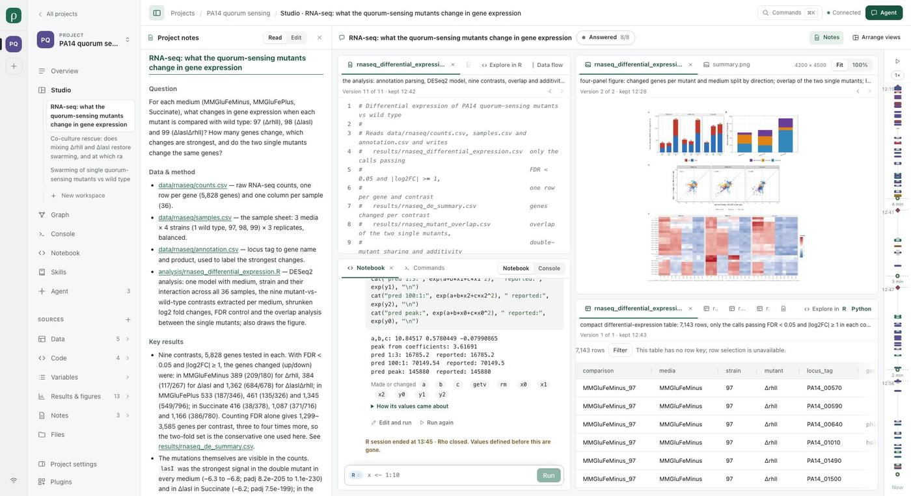

### What the screen showed

- Six columns stood side by side: the rail, the sidebar, the notes, two columns of views, the
  timeline and the Agent panel. The stage between the notes and the timeline was 885 px wide (about
  1010 px in the user's screenshot) and still held four views, each 370–480 px wide: the script
  wrapped every comment line, the table showed four columns and the figure was a thumbnail.
- Every file view spent two lines before its content, a description cut at the view's width and
  "Version 1 of 1 · kept 12:43", and its controls took a third row because the tabs left no room.
- The script, its figure and its table share one name, so three groups led with the same
  "rnaseq_differential_expressi…"; the other tabs were icons beside one or two letters.
- The conversation's title was written four times: in the topbar, the Studio bar, the notes'
  heading and the sidebar, where each session took three lines.
- The table said "This table has no row key; row selection is unavailable." above every ordinary
  CSV, and its row count touched the view's edge.
- The timeline put a time and a pause length around every fold in a 60 px column; the panel's foot
  carried the cost of describing files beside the conversation's own.

### Changes

- **Two places in a narrow stage.** Under 1100 px of stage (`studioWidths.columnsPx`), a
  conversation's Studio lays the work out in rows: what it made in one group, figures first, above
  how it was made (the script, then the Notebook, Commands and the data) in another, each the
  stage's whole width. With room it keeps the two columns. The stage's own width decides, so closing
  the notes or the panel brings the columns back. A saved arrangement is the person's and is kept.
- **One line above a file.** What the file holds, then "Version 2 of 2" with earlier and later only
  when the work kept more than one version. A file with one kept version says nothing about it; when
  it was kept is in the line's title. A file with no kept version still says so.
- **Tab names.** A name shortens in its stem and keeps its extension. Tabs short of room share it
  evenly up to what each name needs; a tab without room for a few letters is its icon, with the
  name in its title and as its accessible name.
- **The title once per place.** The topbar says "Studio" for a conversation's Studio and the Studio
  bar names it; a session in the sidebar keeps two lines.
- **Timeline.** 46 px wide with thinner marks; one time per stretch, the first above the track and
  each later one in the pause before it, whose length is in its title.
- **Smaller things.** The notes read at 13.5 px. The cost of descriptions is in the session card
  only. In Rho-plugins (Tables, source only, not yet selected), the table's toolbar has side padding
  and the row-key sentence is the row count's title.

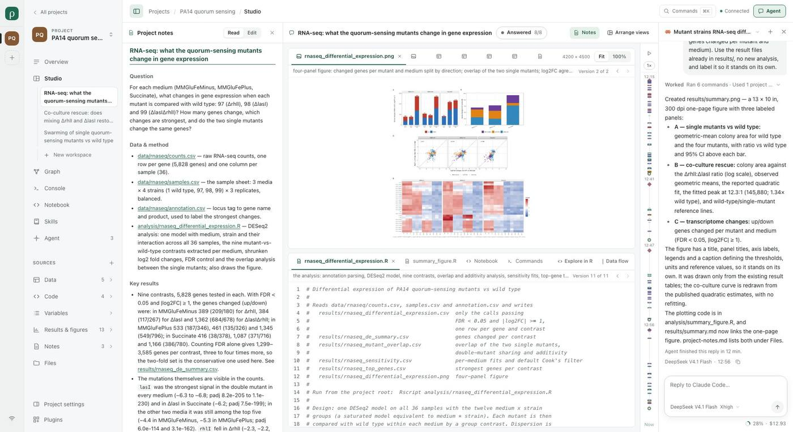

### Verification

- The same capture after the change, at 2000 × 1090 with both panels (rows), with the notes closed
  (columns) and at 1440 × 900 (one view at a time, as before), each screenshot read.
- `test/studio-process.test.mjs` covers the rows form: both places, their order and the same views
  as the columns form. The full suite passed 344 of 347 with the debug Core (3 skipped, Windows only).
- The agent-canvas, frontend and sources acceptances passed; agent-canvas now waits for "Studio" in
  the topbar and the title in the Studio bar. The graph acceptance fails at its meaning-row figure
  card ("Figure: PNG image…" is absent), the same on the unchanged commit `55d677c8`.
- Plugins: 211 of 214 passed, 2 skipped; `presentation.test.mjs` fails on the Agent plugin's
  `agent.sessions.list` label, which this change does not touch.

### Left open

- This is the builder's reading of two screens. No person has said the result is easier to follow.
- With seven results in one group, six tabs are icons; whether a list reads better than tabs there
  is not tried. The Notebook and Commands share a group with the script, so only one shows at a time.
- The user's Commands view listed five "Background wait" rows of `sleep`; those rows were not
  reproduced (the P3 project is gone) and are unchanged.
- The Agent panel's error and continuation notes, the sidebar and the Overview were not changed.

## One frame

2026-11-11, after the pass above. The user judged the layout itself the larger problem: the
application reads as one lump with no designed layout, where another application they use shows
its spaces, its tasks and its work surface at a glance and lets them switch any of the three at any
time. The shipped PA14 project was toured at 2000 × 1028 in a real browser, each screen read, and
the frame rebuilt and toured again.

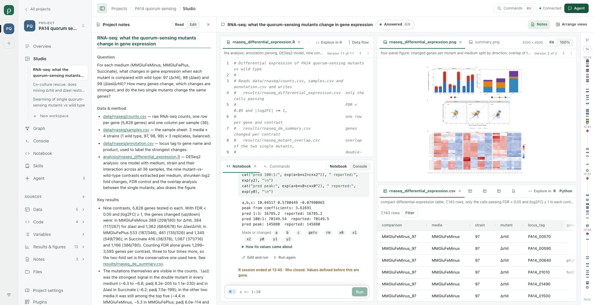

### What the screens showed

- Navigation took two columns, a 61 px rail of project initials and a 248 px sidebar, and the
  sidebar was one flat list of about twenty rows of five different kinds: pages (Overview, Graph,
  Console, Notebook, Skills, Agent), the sessions and workspaces nested under Studio, the kinds of
  file, and settings. At 1028 px of height the list was 1246 px tall, so Project settings and
  Plugins were cut.
- The tasks, what a person comes to follow, were third-level rows under a page named Studio, two
  lines each, with no Agent, time or state. A project was two letters on the rail.
- The project was named four times (rail, "All projects", the project card, the breadcrumb), and a
  57 px bar was spent on that breadcrumb, Commands and Connected.
- Every page had its own skeleton. In a conversation's Studio the stage, the work itself, was the
  narrowest region: about 900 px between 405 px of notes and the timeline and the 340 px Agent panel.

### Changes

- **The sidebar says where and what.** One 268 px column: Projects by name with a dot on each whose
  Agent is working; Tasks, one line per session with its Agent's mark, title and how long ago it
  moved, or that it works or needs a choice; then Sources. Agent, Plugins, Project settings and the
  connection are at its foot. The rail, "All projects", the project card and the breadcrumb are gone.
- **The places are tabs above the work.** Overview, Studio, Graph, Console, Notebook, Skills (and
  Review while records exist) on every project page; a file or page opened from the sidebar is named
  after them while it shows. Commands is the sidebar's search button and ⌘K.
- **The work is one panel, with one panel beside it.** The sidebar and the tabs share a ground; the
  work stands on it as a panel. The project notes moved out of Studio into the panel beside the work,
  which holds the notes or the Agent's conversation, one at a time, from Notes and Agent at the end
  of the tabs. The notes are reachable from every page; they no longer open by themselves.
- Below 768 px the drawer holds the same sidebar with the places as rows.

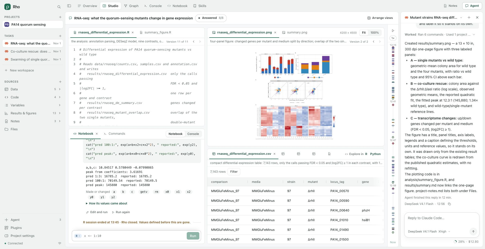

With the panel open the work has 1376 px at this size (1724 px with it closed), so the conversation's
Studio keeps its two columns of views.

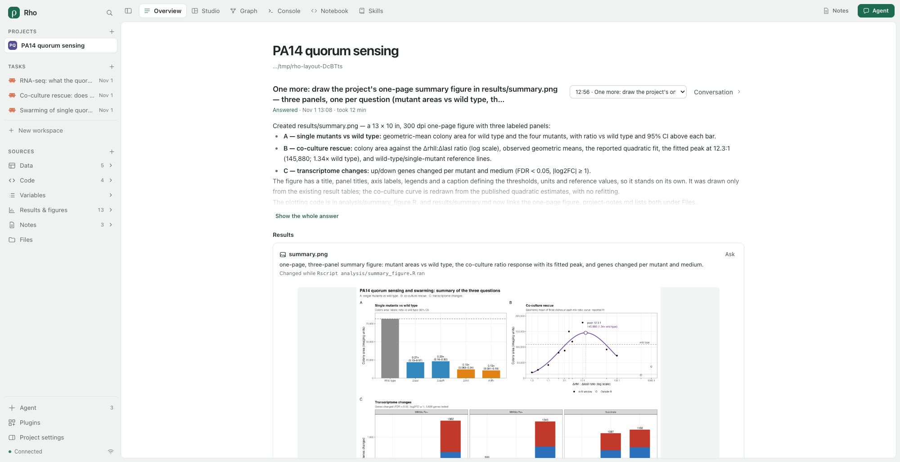

### Verification

- The same eleven screens before and after at 2000 × 1028, and the frame at 1440 × 900, 1024 × 768
  and 390 × 844 with three projects listed: each screenshot read, no horizontal overflow, no page
  errors.
- The sources, agent-canvas, pages, agent-page and frontend acceptances passed with their locators
  moved to the tabs and the sidebar. The pages acceptance first failed at 768 px on Project
  settings, where the bar's controls pushed past the window; the tabs now give way first. With its
  locators moved the same way the graph acceptance got past the navigation and failed at its figure
  card as on `55d677c8`. That script is being rewritten by the Graph pass under way in another
  session, so this change leaves it as it was: it still looks for Graph in the sidebar and for the
  workspace's name in the bar, and needs the tab (`.place-tabs`) and the Studio bar's title.
- The suite passed 344 of 348 with the debug Core, 3 skipped (Windows only). The one failure came
  from where this pass was built, a worktree with no `../Rho-plugins` beside it;
  `test/skills.test.mjs` passed 3 of 3 with that path present.

### Left open

- This is the builder's reading of screenshots. The user has not yet seen the result.
- Tasks lists the open project's sessions only; a task of another project is two clicks away.
- Choosing a task opens its Studio and its conversation. The Overview, Graph, Console and Notebook
  still show the whole project, not that task.
- The notes are no longer open beside a conversation's Studio until asked for; whether the task's
  notes or its conversation should show first is not settled.
- The clip in [Frontend](FRONTEND.md) and the website's demo show the earlier frame. The demo tour
  was updated but not run; the ui, shell and interaction acceptances were not run.

## Values while a cell runs

After seeing the frame in their own project the user asked for one thing first: let the variables be
looked at while something runs. Their screenshot showed `p_compare` open beside the Notebook with only
"A cell is running. The value shows when it ends."

### What the run showed

- The R session is one process that does one thing at a time, and Notebook answered every reading
  `busy` while a cell ran or waited. A long cell left every value's view empty unless it had been
  read before.
- `p_compare` is a ggplot. Read with the session idle, its view was also empty: printing it draws and
  prints no text, and the view showed only what R prints.

### Changes

- Plugins `103d45c` (Notebook): when a cell starts, a local R session on macOS or Linux forks a copy
  of itself that shares its memory and answers readings while the cell runs. A value is then read as
  it was when the cell started; the reading names the cell (`runningCell`) and the view says "Cell 2
  is running. This is p_compare as it was when the cell started." A value the cell has made since
  says so. The copy is not among the code's own parallel children, leaves the random numbers where
  they were and ends with the cell. A session whose values take more than a quarter of the
  machine's memory is not copied and the view gives both sizes; Windows, a server and Python answer
  as before.
- A reading may ask for a picture of what an R value draws when printed, at most 1 MiB. The value's
  view asks, so a ggplot shows its plot, idle or while a cell runs. Rho passes `picture` on to
  Notebook and regenerated its copy of the contract.
- The note about a running cell is a note, in the amber of the other notes, not a problem in red.

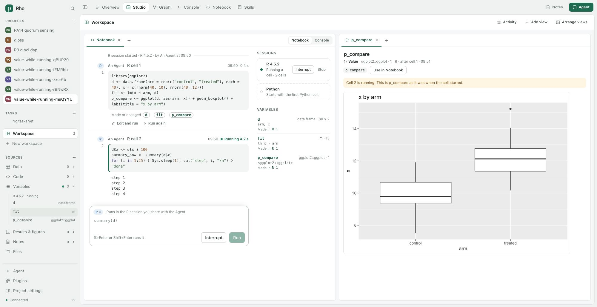

### Verification

- A disposable project on a service built from this change, through `npm run dev`, in Chrome at
  2000 × 1028: a first cell made a data frame, an `lm` fit and a ggplot; a 25 s cell then changed the
  data frame and went on. Opened from the sidebar meanwhile, `p_compare` showed its plot after
  0.8 s, `d` its 80 rows as they were before the cell, and `fit` its coefficients, each under the
  note; when the cell ended the views read the session itself again. Each screenshot was read. The
  first run showed the empty ggplot view and the red note, the second that Rho dropped `picture`.
- Notebook's own tests with R 4.5.2 on this Mac and R 4.2.2 on Debian cover the copy's values, a
  slow reading (stopped after 0.9 s while the cell ran on), an interrupt, two cells in a row, the
  memory limit, stopping the session and what processes are left.
- Measured here: the copy adds about 10 ms to a cell (thirty short cells took 0.35 s with it and
  0.06 s without), and a reading of it takes 30 to 130 ms.

### Left open

- Only local R sessions on macOS and Linux are read while a cell runs. Python, Windows and sessions
  on a server still answer `busy` until the cell ends.
- The copy shows the session as the cell found it, not what the cell has done so far.
- A plot object that R reads by its parts (lattice, an older ggplot2, a heatmap) and a Python figure
  show no picture.
- The memory limit counts what R's values take; a session of several gigabytes was forked once
  (9 ms beside a 4 GB matrix) but not run through a long cell that rewrites it.
- The user's own Rho was running through this and keeps its earlier build and R session until it is
  restarted.

## One list of conversations

2026-11-11, after the user had the frame in their own project, which holds twelve Claude Code
sessions started in a terminal. On one screen, the Notebook with the Agent panel open, they marked
four regions and said that the layout of the Agent's controls alone was a tangle: the Tasks list,
the Agent row at the sidebar's foot, the Agent button at the end of the tabs, and the panel.

### What the screen showed

The screen was reproduced with the build of `7bb72178` on a throwaway project with twelve fabricated
terminal sessions, one of them held open by a live process.

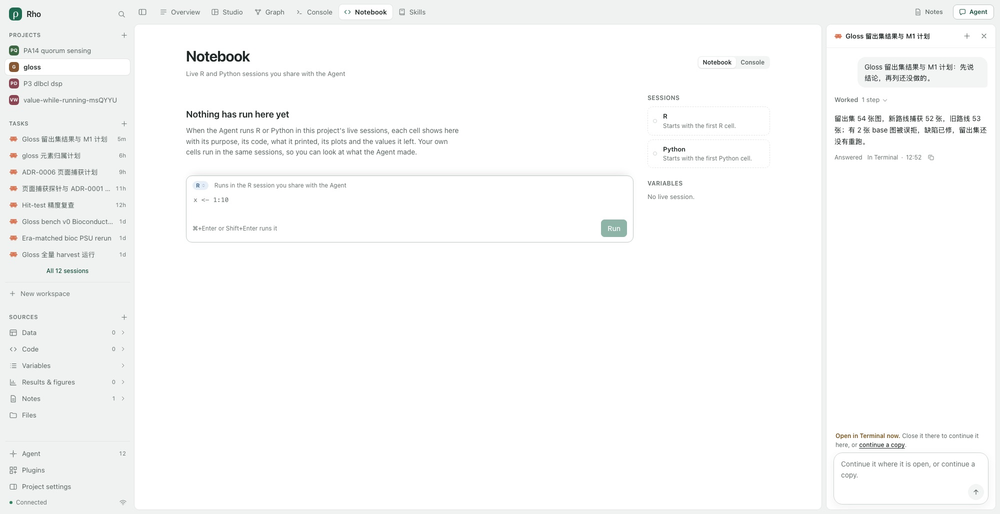

- The conversations had three ways in on one screen: Tasks, "All 12 sessions" under it, and the foot
  row "Agent 12", which opened the same list. Three words named them: tasks, sessions and Agent.
- New conversation was offered twice at once, by `+` beside Tasks and by `+` in the panel's header.
- Nothing tied the panel to the list. With the first task's conversation in the panel beside the
  Notebook, no task was marked.
- The panel's title listed only conversations started in Rho. In this project it was disabled, so
  the panel offered no way to another conversation without leaving the page; and a task whose
  session began in a terminal opened its Studio without its conversation.

### Changes

- **Tasks is the one list.** Under its eight rows "All 12" opens every conversation. The foot row is
  Agents, the Agents that work on the project, with no count, beside Plugins and Project settings:
  what the project is set up with. It opens the Agent page on its Agents; "All 12" and the panel's
  title open it on its conversations. The bar above the work names the list on show, and the page's
  two tabs stand where its "Agent" title was.
- **The task in the panel is marked.** The task whose conversation the panel shows carries the
  panel's tint on every page, and is listed even when it is not among the newest eight.
- **One New.** While Tasks is on screen its `+` is the only one; the panel's header is the title and
  Close. With the sidebar hidden, on the plugin pages and below 768 px the header has its `+` again.
- **The panel's title lists what Tasks lists**, every conversation whichever window its session began
  in, so the conversation can be changed without leaving the page; and a task opens with its
  conversation in every case. With all twelve listed the rows shrank into one another; they keep
  their height now and the list scrolls.

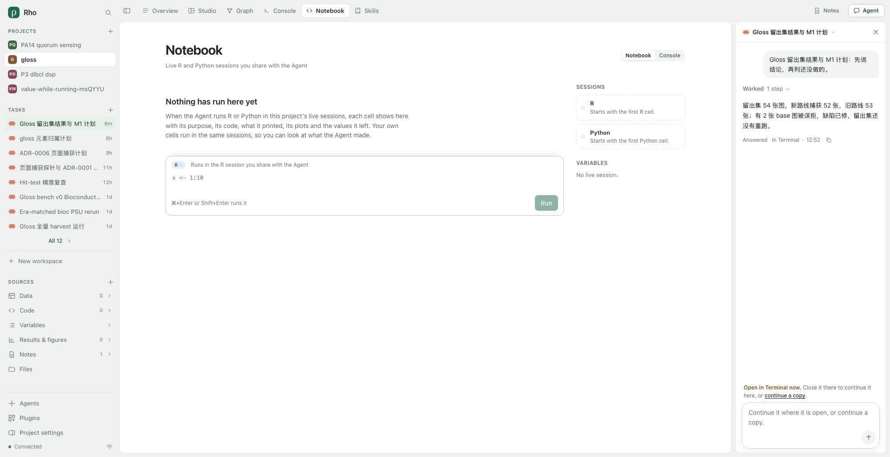

### Verification

- The same screen before and after at 2000 × 1028 on the same throwaway project, then the path through
  it in a real browser: the panel's title to a conversation beside the Notebook, a task from the
  sidebar, "All 12", the foot's Agents, and the sidebar hidden. Each screenshot was read; no page
  errors. At 1440 × 900, 1024 × 768 and 390 × 844 nothing overflowed sideways, and the header's New
  showed only at 390, where the sidebar is a drawer.
- The agent-canvas, agent-page, pages and frontend acceptances passed with their locators moved to
  the Agents row. The frontend acceptance works in a tab opened from a narrower link, which has no
  conversations of its own: there the Agents row shows the runs and the sessions with access, as
  before. The same locator was moved in the continuity acceptance and the session-continuity,
  agent-activity and agent-connect episodes, which were not run. The ui acceptance was left as it was.
- The suite passed 351 of 354 with the debug Core, 3 skipped (Windows only).

### Left open

- This is the builder's reading of screenshots. The user has not yet seen the result.
- The Agent button at the end of the tabs and the foot's Agents row differ by one letter. Whether the
  Agents belong under Project settings instead is not settled.
- The list is headed Tasks, while the page it opens and the panel say conversations.
- The Agent page still holds both lists behind its two tabs. With eight conversations or fewer the
  full list is reached from the panel's title or from that page's tab.
- Inside the panel nothing was changed. On the user's screen a terminal session's `/model` command
  showed as a message with "Outcome unknown", a pasted block showed its markup, a table drawn with
  box characters wrapped, and the notice that a session is open in a terminal was said twice, above
  the box and inside it.

## The tools in Studio

2026-11-11, after the user saw `da6a2cb4` from source in front of their own project. They marked the
Tasks heading and the foot's Agents row and said the two could be one, the Agent where Tasks is with
the recent conversations under it, and not to add buttons a person has to learn. They went on: the
Notebook needs no tab of its own and belongs in Studio, where a workspace should hold several; the
Console is a terminal that works with the Agent, needs no tab either and should look like a
terminal; these belong in one Studio so that they work together; and a Sources row should not open
a page of its own, which takes attention away, but show its kind in the workspace through a view
made for it, Files like a file explorer and Variables like RStudio's object viewer.

### What the screen showed

The "after" picture of the previous section is this section's "before".

- The Agent had two rows in the sidebar, Tasks over the conversations and Agents at the foot, and
  the Agent button at the end of the tabs.
- Of six tabs, Console and Notebook each held one tool alone on a page. The Notebook could also be
  placed as a view; the Console only showed in a conversation's Studio.
- A file chosen in the sidebar replaced the work with that file alone, a kind's "All" opened a page
  of the kind, and Files was a page. Each choice left the workspace.

### Changes

- **The Agent's row heads its conversations.** Where the Tasks heading was, one row: Agent, which
  opens the Agents that work on the project, and `+`, which starts a conversation. The
  conversations are indented under it, with "All N". The foot keeps Plugins and Project settings.
- **Four tabs**: Overview, Studio, Graph, Skills, and Review while there are review records. The
  Notebook, the Console and Files are offered by Add view, an empty workspace and the command
  palette, and what used to open the Notebook or Console page (Skills, the Overview, the board's
  command count) puts the view in the person's workspace.
- **The project's own views.** The Console, the Files explorer and a kind's list are views the
  application draws (`rho.console`, `rho.files`, `rho.sources` in `web/studio-tools.tsx`), saved in
  the workspace's layout like a plugin's. The explorer opens a folder in place, one level at a
  time, and finds a file by name among those the sidebar counted. A kind's list groups by folder,
  or reads newest first for results and reports, with size and time.
- **A row shows its kind; its chevron lists it in the sidebar.** A Sources row puts its view in the
  person's workspace: the one on screen, else the one last used, never a conversation's Studio. A
  file chosen in a view or in the sidebar opens in the same workspace beside it.
- **Where they land** (`withTool` in `web/explore.ts`, `placed` in `web/canvas.ts`). The explorer
  and the lists share a pane at the left edge, a fifth of the workspace; the Console goes along the
  foot, right of that pane, which keeps its full height; a script opens immediately right of the
  lists. Looking at the result changed three things: the lists' pane was squeezed to a sliver once
  four more views were open (it is widened again when it would fall under 15%), a script chosen
  in the sidebar landed left of the explorer, and the search field's icon was squashed.
- A tab that cannot arrange views, one opened from a link, keeps the Notebook and Console tabs,
  the kind's page and the file's own page.

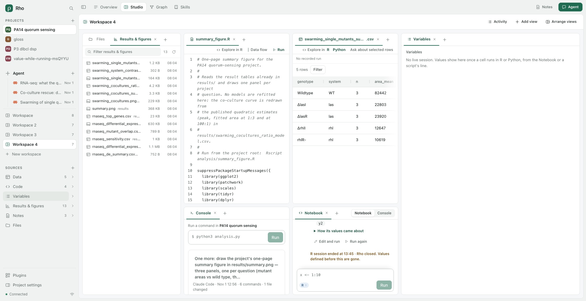

### Verification

- A throwaway copy of the PA14 example in a real browser at 2000 × 1028: from an empty workspace,
  Files, Results & figures, a script, a table, the Console, the Notebook and Variables, each
  screenshot read. The person-files acceptance's screenshots at 1440 and 390 were read too: at 390
  the workspace shows one view at a time, so a file covers the explorer, which stays a tab.
- The sources acceptance was rewritten for the new flow (7 checks: the chevrons list in the
  sidebar and write no layout, a row puts its list in the workspace and a file opens beside it, a
  sidebar file opens in the workspace, the explorer unfolds and finds, reload, the Markdown
  reader, 1024 and 390). It and the frontend, agent-canvas, agent-page, pages and person-files
  acceptances passed. The Agent row's locator was also moved in the continuity acceptance and the
  session-continuity, agent-activity and agent-connect episodes, which were not run.
- The suite passed 351 of 354 with the debug Core, 3 skipped (Windows only).

### Left open

- This is the builder's reading of screenshots. The user has not yet seen the result.
- The website demo's recording and `scripts/demo-tour.mjs` were made for the tabs and pages that
  are gone; the demo has to be walked and recorded again before the site is rebuilt.
- The explorer does not mark the file on screen, has no arrow-key movement, and does not create,
  rename, move or delete.
- Below 640 px of stage a list and the file chosen from it are not on screen together.
- The Variables row opens the existing Variables view, which is not yet an object viewer.

## Several notebooks

2026-11-11, the next part of the same request: one Notebook for a whole project will not do; a
workspace should hold several, made there.

### What there was

A project had one list of cells, and every Notebook view showed all of it. A page could hold one
Notebook (its view was always `notebook`), and a cell carried no word of where it was run. A live
session belongs to the project and a language, one R and one Python.

### Changes

- **A cell keeps its notebook** (Rho-plugins, Notebook 0.5.16). `kernel.run` takes an optional
  `notebook`, an identity the cell keeps and `kernel.read` returns. Rho passes it on and its copy
  of the `kernel.run`, `kernel.read` and `kernel.interrupt` contracts carries it.
- **The first Notebook on a page is the project's**; it lists every cell, as before. With one on
  the page, Add view offers New notebook instead: a tab beside it named Notebook 2, 3, …, with an
  identity kept in the view (`props.notebook`). It lists the cells run in it and runs its own
  there. Rename, in its tab's menu, gives it the person's name.
- **The sessions are shared.** A value made in one notebook is there in the others, as in
  RStudio, where several notebooks run in one R session. The project's notebook marks a cell run
  elsewhere with that notebook's name. Sessions, Variables, Plots and Data flow stay one per
  language.
- **What another view sends goes to the notebook last worked in**, else the page's first: a
  script's line, a table to explore, an expression from a value's view.
- An Agent's cells name no notebook and read in the project's notebook. It can pass the identity
  it reads on a cell to add one to that notebook.

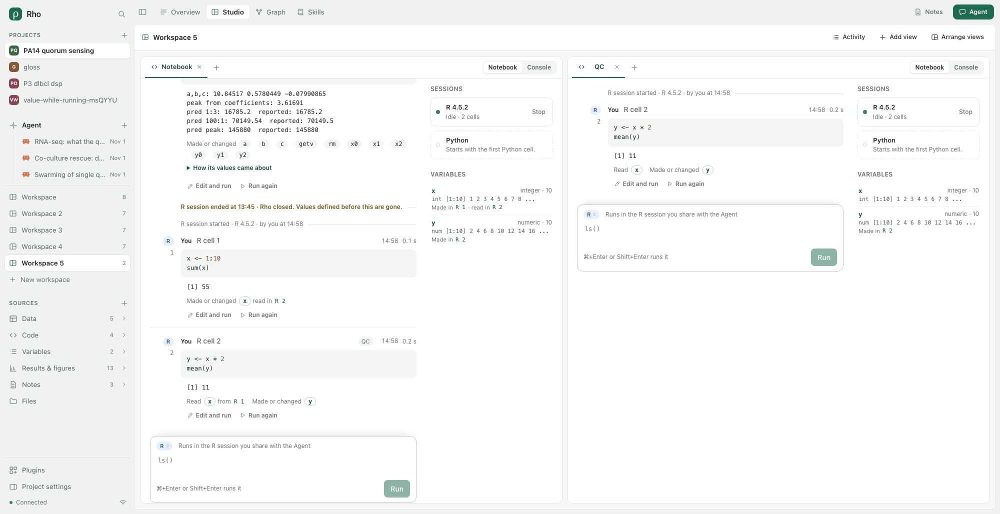

### Verification

- A throwaway copy of the PA14 example in a real browser at 2000 × 1028, each screenshot read:
  the project's Notebook with 44 earlier cells; `x <- 1:10` run there; New notebook from Add
  view gave an empty Notebook 2 that said so; `y <- x * 2; mean(y)` printed 11 there, from the
  same session; renamed to QC; beside each other, the project's notebook listed 45 cells with the
  last marked QC, and QC listed one. After a reload both were as left. A statement run from a
  script went to QC when the keyboard had last been there, and to the project's notebook when it
  had been there.
- Rho-plugins: the kernel tests passed 22 of 23 (one Windows only), with a new one for notebooks
  that share a session, keep their identity across a restart and refuse a malformed one.
- Rho: the suite passed 352 of 355 with the debug Core, 3 skipped (Windows only), with a new test
  through the service. The pages, sources and frontend acceptances passed.

### Left open

- This is the builder's reading. The user has not seen it; on their own running Rho a new
  notebook cannot run a cell until the service is built and started again.
- Whether notebooks should share the sessions or each have its own R and Python is the user's to
  say. Sharing was the smaller step, and each notebook's own process could follow from it.
- Whether a workspace's first Notebook should also be its own, rather than the project's.
- A cell is numbered in its session, so a notebook's first cell can be "R cell 2". Each notebook
  beside another repeats the sessions and variables at its side.
- A notebook's cells are found among the 300 newest of the project's 500; a closed notebook's
  cells stay in the project's notebook under "Another notebook".
- A notebook is not a file: it cannot be saved as `.Rmd` or `.ipynb`, reordered or edited in place.

## A real terminal

2026-11-11, the third part of the same request: the Console is a terminal that works with the
Agent, it does not look like one, and since it is a terminal it should be a professional one.

### What there was

The Console ran each command in a process of its own (`shell -lc`), with no terminal behind it
and nothing kept between commands: no prompt, no `cd` that lasts, no keys to a running program,
no colours, no full-screen programs. Its output was read again every 700 ms.

### Changes

- **The person's shell on a pseudo-terminal** (Rho-plugins, Console 0.3.2, `TerminalHost`). It is
  their login shell in the project folder with `TERM=xterm-256color`, opened by a few lines of
  Python, which macOS and Linux have, so Rho ships no compiled module. The service keeps the last
  megabyte each terminal printed. Rho adds `console.terminal.open`, `list`, `read`, `write`,
  `resize` and `close`.
- **The person's alone.** Every one of those operations, the reads too, is refused to anyone but
  the person at this machine, and none can be put in an Agent's grant. They are not written to the
  activity record and do not wait in the project's queue, so typing is not held up by another
  request and a read that waits for output holds nothing else.
- **Drawn with xterm.js** (`web/terminal.tsx`; `@xterm/xterm` 6.0.0 and its fit addon, MIT). A read
  waits for output instead of polling; keys typed within 4 ms go in one request; the view's size
  is the terminal's. The view keeps its terminal with the page (`props.terminal`): a reload,
  another tab or a view shown again returns to the same shell and what it printed.
- **One view, two forms.** The view is named Terminal, with Terminal | Commands in its header.
  Commands is what the Console showed: the Agent's commands by message and the person's single
  commands. The board's command count opens it there.
- Closing the view hangs the shell up. A shell that ended says how and offers a new one. With
  four open in a project, the fifth is refused and the view lists the open ones to show or close.

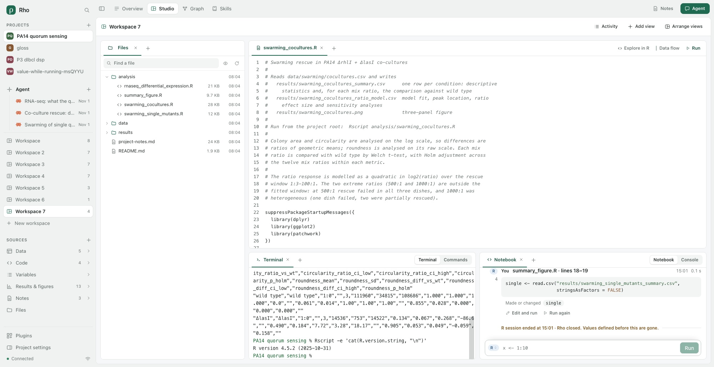

### Verification

- The terminal host alone, then a throwaway copy of the PA14 example in a real browser at
  2000 × 1028, each screenshot read. With the machine's own zsh setup: its prompt, right prompt
  and colours; `tty` named a terminal device and `tput cols` the view's 214 columns; Chinese text
  and coloured output; `top` drew full screen and left on `q`; Ctrl+C ended `sleep 60`; after a
  reload a variable exported before it was still set; Commands and back kept the output; `exit`
  said the shell ended and Start a new shell gave one without that variable. 1024 and 390 wide
  had no sideways overflow. The figure was taken with a plain prompt.
- Rho-plugins: two new tests (a real terminal with a size, Ctrl+C and an exit code; the limits)
  and the presentation test pass.
- Rho: the suite passed 353 of 356 with the debug Core, 3 skipped (Windows only), with a new test
  that the person opens, types, reads, sizes and closes a terminal through the service, that a
  waiting read does not hold another request, and that an Agent's grant and calls are refused.
  The agent-canvas, frontend and sources acceptances passed.

### Left open

- This is the builder's reading. The user has not seen it; their own running Rho has no terminal
  until it is built and started again.
- Windows has no terminal yet (it needs ConPTY), and a machine without `python3` is told so.
  Windows has one since 2026-11-13 ([episode](WINDOWS-TERMINAL-EPISODE.md)).
- A terminal ends with Rho. Nothing of it is kept across a restart but what the shell itself keeps.
- The prompt's symbols need a Nerd Font installed; the view names the common ones before the
  machine's monospace face. Headless Chrome drew boxes for them.
- What is typed in the terminal is not in Commands, the Graph or the Overview: the Agent cannot
  see it, and the person's work there leaves no record in Rho. Whether the Agent may be shown a
  terminal, or type in one with the person's leave, is the user's to say.
- No search in the scrollback, no links, no split terminals in one view; the colours are a light
  set that does not follow a dark system setting.
- The website demo and `scripts/demo-tour.mjs` still walk the Console page.

## One set of session views

2026-11-11, after the terminal. The user: the bar across a workspace is no use any more (views are
added in Studio, activity is in the Graph, a view is moved faster by dragging it); a workspace should
close; and the components are each on their own. The Notebook has its own plot strip and variables
list while Plots and Variables are views of their own, and no view manages the R and Python
processes. Variables should read like RStudio's environment pane.

### What there was

- A person's workspace had a row above its views: the Agent's latest object, a count of held
  updates, Activity and Arrange views. A conversation's Studio has its own bar with its steps.
- `composition.delete` refused a workspace that held any view, and nothing in the page called it.
- The Notebook drew each cell's plots, a strip of all plots and a Variables pane of its own beside
  the cells. Plots and Variables also existed as views, each counting and listing apart. A session
  could only be stopped from the Notebook's console form, and only a cell started one.

### Changes

- **No workspace bar.** Views are added from a group's +, or from the empty workspace's own list;
  a view's tab moves by dragging it or from its right-click menu. The Agent's latest object and
  the recorded calls stay in the Agent panel; activity is in the Graph. Following a running
  Agent is the topbar's Agent chip, which in Studio opens its conversation's Studio as the bar's
  Follow button did. The bar's component, its props and styles are removed.
- **Closing a workspace.** Its sidebar row shows × on hover or focus (always, where nothing
  hovers), and ⌘K has Close this workspace. Closing hangs up its terminals and deletes the layout
  in one conditional write; a notice says the files, sessions and conversations are unchanged and
  offers Undo for 15 s, which brings the workspace back as it was. The service now deletes a
  layout with its views, as closing each would (unsaved buffers stay with their document), and
  refuses only one holding a protected view.
- **The Notebook links instead of repeating** (Rho-plugins, kernel). On the person's own page, a
  cell's plot is a small thumbnail, Plot N, numbered as Plots numbers it; pressing it opens Plots at
  that plot. The session's state is a chip that opens Sessions. The strip and the rail are gone
  there. A conversation's Studio and a Notebook opened from a link keep the rail, since nothing is
  beside them to link to.
- **Variables reads like an environment pane** (`ui-variables.tsx`). Data, Values and Functions;
  name, value summary, type (when the pane is 440 px or wider) and size; sorting, a Find box and
  a total. A row unfolds in place through `kernel.inspect`: a data frame's columns as
  `$ name type values…`, a list's parts, or the object's facts, with the cells that made and read
  it linked back into the Notebook.
- **Sessions** (`rho.sessions`, `ui-sessions.tsx`). One card per language: version, state, where it
  runs, program, process id, who started it and when, cells and the queue, and what it holds; the
  running cell links to the Notebook. Interrupt, Restart and Stop (both confirmed), and Start when
  none is live. Ended sessions fold below. `kernel.start` starts a session without a cell, keeps a
  live one and waits for one that is stopping; like `kernel.stop`, only the person at this machine
  may call it.
- Plots counts over every plot of the session and has Show the cell. Sessions, Variables, Plots,
  Data flow and Servers are added as tabs beside each other.

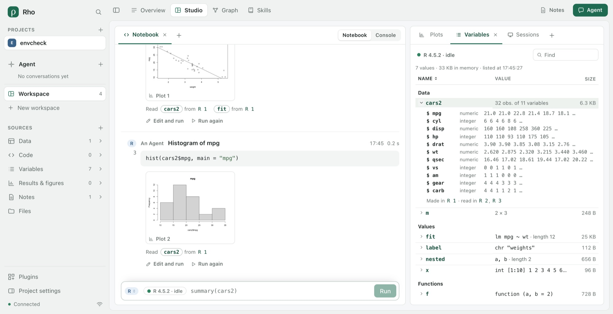

### Verification

- A throwaway project with three R cells, in a real browser at 1440 and 1100 wide, each screenshot
  read: no bar; a plot thumbnail opened Plots at that plot and Show the cell scrolled back to it
  and marked it; Variables unfolded `cars2` and a nested list, sorted, and found by name; Sessions
  started a session with none running and restarted it (a new process id); the console form named
  plots as in Plots; × on the sidebar row closed the workspace to the Overview, and Undo brought it
  back with its views. No page error.
- Rho-plugins: a new test that a session starts without a cell, a live one is kept and a stopping
  one is waited for. The full suite's first run failed one test, React imported by a `.ts` file
  the boundary rule keeps headless; the file became a `.tsx` browser part. The second run passed
  the boundary test and failed the local read-while-running test on its count of fork folders in
  the shared temp directory (2, not 3) while other R sessions ran on the machine; it passed in the
  first run and 3 of 3 alone. Both runs: 218 of 221, 2 skipped.
- Rho: new checks that a non-empty workspace is deleted with its unsaved buffer kept, undo restores
  its bindings and a protected view refuses deletion; that an Agent has no `kernel.start` and cannot
  be granted it, an administrator token is refused it, and the person's call starts a new session
  once. The suite passed 353 of 356 with the debug Core, 3 skipped (Windows only). The frontend,
  plugin-dx, sources and graph (9/9) acceptances passed. Agent-canvas first waited for the
  workspace's title and its Follow button, both in the removed bar; it now reads the sidebar's
  marked workspace and presses the topbar's Agent chip, and passed 10 of 10.

### Left open

- This is the builder's reading. The user has not seen it. In their running Rho the page changes
  show with `npm run dev`; Sessions, Start, Restart and closing a non-empty workspace need the
  service rebuilt and restarted, which ends the R and Python sessions it holds.
- Restart on a server place, a Python session and the conversation Studio were not tried.
- The shell and interaction acceptances, already open, also click the removed bar (its Agent
  marker, Activity and run chain); they need rewriting against the Agent panel and the Graph.
- `kernel.start` takes no change id, so a repeated start after a lost reply is answered with the
  session the first one started rather than recognized as the same request.
- Variables shows R and Python as the session reports them; no grid of a data frame's rows, and no
  editing of values.

## Each notebook its own sessions

2026-11-11, the user's answer to the question left open in [Several notebooks](#several-notebooks):
a split view is the same notebook and shares its sessions; a new notebook has R and Python
sessions of its own.

### What there was

Every notebook of a project ran in the project's one R and one Python session, so a value made in
Notebook 2 was there in the project's notebook. Variables, Plots, Sessions and Data flow each
showed those two sessions.

### Changes

- **A session belongs to a notebook and a language** (Rho-plugins, Notebook 0.5.18). The kernel
  host keys a live session by both; the project's notebook names none. A cell run in Notebook 2
  starts that notebook's own process, and its values are not in the project's. A session record
  keeps its notebook. `kernel.inspect` and `kernel.start` take the notebook; Rho passes it on.
  Splitting a view moves the same notebook, so it keeps its sessions.
- **At most 8 sessions run at once** in a project (`maxSessions`). One more is refused with the
  count and is to be stopped in Sessions.
- **Variables, Plots and Data flow follow the notebook last worked in** in this page, as
  RStudio's environment pane follows the session in front. A small notebook menu in their header
  picks another. Sessions groups the cards by notebook, the project's first, and offers Start R
  and Start Python for a notebook with nothing running. A value's view keeps the notebook it was
  opened from.
- The composer says where a cell runs: "R session of this notebook" in a new one, the shared one
  in the project's. The Agent's skill says that each notebook has its own sessions and that the
  project's is the one it uses unless it names another.

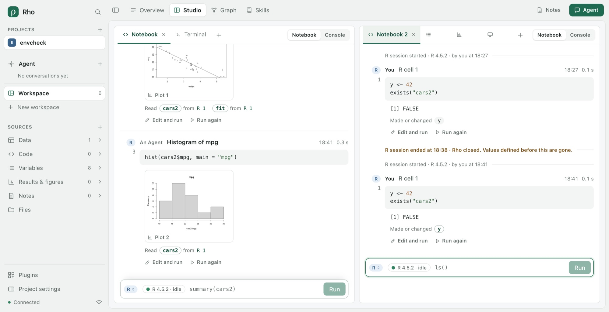

### Verification

- A throwaway project in a real browser at 1600 × 940, each screenshot read: New notebook from a
  group's + gave Notebook 2; `y <- 42; exists("cars2")` printed `FALSE` there, though `cars2`
  was in the project's session. Split right kept it the same notebook. Variables beside it listed
  only `y` and named Notebook 2; pressing in the project's notebook moved it to that one's values,
  and the menu brought Notebook 2 back. Sessions showed two groups, each with its R session and
  process id. No page error.
- Rho-plugins: a new kernel test that two notebooks get separate sessions, a value made in one is
  not in the other, inspect and start take the notebook, the limit refuses one more and a
  malformed notebook is refused. The suite passed 220 of 222, 2 skipped.
- Rho: a new test through the service that a cell run in a named notebook keeps it and runs in its
  own session. The suite passed 353 of 356 with the debug Core, 3 skipped (Windows only). The
  frontend, plugin-dx, sources, graph and agent-canvas acceptances passed.

### Left open

- This is the builder's reading. The user has not seen it. Their running Rho needs the service
  built and started again, which ends the R and Python sessions it holds.
- The notebook the views follow is kept per browser tab, not with the page.
- A closed notebook's sessions run on until stopped in Sessions, where they are listed as "A
  closed notebook".
- Whether a workspace's first Notebook should also be its own is still open; it is the project's.

## The Agent in the terminal

2026-11-11, asked in the same turn: the Agent can see and use the terminal. This answers the
question left open in [A real terminal](#a-real-terminal).

### What there was

Every terminal operation was refused to anyone but the person at this machine, and none could be
put in an Agent's grant. What was typed there left no record in Rho.

### Changes

- **An Agent reads a terminal as text** (Rho-plugins, Console 0.3.3). `console.terminal.screen`
  returns what the screen shows, kept by a headless xterm (`@xterm/headless` 6.0.0, MIT) fed the
  same output as the view, without colour codes, with wrapped lines joined. With `after` (the
  offset `write` returns) and `waitMs` it waits for new output, then for 400 ms of quiet. The
  result says whether it settled and whether a full-screen program owns the screen.
- **An Agent types, opens, lists and closes.** `open`, `list`, `screen`, `write` and `close` can
  be granted. The raw output (`read`) and the size (`resize`) stay with the page that draws the
  terminal. An Agent closes only the terminals it opened. Its calls go to the activity record as
  any other call.
- **The person sees who typed.** A terminal keeps who last typed there and when (`typedBy`). A line
  above it says so, names the terminals an Agent opened with Show it here, and on an Agent's
  terminal says whose it is and offers Your terminal to go back.
- The skill tells the Agent to list first, read before typing, end a command with `\r`, wait for
  the prompt in a terminal it opened, and leave the person's terminals open.

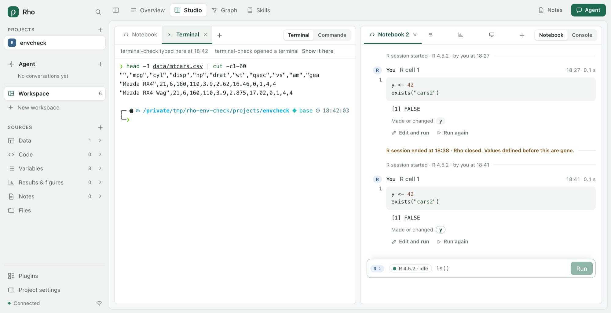

### Verification

- The same throwaway project at 1600 × 940, with an Agent connected through `session.grant`, each
  screenshot read. The Agent listed the terminals, typed a command in the person's and read the
  screen after its offset: the lines matched what the view drew, and it had settled. The line
  above named the Agent and the time. It opened a terminal of its own, which the line offered; Show it here
  showed it and Your terminal went back. No page error.
- Rho-plugins: a new console test that an Agent's typing is read back as text, waits for quiet and
  records who typed. The presentation test names the new operation.
- Rho: the terminal test now checks that an Agent's grant holds close, list, open, screen and
  write; read and resize are refused; a write is read back through screen and recorded with its
  Agent; the Agent closes its own terminal and not the person's.

### Left open

- This is the builder's reading. The user has not seen it, and their running Rho needs the
  service built and started again.
- What an Agent types runs in the person's shell, with their rights. The Agent's own command
  permissions see only its call to Rho, not the command inside it. Every connected Agent's grant now
  holds these operations. No setting withholds only them: turning the Console off for the project
  removes the person's terminal too.
- What the Agent types is in the activity record but not in Commands. Only the last typist is kept.
- The Agent is named by its grant's label.
- An Agent that types before its own shell's prompt has drawn gets the shell's partial-line mark;
  the skill tells it to wait.
- Windows still has no terminal. It has one since 2026-11-13 ([episode](WINDOWS-TERMINAL-EPISODE.md)).

## Each workspace notebook its own, and the terminal's commands

2026-11-12, the user's answers to what [Each notebook its own sessions](#each-notebook-its-own-sessions)
and [The Agent in the terminal](#the-agent-in-the-terminal) left open: a workspace's first Notebook
has its own sessions too; the terminal records the commands the person and the Agent type,
telling them apart, and keeps them apart from the machine's own shell history. A Windows
terminal is left for later.

### What there was

- The first Notebook of a workspace showed the project's sessions, where the Agent's cells run,
  and listed every cell.
- What was typed in a terminal was in the activity record (an Agent's calls) and nowhere else.
  The shell kept its history in the machine's own file, so commands typed in Rho's terminal,
  the Agent's too, were recalled in every other terminal on the machine.

### Changes

- **Every Notebook put on a workspace is its own** (Rho `web/explore.ts`). The first gets an
  identity as the later ones do, and a table explored, a script's line or a value from the page
  runs in it. The project's own sessions are named the Project notebook (Notebook 0.5.19): an
  Agent's cells run there unless it names a notebook, and a link to such a cell opens a Project
  notebook view. A Notebook saved earlier without an identity stays the Project notebook.
  Variables, Plots and Data flow show the first Notebook drawn until another is chosen.
- **The Agent can find the person's notebook.** A message from Studio carries each Notebook
  view's notebook in its interface context, and the Agent's instructions and the kernel skill
  say to pass it to `kernel.run` when the person asks for work in their notebook.
- **A zsh or bash terminal records its commands** (Console 0.3.4, `shell-marks.ts`). The shell
  starts with Rho's startup files around the person's own, as VS Code's terminal does (a
  `ZDOTDIR` for zsh, an init file for bash). Before each command its hook prints the line and
  folder, before the next prompt the exit status, in an escape sequence terminals ignore, with a
  nonce only that shell holds. The service reads them where they fall in the output, so each
  command is kept with who typed it (everyone whose input reached the shell since the prompt,
  so a line both typed names both), the folder, the exit status and the start of what it
  printed. `console.terminal.commands` lists them for the person and the Agent; they are kept
  across restarts.
- **Its own history.** The shell's history file is `.rho/plugins/console/history/` in the
  project: the up arrow recalls what was run in this project's terminals, and the machine's own
  history is not read or written.
- **Commands shows them.** Among the messages' commands and the person's own, In the terminal
  lists each typed command with You or the Agent's name, how it ended, and when opened the folder
  and output. A conversation's Studio lists those typed since it began.

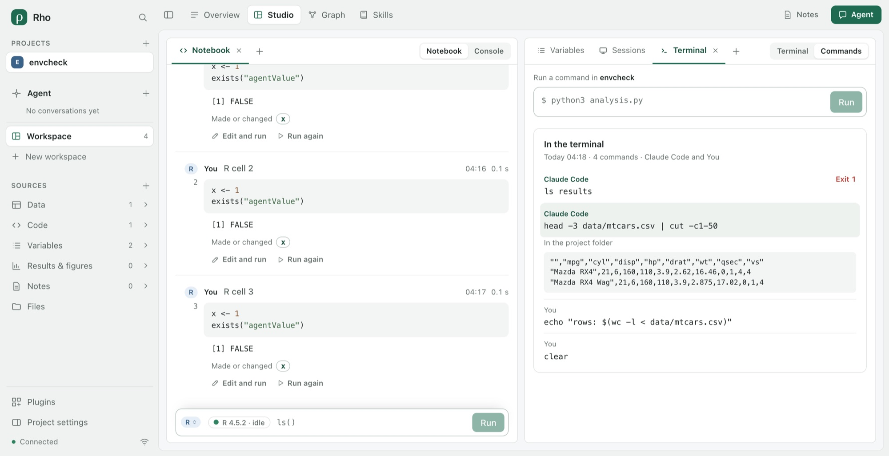

### Verification

- The terminal host with zsh and bash on macOS, under a home of its own and then with the
  machine's own zsh setup (Powerlevel10k): the person's and an Agent's commands with their exit
  status, folder and output, a line both typed naming both, a forged mark printed by a program
  ignored, `exit` recorded as the shell's end, the records read back by a new host with one left
  running marked unknown. zsh's end-of-line mark (`%` in inverse video) after output without a
  final newline was first kept as output; it is now left out.
- A throwaway project in a real browser at 1600 × 940, each screenshot read: the empty
  workspace's Notebook ran `exists("agentValue")` as `FALSE` after the Agent made `agentValue`
  in the project's session, said it runs in this notebook's own R session, and did not list the
  Agent's cell; Variables beside it showed that notebook's `x`; Sessions showed the Project
  notebook (started by the Agent) and the Notebook apart. In the terminal the person typed two
  commands and the Agent two; Commands listed the four with who typed each, `ls results` as
  Exit 1, and the Agent's `head` opened with its folder and output. The up arrow recalled the
  Agent's last commands from the project's history; the command typed then was in that file
  and not in the machine's. The figure was taken at 1440 × 740.
- The machine's own history held eight commands from the earlier terminal checks of
  2026-11-11, typed before the terminal had a history of its own.
- Rho-plugins: a test for each of bash and zsh found on the machine (the above, under a home of
  its own), passing 3 of 3. The scrollback limit test failed once under load: `seq 1 9999`
  could arrive in one 64 KiB read, so nothing was dropped; it now prints more than one read.
  The suite passed 222 of 224, 2 skipped.
- Rho: new tests that a bash terminal's commands reach the person and the Agent with who typed
  them, move the page's cursor and stay out of the machine's history file, and that a message's
  context names each Notebook's notebook. The first full run failed the older terminal test at
  its cleanup: Rho's close wrote the commands file while the folder was being removed. Close now
  writes only what changed and waits for it. The suite then passed 355 of 358 with the debug
  Core, 3 skipped (Windows only), and the frontend, plugin-dx, sources, graph and agent-canvas
  acceptances passed.

### Left open

- This is the builder's reading. The user has not seen it. Their running Rho needs the service
  built and started again, which ends the R and Python sessions it holds.
- A Notebook saved before this keeps the project's sessions; nothing turns it into a notebook of
  its own.
- Other shells (fish, sh) run without marks and their commands are not recorded. A command left
  out of bash's history (HISTCONTROL) is recorded as the line before it. Keys sent to a running
  program are counted as typing the next command.
- What a full-screen program drew, and output past 16 KiB, are not kept with the command.
- Commands typed in the terminal are not in the Graph.

## Every shell's commands, whole, and in the Graph

2026-11-12, the user's answer to what [the last pass](#each-workspace-notebook-its-own-and-the-terminals-commands)
left open: record the commands of fish and sh-like shells, keep what a full-screen program drew
and output past 16 KiB, and put the terminal's commands in the Graph.

### What there was

- Only zsh and bash marked their commands. In any other shell the terminal recorded nothing.
- A command's record held the first 16 KiB of what it printed and nothing more. What `less`,
  `top` or an editor showed was not kept at all.
- The Graph and its timeline drew messages to Agents and the plugins' events. A command typed in
  a terminal was in Commands only.

### Changes

- **fish has hooks too, and sh, dash and ksh93 have marks in their prompt** (Console 0.3.5,
  `shell-marks.ts`). fish sources Rho's file after its configuration and keeps its history under
  its own name, `rho_<project hash>`. sh, dash and ksh93 have no hooks. `ENV` names a file that
  reads the login files and the person's own, then puts marks around the person's prompt: the
  last status where it starts, the folder where it ends, and a mark after the continuation
  prompt. The command is the line typed after the prompt, read from the screen when its line
  feed arrives, plus the lines after each continuation prompt. `/bin/sh` that is bash gets bash's
  hooks.
- **The line shown is checked against the lines typed** (`terminal-commands.ts`). dash has no
  line editor of its own. A line typed while a command runs is shown then, and the shell reads it
  later without showing it again. So the line after the prompt was that command's output, not the
  command. Rho now keeps the lines typed, as the terminal edits them (backspace, Ctrl+U, Ctrl+C
  drops what was not read yet). A line shown after the prompt as it was typed is the command.
  Otherwise the oldest line typed before the prompt appeared is what ran, and what is shown is
  its output. A command that ran without a line feed (a `cd` typed ahead) is recorded at the
  next prompt. The echo of a line typed while a command ran is not counted as its output.
- **mksh and pdksh are not marked.** On Debian `ksh` was mksh, which scrolls a long line sideways
  as it is typed (`…wider-than-forty-cols end <`), so the screen never shows the line whole.
  Recording it would record wrong commands. mksh keeps Rho's history and `recording` stays false.
- **All that was printed, and the full screens.** Output is read from the terminal emulator line
  by line as each line feed completes one, so nothing depends on the scrollback. Past the
  record's 16 KiB, a file beside it keeps the first 512 KiB and the last 64 KiB, with the bytes
  between counted, and the last 4 screens a full-screen program showed as it left. The files
  stay under 64 MiB per project; past that the oldest are let go, and their records say so.
  `console.terminal.output` reads one in pages of up to 64 Ki characters, for the person and the
  Agent. A record shows "Show all it printed · 341 KB" or "Show the full screen it drew".
- **Terminal commands are in the Graph** (`src/terminal-work.ts`). A command an Agent entered
  while answering a message of its conversation in Rho is a step of that message. Every other
  command is a step of "Typed in the terminal" by whoever entered it: You, or an Agent working
  from outside Rho. Commands with no pause over 30 minutes are one group. A command spans from
  its start to its end. A file that changed while it ran is drawn as changed by it (observed),
  and a change between commands is not the terminal's. The groups are not messages, so they are
  not "Asked" or "Answered", the page counts them apart ("5 recorded steps, all typed in a
  terminal"), and the person's typing is in their own lane. A step says "In the terminal · typed
  by You" and reads all its output.
- **One command per change in Commands.** A file's change was shown under every command within a
  second of it, so `clear` showed the `high.csv` that the next command wrote. A change inside one
  command's start and end is now that command's alone.
- **The Agent's grant limit is 128.** With `console.terminal.output` the default Agent grant
  held 97 methods, one over the limit of 96, and Rho refused to grant it. As at 64, the smallest
  step was taken: `layeredGrantLimits.maxMethods` is 128, and a larger grant is still refused.

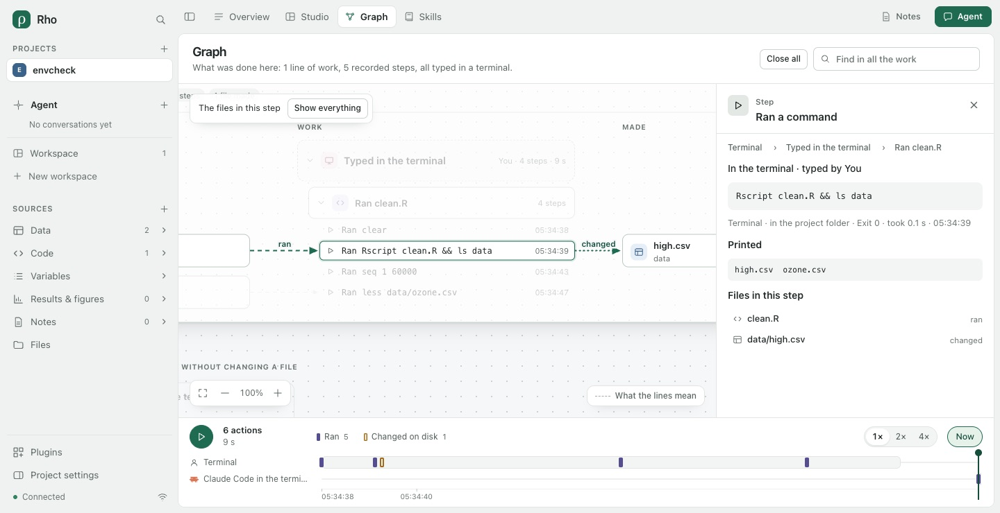

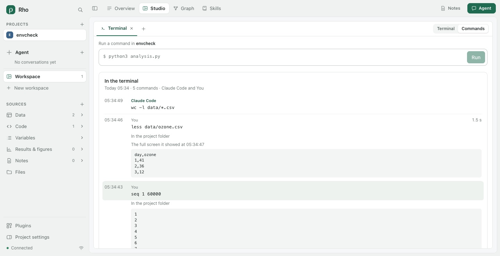

### Verification

- Rho-plugins on macOS: bash, zsh, `/bin/sh` (bash), dash and ksh93. Each records a person's and
  an Agent's commands, a line both typed, a forged mark, `printf "a\nb"; false` as Exit 1, a
  loop typed over three lines with its output, and four lines typed in one write while the first
  ran. The first full run of the shell tests on Debian 12 arm64 failed fish (its escape kept the
  newline `string replace` adds), `/bin/sh` (dash keeps no history file) and `ksh` (mksh, above).
  The earlier screen test then failed once: it typed before dash's prompt. After the changes
  above, bash, fish 3.6, sh (dash), dash, ksh93u+m and mksh (not marked) passed. A command's
  output past its record (`seq 1 20000` under small limits) came back whole in pages: the gap's
  place and size, the last lines, a printf full screen, and the oldest file let go past the
  budget. Console tests: 17 of 17 on macOS, 19 of 19 twice on Debian.
- A throwaway project in a real browser at 1600 × 940 with the person's own zsh, each
  screenshot read. The person typed `Rscript clean.R && ls data`, `seq 1 60000` and
  `less data/ozone.csv` (then `q`), and the Agent typed `wc -l data/*.csv`. All five were
  recorded with who typed them. `seq` kept 348,894 bytes, read back in 64 Ki pages, all within
  the kept start. The `less` screen was first shown blank: less paints a short file from the
  bottom, under 33 blank rows. The view now leaves out the blank rows above and below. In the
  Graph the first reading showed "Typed in the terminal … Answered", "Asked 2" and
  "2 messages". Now the line reads Terminal · 4 steps · 1 file made, the Rscript step ran
  `clean.R` and changed `high.csv`, the Agent's command is "Claude Code in the terminal", and the
  Overview reads "What you and the Agent did". The figures were taken at 1440 × 740.
- Rho: tests for the merge and grouping of terminal commands and for the Graph (a change between
  two commands is neither's, no "Answered", the step's words), and for an Agent paging a
  command's output through the service. The full suite passed 357 of 360 with the debug Core, 3
  skipped (Windows only). The frontend, plugin-dx, sources, graph and agent-canvas acceptances
  passed. Rho-plugins passed 225 of 228, 2 skipped. The one failure was a kernel test that counts
  fork folders in the shared temporary folder while other tests run; it passed alone 2 of 2.

### Left open

- This is the builder's reading. The user has not seen it.
- tcsh and csh are not recorded, nor mksh or pdksh. A prompt the person sets in an sh-like shell
  replaces the marks, and their commands are then not recorded.
- A line rewritten after its line feed, as a progress display does, is kept as it first stood.
- An Agent outside Rho is not tied to its own session's messages. Its commands form a line of
  their own beside the session, which may show the same work as tool calls.
- A file that changed again later shows only its last change, as for an Agent's commands.
