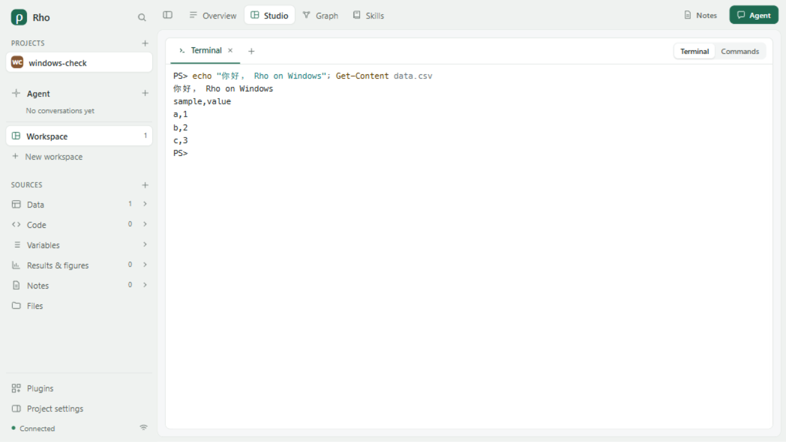
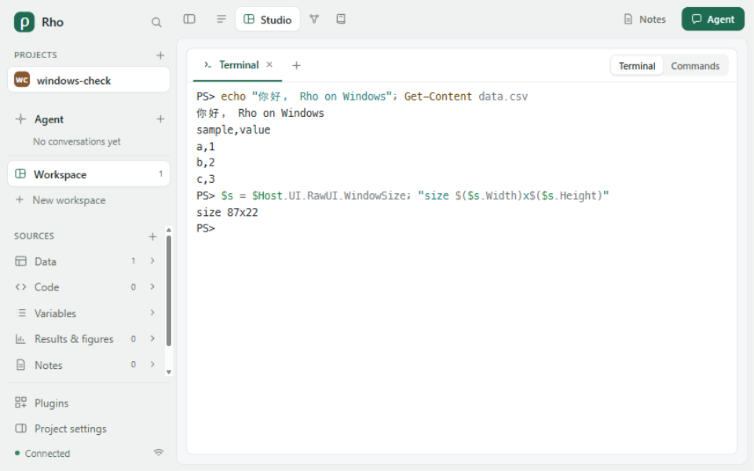
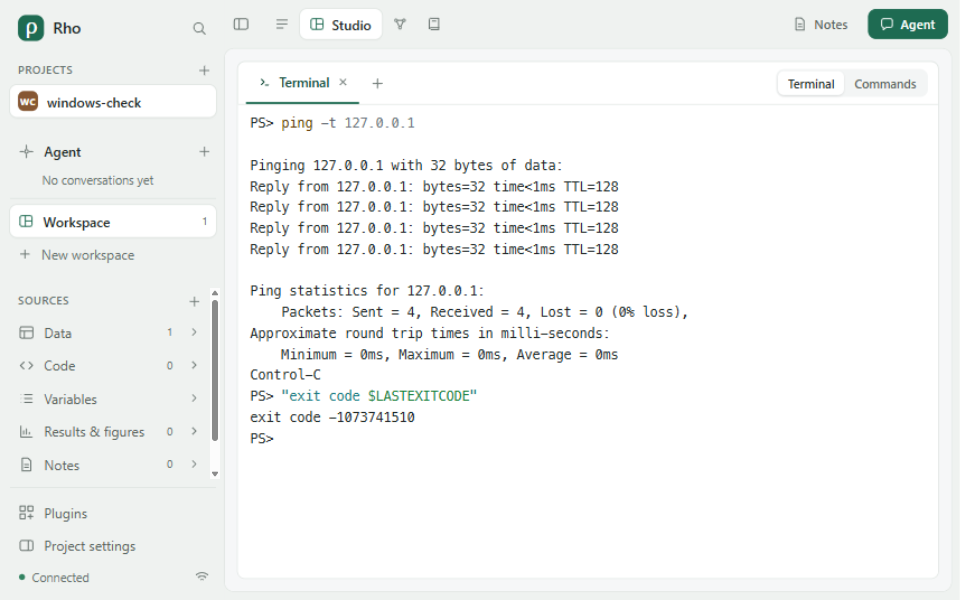
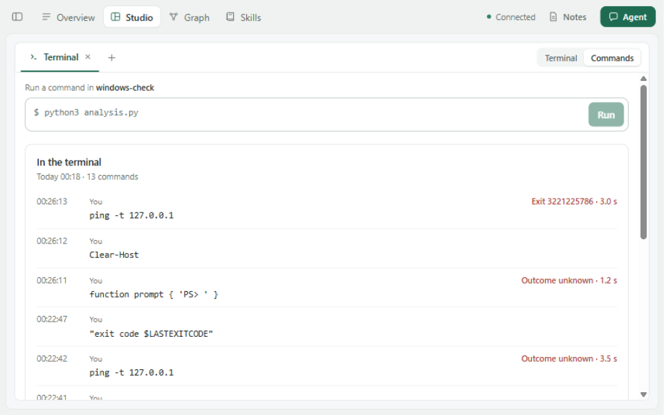

# Windows: the terminal, its records and the Unix-only tests

Updated 2026-11-13. [#116](https://github.com/YuLab-SMU/Rho/issues/116) listed what Rho's source
did not do on Windows, or had never been seen doing there: Studio's terminal (refused at once), the
record of a terminal's commands, reading an R session while a cell runs, telling Rho's own Agent
connection from another window, and the tests that ran only on Unix with a real Agent never run
through Rho. The user asked for the issue to be resolved. This episode, against Rho `8180920d` and
Plugins `884766c`, probes each part on Windows, changes what the probes showed in its owner, and
runs the same checks again; Plugins changes are Console 0.3.6 and 0.3.7, Agent 0.4.35 and
Notebook 0.5.20.

## Setup

- Windows 11 x64 (10.0.26200), Node 24.15.0, npm 11.12.1, R 4.5.1, Miniconda's Python 3.13.9
  (Python on `PATH` is only the Store's alias). Shells: Windows PowerShell 5.1 (PSReadLine 2.0.0),
  PowerShell 7.7.0 installed with winget for this episode (MSIX, started through its execution
  alias, PSReadLine 2.4.5), Git Bash 5.2.37 and cmd.exe. The inbox console host is 10.0.26100.
- Claude Code 2.1.142 installed; Claude Code 2.1.310, the Claude Agent SDK's own, from the adapter's
  package. Codex 0.167.2 installed with npm for this episode; Codex 0.164.0, the Codex adapter's own.
- The Agent is ZCode; its shell is Git Bash, run as Administrator. Probes ran from a scratch folder
  outside the checkouts. The browser and Agent runs used a Rho started from this source on a
  throwaway state and projects folder; the person's own Rho was not running and was not touched.

## The issue's parts

| Part | On `8180920d` | Now |
| --- | --- | --- |
| 1 Terminal | `open` refused: the Python bridge needs `pty`, which Windows' Python lacks | The console host Windows runs for ConPTY, with a PowerShell bridge; checked in tests, a real browser and by an Agent |
| 2 Command records | No Windows shell marked | PowerShell 5.1 and 7 and Git Bash recorded; cmd.exe not, with the reason |
| 3 R read while a cell runs | `busy` until the cell ends | Still `busy`, now with why there is no way that reads the session as it was |
| 4 Rho's own connection | `owns()` always false on Windows | Reproduced with a real Claude Code: the second message was refused; now read from the parent processes |
| 5 Unix-only tests, real Agents | 21 Rho and 14 Plugins tests skipped on Windows; no real Agent run | Stand-ins run on Windows; 4 Rho and 11 Plugins skips left, each for a stated reason; a real Claude Code ran through Rho; Codex did not |

## The terminal

**The route.** Node can start Windows' own console host as ConPTY's `CreatePseudoConsole` starts it,
`conhost.exe --headless --width W --height H -- PROGRAM`, over plain pipes: it took typed bytes on
its input and printed the screen as VT sequences on its output (first output after 47 ms), `你好`
went through, a size written to its input as `CSI 8 ; 30 ; 100 t` made `mode con` report 30 lines
and 100 columns, closing its input closed the console as closing a window does (everything on it
gone 260 ms later), and `taskkill /T /F` ended the tree. Two things did not work. The console host
ended with 0 after `exit 7`, so it cannot say how the shell ended. And Ctrl+C reached nothing: a
`ping -t` went on, directly under the console host and under a Node program between them alike.
A program started in the background (this probe, a Rho started with `--background`) passes on a
flag that ignores Ctrl+C to all it starts; a PowerShell that cleared it first
(`SetConsoleCtrlHandler(NULL, FALSE)`) passed Ctrl+C to `ping`, which printed `Control-C`.

So the console's first program is a few lines of Windows PowerShell, as `process-group.ts` already
uses for console events: it clears the flag, starts the shell, keeps itself from ending on Ctrl+C,
and says the shell's process and exit code over a named pipe of the terminal's own. Ctrl+C then
stopped `ping` under cmd, Windows PowerShell and Git Bash, and `exit 9` read 9. The bridge costs
about half a second: PowerShell's start (300 ms warm) and Add-Type (213 to 242 ms). Calling the
same function through .NET's internals took 16 ms but reads as the reflection AMSI-bypass scripts
use, so it was not taken. Rejected routes: `node-pty` is a compiled module, which the package does
not ship and the packer refuses; `pywinpty` needs an install; PowerShell calling
`CreatePseudoConsole` itself is the shape of known reverse shells, after a PowerShell file of this
project was once flagged by an antivirus as a downloader. The console host's command line is the
contract between Windows' `CreatePseudoConsole` and its own console host, not a published API.

**What checking it showed.**

- The first screen came back empty: the console host draws its empty screen before the bridge has
  started the shell, and a reader waiting for the first output took that. That output is now held
  until the bridge says the shell started, and on Windows a reader from the start of a marked shell
  waits for its first prompt: Windows PowerShell with the machine's conda profile showed it after
  2.4 to 6.5 s, Git Bash after about 3.7 s.
- After a full-screen program left, its command's output read `\n\n` instead of `after`: leaving the
  alternate screen makes the console host draw every row again, the rows below the cursor still
  blank, and taking each row at its line feed took those. Rows are now taken when they scroll off the
  screen, which the console host never draws again, and at the command's end.
- One run of a test ended its tests in 10 s and its process after five minutes; in 5 runs 3 Git Bash
  processes outlived their consoles, with the project folder as their own. A subshell Git Bash forks
  as its console closes is sent no close event. The bridge now puts itself in a job object before it
  starts the shell, and when Rho closes the terminal (a close file it was given, then the hang-up)
  ends what is left in the job after the grace period: 8 of 8 runs left nothing.
- Git Bash wrote no history when its console closed, as Windows ends it before bash writes it; it
  now adds each line before the next prompt (`history -a`).

**In a real browser.** Studio's Terminal view opened pwsh in the project folder (the default order:
pwsh, Windows PowerShell, `ComSpec`). Typing showed PSReadLine's colours and `你好，Rho on Windows`;
shrinking the window to 960 × 600 gave PowerShell 87 × 22 with the earlier lines intact; a real
Ctrl+C stopped `ping -t` and the Commands view recorded exit 3221225786; Rho stopped and started
again, the view opened a new shell and the Commands kept their records; closing the view left no
console host, bridge, shell or `ping` running. The automation's own Ctrl+C sends key events without
a key code, from which xterm makes no `\x03`; a real key press, and the same keys with their codes,
did. Choosing a folder with Open folder… opens the system's chooser, which the automation cannot
drive; ending it showed "The system folder chooser did not finish. No folder was opened."

## Command records

The console host passes a shell's marks on at once but draws its text on its next frame. Printing
five lines and then a mark, the mark came before some of those lines in 4 of 10 runs for PowerShell,
cmd and Git Bash alike, until the screen was full; with every line scrolling, where the console host
draws at once, 6 of 6 were in order. `--passthrough` changed nothing on this console host. With the
shell waiting before each mark, PowerShell's marks were in order in 25 of 30 runs at 0 ms and 30 of
30 at 20 ms and at 50 ms; a shell now waits 50 ms. Git Bash waits with a timed read on a pipe of its
own (61 to 64 ms), as `sleep` starts a program (113 ms).

- PowerShell 5.1 and 7 get a script after the person's profile, passed as a command so the
  execution policy does not apply. With PSReadLine loaded, its history file becomes Rho's before the
  first line is read; `PSConsoleHostReadLine` marks the line handed over, with the folder, and
  `prompt` the status: 0 when the command succeeded, else the exit code a program set during it,
  or one it set again with no PowerShell error, else 1. The first browser run recorded the Ctrl+C'd
  `ping` as unknown: PowerShell holds Windows' exit codes signed (−1073741510) and the record takes
  digits; the mark now gives them unsigned, as Node does. A command that replaces `prompt` is
  recorded as not seen to end; the next line wraps the new prompt.
- Git Bash gets bash's hooks with its folders as Windows paths (`pwd -W`).
- cmd.exe is not marked: its prompt cannot carry the last status and cannot wait before a mark.

## Reading R while a cell runs

Windows R has no `parallel::mcparallel` and refuses `mc.cores` above 1. Writing a session's values
out when each cell starts costs every cell time with the session's size and cannot carry values that
hold a connection or a pointer; reading the session mid-cell would show values the cell is
changing. So a local R session on Windows stays `busy` while a cell runs, as before, and the kernel
README says why.

## Rho's own connection

With Claude Code 2.1.310, a conversation in Rho answered its first message; the second was refused,
"This session is open in Agent app. Close it there to continue here. Nothing was sent." Claude Code
writes a live session file under `~/.claude/sessions` (the SDK's is named "Agent app"), which Rho
takes as the session being open elsewhere unless its process descends from the adapter Rho started,
and on Windows that walk was not done. `owns()` now reads the holder's parents with their start times
from `Win32_Process` in one PowerShell call (at most 5 s; a parent that started after its child has a
reused process ID and ends the walk) and keeps the answer for the adapter's connection: the second
message then completed. A new test, on every system,
holds the session open from a process the stand-in adapter started; it fails with the old Windows
answer.

The installed Claude Code 2.1.142 never answered in Rho: the adapter's SDK starts Claude Code with
`--plugin-dir-no-mcp`, which 2.1.142 does not know, and Rho said only "Internal error". The reason
the adapter gives is now in the message's problem.

## The Unix-only tests and real Agents

Node 24 refuses to start a batch file (`spawn EINVAL`), and npm installs Node programs on Windows as
batch files: an npm `codex.cmd`, `dsh.cmd` or `kimi.cmd` that Rho found on `PATH` could not start.
The Agent plugin and Rho now run one through `cmd.exe /d /s /c`, each argument escaped as cross-spawn
does (checked with quotes, `%PATH%`, `^ & | < >`, an empty argument and 中文), and end its tree on a
timeout. cmd ends a command line at a line break, so an argument over several lines (the Claude CLI's
system prompt) is refused for a batch file. The tests' stand-ins are Node scripts with a `.cmd`
beside them (`test/support/stand-in.mjs`), or an `.exe` launcher compiled once with the C# compiler
Windows has where an argument spans lines; `npm run dev` stops its service with the stop request
`rho --stop` uses, and its test raises Ctrl+Break. With the stand-ins, two Plugins tests written
after the last Windows run failed on Windows expectations and were corrected, and a third showed
that a program named in a missing folder of the project was refused as outside it; Notebook 0.5.20
answers `not_found`. Remote places stay Unix only: they share ssh connections through ControlMaster
and a socket under `/tmp`, which Windows' OpenSSH does not offer.

A real Claude Code (2.1.310) through Rho's service on Windows: a new conversation ran
`x <- c(1, 2, 3); mean(x)` (`[1] 2`) and `print(sum([1, 2, 3]))` (`6`) in the Notebook, opened a
terminal of its own and typed `echo hello from the Agent` (64 s); its next message, in the same
session, read `console.terminal.commands` (exit 0, typed by the Agent) and closed its terminal
(25 s). A session started outside Rho with `claude -p`, asked to remember a word, was listed
("Script"), continued in Rho under its own ID and answered `marigold`. A command the person ran in
the Console exited 0 with its output kept. Codex was not run: the npm install lacked its Windows
binary (an optional dependency, at about 90 KB/s here); the adapter's own Codex had no sign-in on
this machine, and the model gateway its configuration names refused the model Codex asked for.
Signing in is the person's to do.

## Checks

- Rho-plugins on Windows: 218 of 229 passed, 11 skipped: three `/bin/sh` terminal tests whose
  Windows counterparts passed, five remote places, the two fork tests and ComplexHeatmap (not
  installed). The terminal tests ran on pwsh 7.7, Windows PowerShell 5.1, Git Bash and cmd.exe.
- Rho on Windows with the CI-built Core `8bed8ef` from the installed 0.5.7: 357 of 361 with four
  test files at a time, as CI runs, 4 skipped (two named-pipe tests; two that need a folder the
  account cannot write in, which an Administrator still writes in). At this machine's 24 at a time, 352 of 361: five
  failed on their time limits and each passed alone; the two among them this change put on Windows
  (an Agent client stand-in's 0.4 s limit, a log still open when its folder was removed) were fixed.
- The startup files and arguments bash, sh, zsh and fish get on macOS and Linux are byte for byte
  those of `884766c`. macOS and Linux run in CI after the push.
- CI on the first push (Rho `c471caed`, Plugins `68d7ed3`, [run 43265395942](https://github.com/YuLab-SMU/Rho/actions/runs/43265395942))
  failed in three places, none seen here. On every system the ledger test: joining Status's
  verification lines into one made the baseline's count the first on the line that cites the
  ledger; the sentence citing it starts its own line again. On macOS a ksh record took the echo of
  its command as output: the wake that ends a Windows reader's wait for the first prompt also
  ended a Unix reader's wait for quiet, so the test typed before ksh had drawn its whole prompt;
  Console 0.3.7 wakes only on Windows, as `884766c` did elsewhere. On the Windows Server 2022
  runner (console host build 20348) the two tests that expected a full-screen program to be seen
  as one: its command ran to its end with the right output but no screen, as that host draws the
  program's screen as the main one and passes no switch on. The tests now expect a screen where the
  switch reaches the terminal and say when it does not.
- CI on the fix (Rho `14992760`, Plugins `543166d`, [run 43271375926](https://github.com/YuLab-SMU/Rho/actions/runs/43271375926))
  passed every job: Rho 357/361 on macOS and Linux and 356/361 on Windows (4 and 5 skipped), the
  Plugins' terminal and Agent-start tests 22/26, 20/24 and 21/24 (the other system's terminal tests
  skipped), the four Cores, the figure describers, the candidate and its six installations. On
  Windows both full-screen tests said that console host passed no switch on. No macOS runner took
  the first attempt's macOS job, which GitHub cancelled; its re-run passed.

## Limits

- The console host's command line is Windows' internal contract with it; a later Windows may change it.
- Mark order rests on a 50 ms wait; under heavy load a command's last lines can fall outside its record.
- cmd.exe's commands are not recorded. Ctrl+Break cannot be typed in the page.
- On Windows Server 2022's console host (build 20348) a full-screen program is not seen as one and
  keeps no screen; Windows 10 and Windows 11 before 26100 were not checked.
- The first prompt of a shell with a slow profile is waited for only for marked shells.
- PowerShell from an MSIX package started through its alias was checked here; one installed by MSI was not.
- Codex was not run in Rho on Windows; real Claude Code only from the SDK's 2.1.310; one person, no
  observed users.
