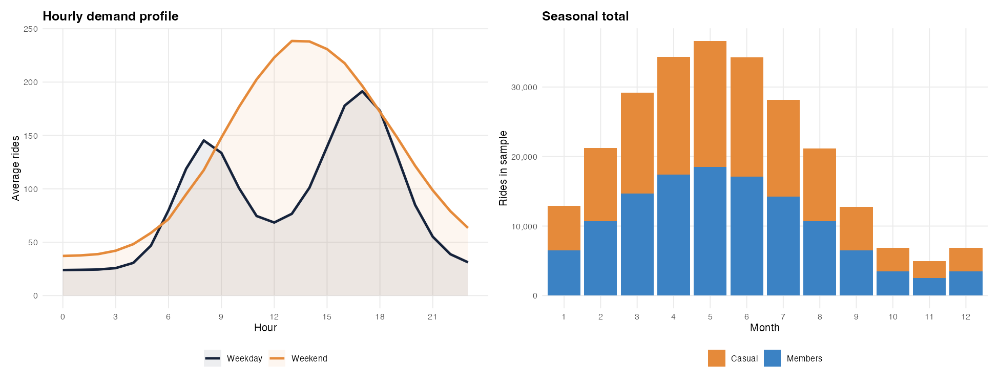
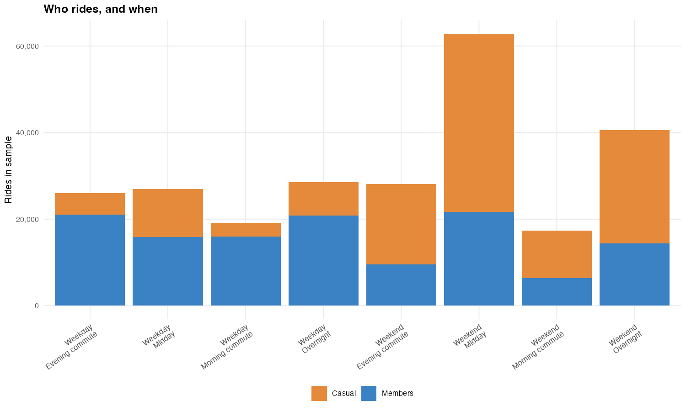
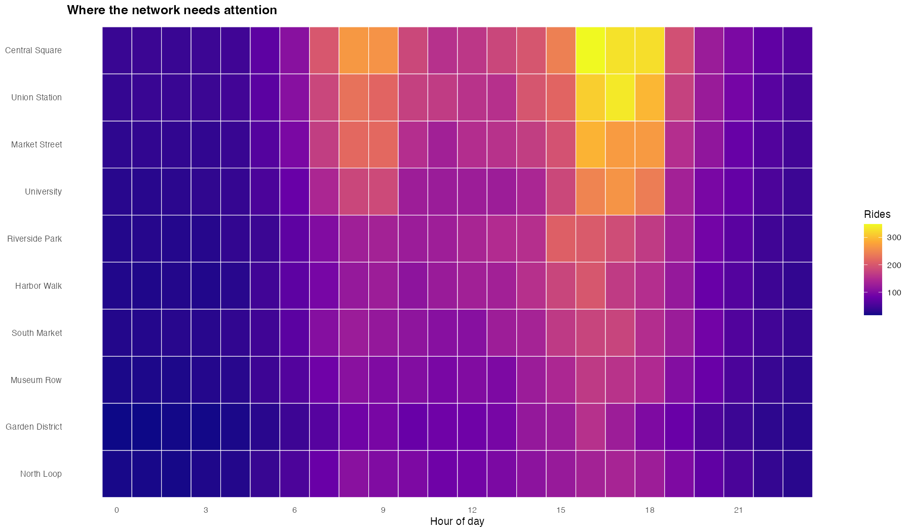

# City bike-share demand

The project uses a compact, synthetic bike-share dataset with repeated weekday and weekend observations across twelve months. The patterns are designed to make the working questions visible without hiding the files or the assumptions.

## 1. When is demand highest?

Weekday rides have two clear commute peaks around 08:00 and 17:00. Weekend demand is flatter and moves toward late morning and afternoon. The result is a different operating rhythm for workdays and leisure days.

## 2. Who is riding?

Members account for most weekday commute rides. Casual riders become a larger share around midday and on weekends, especially in the warmer months. That split makes the same station look like a commute asset in the morning and a leisure asset later in the day.

## 3. Where should the operator look first?

Downtown and transit-hub stations carry the strongest peaks. Parks and the waterfront build demand later in the day, while residential stations remain steadier. The station table and heatmap give an Agent a concrete starting point for a rebalancing rule.

## Files

- [data/rides/hourly_demand.csv](../data/rides/hourly_demand.csv) — repeated hourly observations with rider type, weather and day type.
- [data/rides/trips_sample.csv](../data/rides/trips_sample.csv) — a small trip-level sample for table questions.
- [data/stations/stations.csv](../data/stations/stations.csv) — station location, area and capacity.
- [data/stations/station_hourly.csv](../data/stations/station_hourly.csv) — station by hour demand and utilization.
- [results/station_demand.csv](station_demand.csv) — station-level pressure summary.
- [results/rider_mix.csv](rider_mix.csv) — member and casual totals by day type and period.
- [analysis/hourly_demand.R](../analysis/hourly_demand.R), [analysis/station_patterns.R](../analysis/station_patterns.R) and [analysis/summary_figure.R](../analysis/summary_figure.R) — the scripts that produce the tables and figures.
