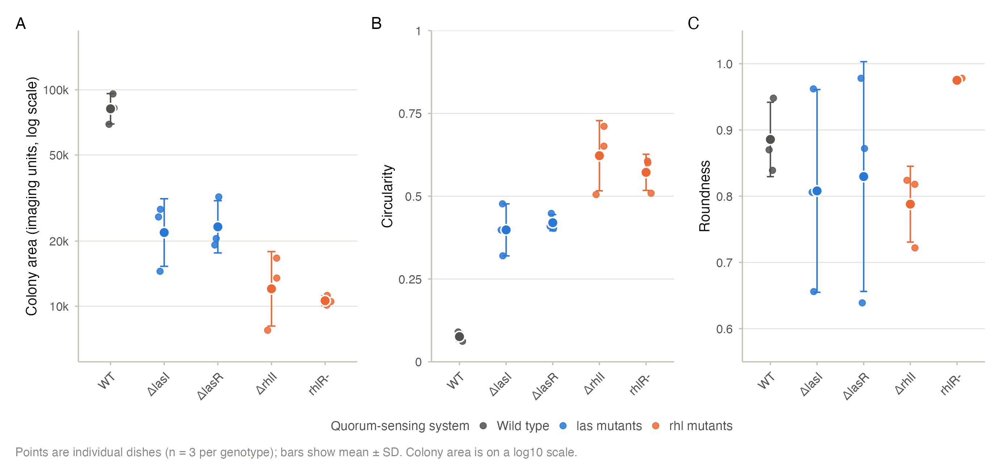
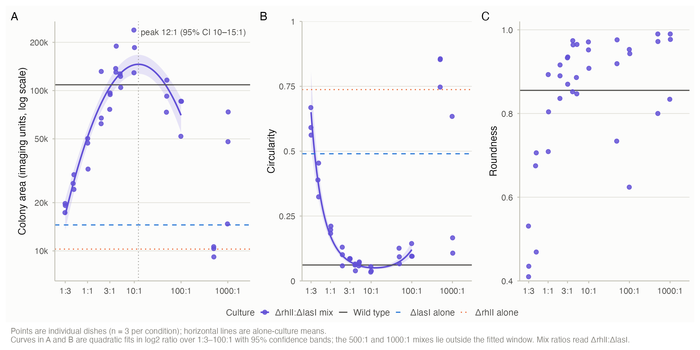
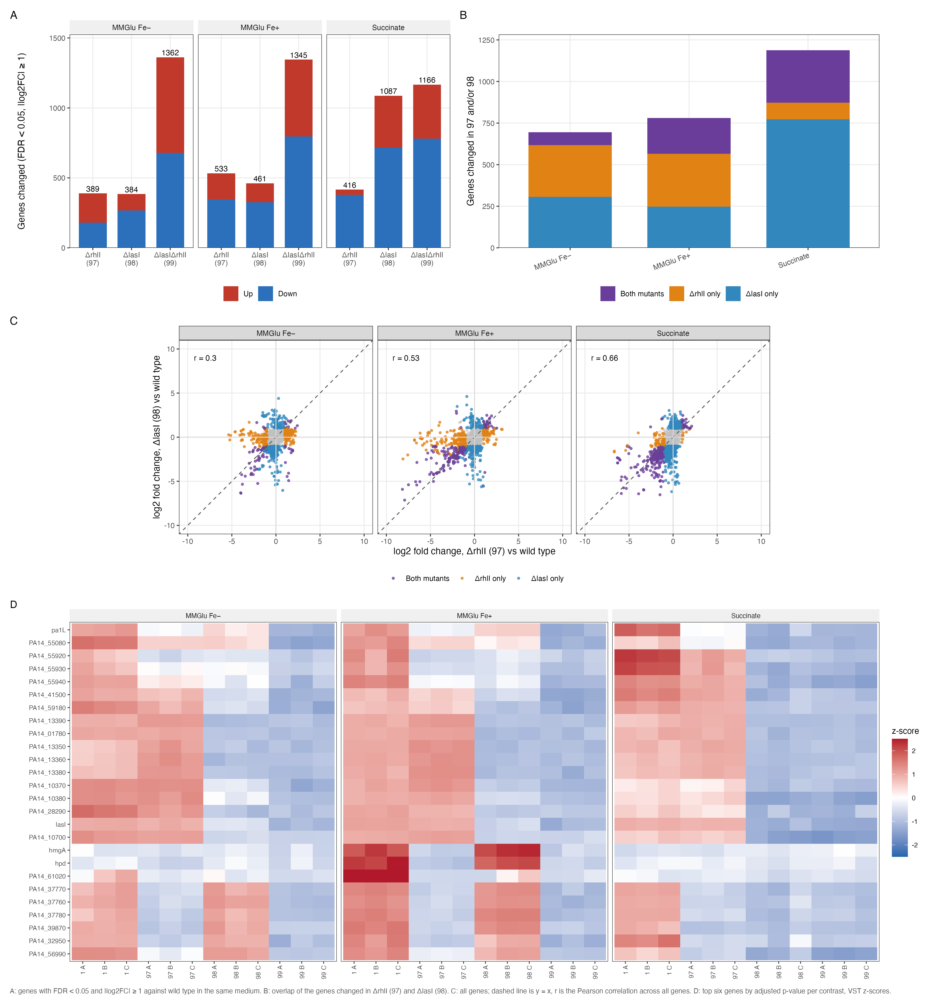

# PA14 quorum sensing and swarming: conclusions

**One-page figure:** [summary.png](summary.png)

Three questions, each answered briefly below with its key numbers and figure. The full analyses and result files are in the project.

## 1. Do the single quorum-sensing mutants swarm worse than wild type?

Yes. All four single mutants swarmed far less than wild type, and the rhl mutants were the more severe loss. Mutant colonies were also much more circular while roundness was unchanged, so the shape change is in perimeter irregularity rather than elongation.

| Mutant | Colony area ratio vs wild type (95% CI) |
|---|---:|
| ΔlasI | 0.27 (0.13–0.57) |
| ΔlasR | 0.29 (0.16–0.50) |
| ΔrhlI | 0.15 (0.063–0.34) |
| rhlR- | 0.13 (0.091–0.19) |

- Wild-type geometric mean area: 81,732; every mutant comparison had Holm-adjusted p ≤ 0.016.
- Pooled rhl mutants vs pooled las mutants: area ratio 0.50 (95% CI 0.35–0.71, p = 0.0015).
- Circularity rose from 0.076 in wild type to 0.40–0.62 in the mutants (5.2–8.2×); roundness did not change consistently (Holm p ≥ 0.41).

Details: [swarming_single_mutants_summary.csv](swarming_single_mutants_summary.csv), [swarming_system_contrast.csv](swarming_system_contrast.csv).

## 2. Does mixing ΔrhlI and ΔlasI restore swarming, and at which ratio?

Yes, and the rescue has a clear optimum. The fitted peak was at 12.3:1 ΔrhlI:ΔlasI, where colony area was 1.34× wild type and roughly 14× and 10× the two mutants grown alone. The ratio explained most of the variation in area, and the peak was statistically indistinguishable from wild type; at 500:1 the rescue collapsed.

- Peak: 12.3:1 ΔrhlI:ΔlasI (95% CI 10.4–14.7); peak area 145,880 (132,127–161,011), 1.34× wild type (95% CI 0.99–1.71).
- The 10:1 mix was 1.64× wild type (0.83–3.25; Holm-adjusted p = 0.90); 500:1 was 0.09× wild type (0.05–0.18; Holm p = 0.037).
- Ratio explained 93% of the variance in log area across the ten well-sampled ratios (1:3–100:1; one-way ANOVA F(9,20) = 29.5, p = 1.2e-9); the quadratic fit had R² = 0.891 versus 0.364 for a linear fit.
- Fitted area reached wild-type level between 3.2:1 and 46.4:1; the peak was 8.7× the 1:3 value and 2.1× the 100:1 value.

Details: [swarming_cocultures_summary.csv](swarming_cocultures_summary.csv), [swarming_cocultures_ratio_model.csv](swarming_cocultures_ratio_model.csv).

## 3. What do the mutants change in gene expression?

Each mutant changes a large, medium-specific part of the transcriptome. The strongest signals were the quorum-sensing genes themselves, phenazine biosynthesis, denitrification and oxidative-stress genes. The two single mutants shared a significant but medium-dependent set of changes, mostly in the same direction, and the double mutant behaved largely additively.

Genes changed (FDR < 0.05 and |log2FC| ≥ 1), by medium:

| Mutant | MMGluFeMinus | MMGluFePlus | Succinate |
|---|---:|---:|---:|
| ΔrhlI (97) | 389 | 533 | 416 |
| ΔlasI (98) | 384 | 461 | 1,087 |
| ΔlasIΔrhlI (99) | 1,362 | 1,345 | 1,166 |

- Nine contrasts, 5,828 genes tested. Counting FDR alone instead of the two-fold threshold gives 1,299–3,585 genes per contrast.
- Single-mutant overlap: 78 / 214 / 315 shared genes in MMGluFeMinus / MMGluFePlus / Succinate (Jaccard 0.112 / 0.274 / 0.265; hypergeometric p 2.1e-20 / 1.4e-112 / 1.5e-156).
- Direction agreement among shared genes: 79% / 98% / 99%; genome-wide log2 fold-change correlation 0.30 / 0.53 / 0.66.
- Double mutant: 793 / 674 / 213 genes changed in neither single; its log2FC regressed on the sum of the single effects with slopes 1.04 / 0.84 / 0.71 (R² 0.73 / 0.73 / 0.90).

Details: [rnaseq_de_summary.csv](rnaseq_de_summary.csv), [rnaseq_mutant_overlap.csv](rnaseq_mutant_overlap.csv), [rnaseq_differential_expression.csv](rnaseq_differential_expression.csv), [rnaseq_top_genes.csv](rnaseq_top_genes.csv).
